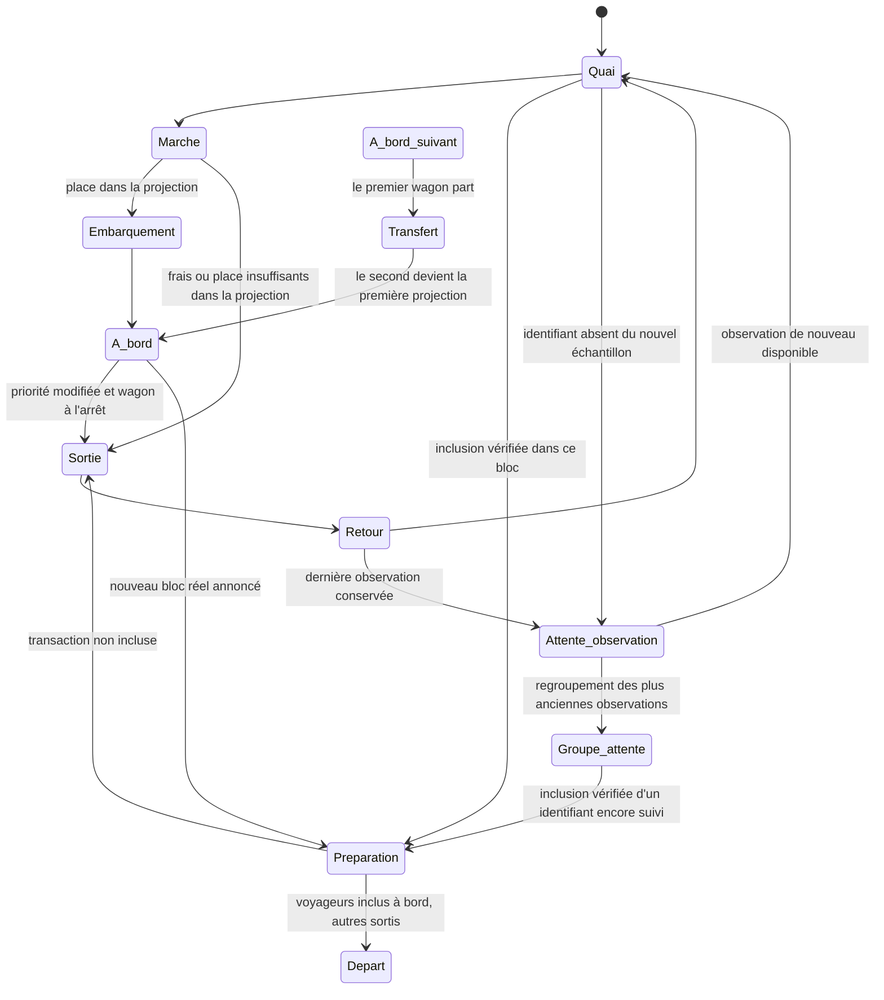

# Voyageurs, wagons et panneau du quai

La scène utilise les transactions validées de la source. Les deux wagons à l'arrêt sont des projections : le haut représente le prochain bloc estimé, le bas le suivant. Une transaction embarquée dans ces projections reste **en attente dans la source**. Le dernier bloc reçu est présenté dans les informations, sans wagon historique permanent.

## Parcours

Les transactions en attente sont classées selon les frais observés, puis l'identifiant pour stabiliser les égalités. Chaque projection possède douze unités **visuelles** : les plus prioritaires remplissent le premier wagon, les suivantes le second, puis la file. Un voyageur occupe une à trois unités selon ses besoins de ressources : référence de 400 vBytes pour Bitcoin et 100 000 unités de gas pour Ethereum. Le tarif de référence de l'instantané sert de repère pédagogique. Ces règles simplifiées n'intègrent pas les dépendances Bitcoin, les nonces Ethereum, les transactions privées, la sélection des producteurs ni toutes les contraintes du protocole.

Un voyageur moins prioritaire revient au quai et peut réessayer. Un nouvel instantané peut déplacer un voyageur précédemment embarqué si un meilleur candidat occupe le budget illustratif, lorsque le wagon est à l'arrêt. Aucun de ces mouvements n'annonce un rejet du réseau.

L'échantillonnage privilégie les frais élevés dès la collecte. Bitcoin lit les transactions du premier bloc projeté de mempool.space par WebSocket, puis retient les meilleurs taux de frais de cette liste ; ce n'est pas un classement exhaustif de tous les mempools. Si cette liste est indisponible, la source annonce explicitement son repli sur les transactions récentes. Ethereum classe les transactions du bloc `pending` disponible par prix effectif du gas avant de limiter l'échantillon. Il s'agit du `pending` du fournisseur, sans mesure d'un mempool mondial. Les preuves d'inclusion restent séparées de cette sélection, même si leurs frais sont faibles.

## Quai et portes

Chaque rue est verticale. Les wagons partagent une couleur de carrosserie ; le nom du réseau et ses repères orange ou violet identifient la chaîne. Leur position horizontale reste au centre de la chaussée, y compris lorsque le second rejoint la place du premier.

Les voyageurs qui marchent restent sur le quai à droite de la chaussée. L'entrée utilise la porte en haut à droite du wagon ; la sortie utilise une autre porte, en bas à droite. Chaque porte s'ouvre pour le passage correspondant. Les trajets d'approche, de sortie et de retour en file ne traversent pas la route. Seul le passage par la porte rejoint l'intérieur du wagon.

Les portes sont sans marches. Les personnages sont dessinés au-dessus des portes pendant leur passage, pour que leur silhouette reste visible.

Les nouvelles transactions entrent depuis le haut du quai, avec des arrivées décalées, puis rejoignent leur place dans la file. La première projection commence à la coordonnée verticale 175 pour dégager cette zone. Les petites flèches au-dessus des voyageurs indiquent une sortie ou un retour en file illustré ; elles n'indiquent pas une annulation de transaction.

La géométrie de la rue, des wagons, des portes et du quai est partagée dans `src/lib/streetGeometry.ts` entre le moteur de mouvement et le dessin SVG. Cette référence commune permet aux trajets de rejoindre les portes effectivement affichées.

La file courante est classée par taux de frais décroissant, séparément par chaîne, avec l'identifiant comme départage stable. Seuls les voyageurs en attente actuellement observés et hors wagon participent au classement. La tête de file est face à la porte haute, à la coordonnée verticale 239 ; les quatre colonnes se prolongent vers le bas avec un pas de 20. Les anciennes observations sans statut actualisé restent dans la partie basse du quai, hors classement courant.

Un changement de rang anime une phase `reordering` de 350 à 1 000 millisecondes, toujours par le corridor droit. Une arrivée ou un retour finit d'abord son trajet capturé, puis rejoint sa nouvelle place ; une destination inchangée ne relance pas l'animation. Les voyageurs peuvent se superposer. Le classement ne réorganise pas les sièges occupés à bord, y compris en mouvement réduit lorsque le wagon reste le même. En mouvement réduit, les places sur le quai sont actualisées statiquement.

Un voyageur déjà embarqué reste à bord pendant le déplacement du wagon. Une sortie nécessaire attend son arrivée et emprunte alors la porte basse à droite ; les portes restent fermées pendant le trajet. Le changement visuel de wagon n'altère jamais le statut fourni par la source.

## Transfert et statut réseau

Seule une preuve de la source peut fournir le statut `confirmed`. Le champ facultatif `Tx.blockHash` précise le bloc dans lequel une inclusion a été vérifiée ; le journal facultatif `Snapshot.inclusions` transmet aussi les identifiants suivis retrouvés dans des blocs intermédiaires. Une ancienne confirmation sans hash reste compatible avec le contrat mais ne suffit pas pour emporter son personnage dans un départ. Le moteur exige `status === 'confirmed'` et `blockHash` égal au hash du bloc annoncé. Une disparition de l'échantillon n'est pas une confirmation.

Lorsqu'un nouveau bloc est reçu, le premier wagon reste au quai le temps d'ajuster son contenu au bloc réel : les inclusions connues embarquent rapidement, les voyageurs non inclus sortent par la porte basse droite avant le départ et restent dans la file. Seules les inclusions vérifiées partent avec le premier wagon. Le second monte à sa place, en conservant ses voyageurs et leurs statuts en attente. Après son arrêt, les priorités peuvent à nouveau évoluer. Un nouveau second wagon entre ensuite depuis le bas.

Une transaction absente du nouvel échantillon conserve sa dernière observation et son personnage. Celui-ci reste à bord pendant un déplacement, puis quitte le wagon à l'arrêt par la porte basse et revient dans la file du quai droit. Il y reste en attente visuelle, sans remonter vers la sortie de la scène ni tenter un nouvel embarquement. Son absence ne modifie jamais son statut réseau ; son libellé et une petite horloge précisent qu'il s'agit d'une observation précédente. Les détails courants ne s'ouvrent plus pour cet identifiant. Si la source retrouve une observation encore individualisée, le moteur réutilise son personnage et reprend le parcours approprié.

Jusqu'à 80 anciennes observations peuvent rester individualisées en attente. Au-delà, les plus anciennes déjà immobiles en file rejoignent un groupe à la coordonnée `(360, 686)`, toujours sur le quai droit. Leur silhouette individuelle fusionne avec la représentation du groupe uniquement à son arrivée ; le compteur augmente dans le même état d'affichage. L'archive de la scène conserve jusqu'à **512 identifiants et leurs dernières observations pendant 30 minutes** depuis leur dernière présence dans l'échantillon. Les observations expirées ou évincées par cette borne restent représentées dans un compteur distinct **sans suivi individuel**, dont le statut actuel est inconnu.

Une inclusion vérifiée réserve l'observation encore suivie pour son bloc, sans créer immédiatement un personnage supplémentaire. La réservation conserve l'identifiant dans l'archive, protégée de l'expiration et de l'éviction pendant l'attente du départ ; la borne de 512 identifiants reste applicable. La durée de 30 minutes concerne les observations encore sans preuve, et une réservation peut donc durer davantage pendant une pause ou une file de départs. À la préparation du départ correspondant, l'observation quitte le groupe et réduit son compteur. Le personnage est réadmis depuis la position du groupe, puis rejoint rapidement la porte haute droite du wagon associé au hash réellement inclus. Les réservations sont libérées après traitement, annulation ou règlement statique en mouvement réduit.

Si une observation suivie revient simplement dans l'échantillon en attente, son personnage est également réutilisé depuis le groupe. Les observations déjà passées dans le compteur sans suivi ne peuvent plus être rapprochées individuellement d'un bloc. Le total du groupe n'est donc ni un nombre de transactions uniques, ni un nombre de transactions encore en attente sur le réseau. Il est plafonné à un million, puis affiché comme une borne minimale.

Les inclusions connues qui embarquent pour le départ réel peuvent se superposer sur les douze emplacements dessinés. La taille de cet échantillon reste bornée et ne représente pas tout le bloc. Les budgets des deux projections restent des règles pédagogiques indépendantes de la capacité du réseau.

Pour chaque chaîne, le serveur conserve au plus **2 048 identifiants observés pendant 30 minutes** et vérifie les blocs nécessaires au suivi. Il conserve un journal roulant de **16 blocs et 2 048 identifiants d'inclusion au total**, séparé de l'échantillon courant de 120 transactions et des trois derniers blocs affichés. Jusqu'à huit blocs peuvent être rattrapés par collecte ; les lacunes non vérifiées restent à réessayer. Cette mémoire volatile aide à retrouver les inclusions, sans représenter tout le réseau ou un historique exhaustif. Une vérification indisponible ne provoque aucune confirmation déduite. Une réorganisation peut invalider une preuve d'inclusion ; inclusion observée et finalité restent distinctes.

La scène conserve une file de **16 départs** afin de traiter plusieurs blocs reçus entre deux rafraîchissements. Le premier chargement initialise les preuves déjà présentes sans faire partir l'ancien journal. Un départ attend une preuve de vérification du bloc ; l'apparition d'un hash seule ne suffit pas à inventer ses passagers. Une preuve complémentaire reçue après un départ peut être illustrée avec le même hash sous le libellé **RATTRAPAGE** : elle ne représente pas un nouveau bloc. Un recul du dernier bloc annule les départs supérieurs encore en file ou en préparation ; les véhicules déjà en mouvement terminent leur trajet. Les bornes du journal, du suivi et de la file peuvent laisser des confirmations non illustrées après une longue interruption, une panne ou une expiration ; l'application ne les déduit jamais de l'absence d'un identifiant.

Les occupants inclus restent visibles avec le premier wagon pendant son départ, jusqu'à sa sortie de l'écran. Ce groupe historique est borné et reste distinct des projections et des compteurs du panneau. Le départ utilise une preuve fournie par la source ; l'animation ne crée aucune preuve supplémentaire.

À vitesse normale, le premier wagon attend une préparation d'au moins 0,5 seconde avant son départ. Les trajets d'embarquement des inclusions et de sortie des autres voyageurs sont accélérés. Le départ attend la fin des passages pour éviter toute sortie d'un wagon en mouvement.

Le second wagon rejoint ensuite la première position en 1,2 seconde. Son remplaçant entre depuis le bas de la scène pendant 0,7 seconde, puis s'arrête au quai. Les portes restent fermées pendant les mouvements. Ces durées suivent la vitesse, la pause et les mouvements réduits.

Aucune minuterie n'invente un transfert de candidat en direct. Le déplacement des wagons suit la même horloge que leurs voyageurs ; les anciens déplacements CSS indépendants ont été retirés. En simulation, les données et les embarquements sont fictifs. Pause, vitesse, onglet masqué et mouvements réduits s'appliquent au wagon et à ses voyageurs.

## Taille des têtes

Seule la tête change d'échelle. Elle dépend d'une courbe logarithmique absolue et bornée entre 0,8 et 1,85. La même transaction conserve sa taille lorsque ses voisins changent. Pour Bitcoin, la ressource est sa taille virtuelle en vBytes ; pour Ethereum, c'est sa **limite de gas déclarée**, pas sa taille en octets ni le gas effectivement consommé.

## Couleur des t-shirts

La couleur compare le taux de frais de chaque voyageur à la moyenne des transactions **en attente actuellement affichées dans sa chaîne**. La moyenne est calculée séparément pour Bitcoin et Ethereum ; elle exclut les confirmations, les archives et les voyageurs en départ. Ce repère porte sur l'échantillon de la scène, pas sur une moyenne du réseau.

L'interpolation est continue : jaune `#f2d35d` pour des frais faibles, orange `#ef9a42` à la moyenne, rouge `#db4e47` à deux fois la moyenne ou davantage. Une moyenne absente ou nulle et des valeurs invalides donnent l'orange neutre ; zéro face à zéro reste donc orange. Les changements de couleur utilisent une transition de 300 millisecondes, désactivée en mouvement réduit. La couleur ne prouve ni inclusion ni rejet et les frais restent lisibles dans les détails.

## Horloge et accessibilité

`src/lib/passengerMotion.ts` est un moteur pur, indépendant du dessin. Chaque réseau possède son instance de `src/hooks/usePassengerMotion.ts`, avec une horloge `requestAnimationFrame`, un rendu à environ 24 images par seconde et un échantillon courant de 80 voyageurs en attente au maximum. Le fonctionnement normal conserve jusqu'à 160 personnages résidents et 80 admissions différées. Une préparation peut temporairement conserver jusqu'à **912 résidents**, dont jusqu'à **752 inclusions vérifiées** pouvant se superposer sur les emplacements du premier wagon ; ces bornes couvrent les observations résidentes, archivées et différées que le moteur peut retrouver. Elles restent des limites de représentation, pas les tailles réelles des blocs. Le groupe historique en départ est limité à 752 silhouettes et reste distinct des résidents et des compteurs courants.

La préparation réserve des places pour ses inclusions en regroupant au besoin les anciennes observations déjà sur le quai. Les rafraîchissements remplacent le tampon d'admission par les observations actuelles, sans accumuler une liste illimitée. Il n'y a pas de saut de temps après pause ou retour d'un onglet masqué. Le décor est mémorisé pour éviter de le recalculer à chaque mouvement. **Ces nouvelles bornes et leur coût de rendu restent à valider : les tests et les contrôles de compilation sont suspendus à la demande du propriétaire.**

Pause suspend les voyageurs, les wagons, les signaux et le défilement du panneau. Les mouvements réduits traitent les preuves statiquement, sans trajet ni transition de couleur : les transactions en attente rejoignent leurs projections, les inclusions connues conservent leur statut et leur hash vérifiés comme observations sur le quai, et les anciennes observations peuvent rejoindre le groupe collectif. Une preuve retrouvée met aussi à jour un personnage déjà présent. Cette préférence conserve les observations et ne bloque pas indéfiniment une préparation. Les personnages de l'échantillon courant restent sélectionnables au clavier, y compris dans les wagons. Les confirmations et la fraîcheur affichées gardent la sémantique de la source.

## Panneau d'informations

Le panneau alterne toutes les huit secondes entre Réseau, Bloc et Voyageurs. Une sélection fixe les données actuelles de la transaction ; Échap ou le bouton de libération permet de retrouver le panneau. Les pages restent accessibles manuellement, avec les flèches du clavier. Les détails sélectionnés suivent l'instantané courant et disparaissent lorsque la transaction n'est plus dans l'échantillon disponible.

Les compteurs du panneau concernent les voyageurs de l'échantillon courant. Les observations précédentes conservées en attente restent hors de ces compteurs. Le nombre de transactions du réseau reste distinct, et sa valeur absente est affichée comme non mesurée.

La rubrique « Comprendre » explique pourquoi deux wagons sont représentés : les deux illustrent des blocs à venir, dans l'ordre de priorité. Elle décrit aussi l'ajustement au bloc réel, le départ du premier wagon, la promotion du second et l'arrivée de son remplaçant. Le panneau du dernier bloc distingue les inclusions reçues des projections à l'arrêt.

## Vue immersive et deux réseaux

Bitcoin et Ethereum restent visibles ensemble. Chaque rue reçoit son propre instantané et conserve son état de connexion, ses frais, ses blocs et son échantillon. Une panne sur une chaîne ne remplace pas les données de l'autre. Les commandes de pause, de vitesse et de mouvements réduits s'appliquent aux deux scènes.

La ville utilise l'espace disponible de la fenêtre ; les détails peuvent être repliés pour libérer la scène. Les deux rues restent côte à côte, y compris sur les petits écrans pour conserver une hauteur utile à chaque scène. Les barres, les métriques et les commandes se compactent selon la largeur et la hauteur disponibles, notamment sur les ordinateurs portables. À 700 pixels de largeur ou moins, le cadrage montre la route et le quai droit en retirant le campus décoratif à gauche. Sur les grands écrans, le panneau de détails utilise le côté gauche disponible pour dégager le quai. Les SVG gardent leurs proportions. Une sélection est identifiée par le réseau et le hash, afin que des identifiants semblables ne mélangent pas les informations des deux chaînes.
