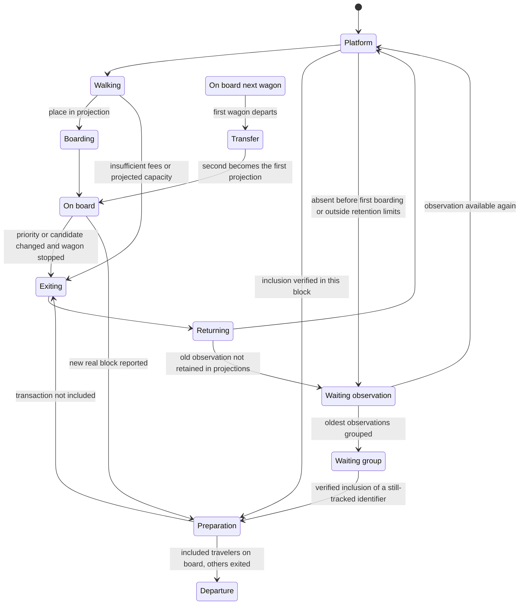

# Travelers, wagons and the platform board

## Flow at ordinary entrances — 16 October 2026

The upper board's **Flow** page prioritizes events received through one shared connection per network: Bitcoin additions and Ethereum pending notifications. It identifies the tracked mode, covered duration, average rate and available points over approximately one minute. Periodic observations between two complete inventories remain an explicitly named fallback, distinct from these notifications. No value relies on the pool's net change alone. Initialization and interruptions never become an invented zero.

On Bitcoin, arrivals actually identified in the stream join the sample and enter through the ordinary outer edge. Up to 384 recent details fit within the 1,920 pending limit; they do not add another 384 people beyond the cap. An already known traveler keeps its identity; replacing another detail may leave it as an old observation under the existing budgets. The stream's source and timestamp are stated separately from the RPC inventory. These people remain inspectable with their own fees and sizes; their arrival announces neither GBT candidate membership nor confirmation. The lateral Bitcoin “+X outside sample” collective group is removed, even when the Flow counter falls back.

On Ethereum, the “+X outside sample” collective group remains at the ordinary outer edge when a new interval measures arrivals outside the individual selection at first publication. It remains distinct from the upper network terminal, which represents inclusions discovered in a block, and does not join a wagon. A few neutral pictograms represent the exact displayed quantity without inventing individual details. An observation already present on load, or repeated unchanged, does not replay this signal. Pause and a hidden tab suspend its movement; reduced motion keeps a static presentation.

The two measurement methods remain distinct: Ethereum events may report a promotion from queued to pending, while inventory fallback compares their union and does not count this category change as an arrival. Notifications are deduplicated within a bounded period; reconnections or gaps establish a new baseline and do not replay old batches. The individual Bitcoin reserve expires after sixty seconds without a validated consecutive delta, without renewing its timestamp on reads; removals or replacements remove metadata without inclusion evidence. Transactions that appear and disappear between observations may be missed, and expired data stops being used. No per-transaction enrichment call is created; Ethereum gains no new individual traveler from its hashes.

## Rest of the network and late discoveries — 16 October 2026

Each platform has a **Rest of the network — outside sample** box below the large board and above arrivals. It occupies the outer edge: left for Bitcoin, right for Ethereum. It does not count the worldwide mempool or certify current presence in the provider's pool.

This marker is now a small terminal with a connected-node illustration at the very top. Its displayed width is capped so it remains compact as the platform widens. The active queue starts lower down; its space remains distinct from historical observations. Ordinary arrivals still enter horizontally from the outer edge, at the height of their queue place.

The terminal lights up during actual use of its animated passage, from preparation until the relevant travelers finish their journey, including after the door closes. Body, nodes and outline change color, with a fixed nonflashing halo. At normal speed, with at least one second of preparation available, lighting precedes opening by 120 ms; the door opens over 80 ms, waits another 120 ms, then newly discovered travelers appear and walk. It stays open for 150 ms after they clear the passage before closing over 80 ms. These margins decrease proportionally when evidence arrives during preparation, without extending its scheduled duration. Previously known people remain visible throughout. This decorative marker is neither a counter nor new inclusion evidence; it never precedes receipt of evidence. Block data without an identified traveler does not light it up.

Only travelers currently emerging from the network terminal have a longer trail behind them. It follows the already traveled portion of their path and its turns; it does not arbitrarily extend their direction across the road. It is limited to eight points and 110 units after projection, including on a widened platform. Ordinary arrivals and other transactions have no trail; a past network origin alone does not reactivate it. The trail does not precede door opening or remain on a stopped or seated person. It freezes during pause or in a hidden tab; reduced motion settles positions without an animated trail. Fee colors and traveler selection remain independent of this decorative effect.

When several travelers are discovered together, their appearances are slightly staggered and their paths spread across four lanes above the queue. They exit through the same door, move away from the terminal before spreading out, then join the corridor and the wagon's upper door. A lone traveler keeps the usual central path. The gap between appearances does not exceed 36 ms and the whole cohort spreads over at most 480 ms, limited to 40% of remaining walking time. Travel duration adjusts to preserve the preparation deadline without artificially delaying the bus. New evidence neither moves nor reschedules travelers already in motion. Large cohorts may still overlap: no fictional person is added, and the remainder without details retains its collective representation.

The **Transactions** button sits in the time-since-departure line, labeled **Tx** on small screens. It covers neither the box nor any Canvas height. The list remains accessible by pointer and keyboard, including Escape and focus return to the button.

When exact inclusion evidence supplies details for a transaction never represented, admitted or archived before, its person starts from this box. The door opens before walking; the traveler joins a horizontal lane above the queue, then the corridor and the first wagon's upper door, without visiting a waiting place or walking on the road. The door closes once the passage is clear. These steps remain within departure preparation: three seconds for Bitcoin and 1.5 seconds for Ethereum at normal speed, after receiving the block and its evidence. An already known transaction keeps its position and origin; an archived traveler still approaches the wagon from the historical group. A late discovery dates neither its broadcast nor its real mempool arrival.

Evidence containing only an unknown hash invents no person. During preparation and departure, the received block may carry a **collective** remainder, calculated from its actual transaction count minus the unique identifiers individually represented anywhere in the scene. Bitcoin excludes coinbase, which did not pass through the mempool. This static group has no hash, fee or selection option; inconsistent counts remove the remainder rather than inventing a population. It remains distinct from the Bitcoin candidate group, which disappears as preparation starts. The rear counter retains its individual scope and the remainder has its own badge.

A passage marked **Recovered inclusions** does not redraw this complete remainder: it carries only individuals whose evidence has just been recovered, to avoid showing the whole same block again. The percentage retains its explicit complete-block scope.

Pause and a hidden tab freeze the path and network door; reduced motion consumes evidence without replaying arrivals, doors or departures. Data and representation limits remain those of the existing engine. Tests use controlled blocks and transactions without real services; results are in [validation.md](validation.md).

## Closing information — 16 October 2026

The platform panel always has a **Close information panel** cross at the upper right, including with no selected transaction. Its header remains visible during scrolling. The cross and bottom **Information** button close the panel, clear selection and return focus to that button; the next opening shows network statistics. **Unpin the information panel** remains separate: it only clears selection to return to statistics without closing.

**Escape** first closes the transaction browser if it consumed that key, then the panel on the next press. **Learn** and **Data sources** retain their own return to the city before closing the underlying panel. Header buttons have 44-pixel targets; these controls remain available during source failures and reduced motion.

## Ethereum predecessors — 15 October 2026

A high-fee traveler may wait for a preceding transaction from the same account. The nonce determines this order: fees alone cannot bypass a missing nonce. The engine now accounts for the immediate known predecessor in the complete pool, including outside the visible sample. No extra person is created to represent a parent absent from the scene.

The reason distinguishes an unadmitted pending parent, a queued parent, a known nonce gap and a previously known parent whose status is now unknown. A replacement updates the expected parent. Exact inclusion of the parent allows admission to be reevaluated; disappearance alone is insufficient. If no predecessor has ever been observed, the projection remains explicitly uncertain and may follow the provider's pending classification. Details state this limitation even when the traveler is on board.

Failure, old data or a reorganization does not turn an unknown parent into an available nonce. The same reasons are available through the keyboard transaction browser, tooltip and panel. Exits still use the door after stopping; resolving a dependency does not trigger a confirmed departure. Pause, reduced-motion and capacity rules are unchanged.

## Bitcoin candidate / block comparison — 15 October 2026

The large Bitcoin board's **Comparison** page summarizes the share of the observed candidate found in the latest block. It distinguishes transactions **proposed and included**, **proposed but not included in this block**, and **included outside the candidate**. All three counts concern complete lists excluding coinbase; they do not measure only visible people. The detail panel's **Block** page gives totals, height, sources and timestamps.

The candidate is retained before the matching block is first detected, with its height and parent. A later observation of the next candidate does not change this comparison. Without a valid prior reference or a verified complete list, the board says it is waiting for a comparison, without a false zero. Demonstration mode provides no real comparison. A temporary failure preserves original timestamps; snapshot expiry removes the result.

The comparison does not drive people: departures remain based on exact inclusion evidence. “Not included in this block” does not mean “still in the mempool.” A node's candidate may differ from the miner's choices. Rotation keeps its four-second cadence and respects pause, selection, visibility and reduced motion.

## Statuses, search and historical area — 15 October 2026

Each street's **Transactions** button offers case-insensitive search by complete hash or fragment, followed by **All**, **Present**, **Deferred**, **Historical** and **Included** filters. These groups describe known presence or inclusion; fees remain separate. Search covers individually represented travelers still in the scene, and its counter does not measure the complete mempool. Filters remove no person from the scene. Without a result, details are disabled and a control resets search and filters.

The list, tooltip and panel share the same status. A transaction with old details remains “pending in the provider's latest complete inventory” if that inventory still attests its presence. The queued category is separate; disappearance from the sample alone gives an unknown current status, never confirmation. The panel explicitly separates **Presence / inclusion**, **Status of received details** and available timestamps.

At the bottom of the platform, **Observations** holds travelers whose current status is unknown, absent from the inventory or replaced. Returns and reobservations use the platform; wagon occupants keep their seats during movement. Observations remain inspectable and may overlap once their area's physical places are occupied. This marker is separate from the collective archive lower down. Retention limits and evidence required for departure are preserved.

## Tracking fidelity — 15 October 2026

Initial loading places the observed stock on the platform without simulating a network arrival for every transaction already present. Subsequent observations arrive from the outer edge, with start staggering capped at 1.5 seconds per cohort. Detail timestamps come from actual collection (candidate for its members, inventory for others), not every local poll.

The engine distinguishes old details from inventory-verified presence. Pending, queued, absence from the inventory, another transaction with the same nonce and unknown status have readable reasons in tooltips and the panel. Old observations remain inspectable; no disappearance from an inventory triggers a confirmed departure. A recent Bitcoin candidate permits reboarding despite old details. Ethereum uses the exact next-projection base fee, retained caps and known predecessors. The gas limit remains a conservative reservation, not measured consumption.

“Animation speed” and pause concern movement; data continues to refresh. The legend states that color is relative to the sample. Object, Canvas and block-resource budgets, doors, stopping before exiting and exact inclusion rules remain applicable.

The scene uses validated source transactions. When Bitcoin receives a usable `getblocktemplate` candidate, the upper wagon represents this **complete node candidate**, with known people and a collective remainder; the lower wagon remains an **estimate**. Without a usable candidate, both Bitcoin wagons return to their usual projections; Ethereum retains two estimated projections. A place on board proves no inclusion: an individual transaction is either observed pending by the source or retained as an old observation with unknown current status and a clock. The latest received block appears in information, without a permanent historical wagon.

Current limits are described in [architecture.md](architecture.md): up to 1,920 candidates per chain and 24 separate confirmations, with a fixed independent reserve of 1,920 old observations and at most 3,840 ordinary residents. Free queue places follow the `v20` geometry below. Historical paragraphs about other animations retain their former limits and verification status; consult [validation.md](validation.md) for current check results.

## Paths

Pending transactions are ranked by observed fees, then identifier to stabilize ties. In estimates, the highest priorities fill the first wagon, followed by the second, using **their native size and a block's capacity**. With an active Bitcoin candidate, membership takes precedence over this distribution: only its known members are admitted to the first wagon; other observations still eligible may join the second or stay on the platform. A former member may therefore leave the first wagon even if room remains. Seats within the same wagon stay stable when capacity and membership allow.

Bitcoin sums `Tx.size` in vBytes against 1,000,000 vBytes; the first wagon also respects `weightLimit / 4` when the node's candidate sets a lower limit. Ethereum sums declared gas limits against the latest observed block's `gasLimit`. Zero or invalid size is not admitted as a capacity-free transaction. Declared gas is a conservative estimate, distinct from actual consumption; blob resources are not measured. Unknown Ethereum capacity remains unknown. The plan reserves sizes for travelers still walking; an estimated projection's counter includes them only after boarding. The complete Bitcoin candidate counter has another scope, described below. Bitcoin's recommendation is not an admission threshold; Ethereum retains eligibility against the observed base fee. Fallback estimates do not reproduce Bitcoin packages and dependencies, Ethereum nonces, private channels or every producer constraint.

The **96 drawn places** remain arranged in eight columns and twelve rows within an unchanged wagon size; they serve presentation only. Travelers may overlap beyond this grid without changing their transaction sizes or block capacity. The old conversion into one to three units no longer governs admission or the percentage.

A lower-priority traveler returns to the platform and may retry. A new snapshot may move a previously boarded traveler if a better candidate occupies projected native capacity while the wagon is stopped. None of these movements announces a network rejection.

Current sampling remains limited to **1,920 pending transactions** and 24 separate confirmations per chain. Bitcoin now prioritizes up to 384 real stream arrivals, then fills from the `getblocktemplate` candidate's base selection, ranked by individual fees and potentially mixed with the independent RPC inventory. If that candidate is unusable, fallback uses the complete RPC pool's top fees, the first mempool.space projected block, then only that API's recent transactions, in that order. The final result is mixed, without a worldwide ranking or guaranteed miner selection. Ethereum keeps local eligible-pending ranking through `txpool_content`, falling back to an available pending block. Inclusion evidence remains separate from these selections, including for low-fee transactions. Recent REST fallback remains capped at 1,000 upstream objects; a smaller source is not artificially filled.

## Bitcoin node candidate

`Snapshot.blockTemplate` describes source, reception time, proposed height and parent hash, together with the complete count excluding coinbase, total weight, its limit and the complete proposed-fee median when supplied. `selectedTransactionIds` sends at most 4,096 member identifiers among current travelers and still-tracked observations. Individual fees rank at most 1,920 new people, while proposed membership comes from the node's calculation. The individual drawing does not reconstruct every dependency.

While stopped, outside preparation and movement, the first wagon's plate uses the **entire candidate**: `transactionCount`, `weight / 4` vB against `weightLimit / 4` vB, or `100 × weight / weightLimit`. The remainder is represented by a static noninteractive SVG group, bounded to one motif and rectangle regardless of its count. It carries the grouped-transactions badge; this group adds neither a traveler to the engine or Canvas nor a keyboard option, individual identifier, fee or value. Its count is the complete total minus known members individually represented anywhere in the scene, including arrivals on the platform, deduplicated by identifier. Entering the wagon therefore does not decrement it twice. Example: a candidate with 5,000 transactions at 99.8%, with 960 individuals present and 4,040 grouped transactions. The group is separate from old observations grouped at the bottom of the platform.

A candidate is active only on valid live Bitcoin data, linked to the observed head and next height, and at most **30 seconds** old. The server and interface enforce this limit; a one-shot deadline also enforces it during a slow request or paused scene, without refreshing timestamps or starting a collection. An expired, unavailable, inconsistent candidate, or one linked to another parent, gives way to the announced estimate. Conversely, a valid candidate without known members reserves an empty first wagon. Source and timestamp remain explicit: nothing proves a mining pool is working on this candidate.

Known historical members may target the first wagon, including from the platform before any previous boarding, for less than 30 minutes from observation. This membership updates neither source status, fees nor timestamp; the clock and “current status unknown” note remain. Other previously boarded historical travelers still eligible may occupy the estimated second wagon, under the 1,920-old-observation and 3,840-ordinary-resident limits. Paths use doors and the platform, with required exits only while stopped. Selection is retained for replanning after a real departure but revoked as soon as it no longer matches the current parent or a fallback replaces it.

The server reader runs `getblockchaininfo`, then `getblocktemplate` with SegWit rules, in the background. Only one attempt may run at a time, followed by at least **15 seconds** after it finishes; the total budget is **eight seconds**, with at most **16 MiB** of response data and **30,000 transactions**. Reported network, synchronization, parent, height, identifiers, dependencies and weights are checked. Raw bytes are neither sent to the browser nor retained for animation. These consistency checks do not equal full consensus validation. The reader uses `BITCOIN_RPC_URL`, shared with complete-pool fallback; an empty value disables both optional reads. The three-second HTTP cache, block providers and actual evidence retain separate roles.

A candidate change is not a new block and triggers no real departure. Only `Tx.blockHash` and actually verified inclusion-journal identifiers may reserve preparation and departure for a received block. During preparation, the first wagon illustrates real inclusions, which may differ from the preceding candidate; once stopped, the current parent's new proposal may guide its projection again.

The candidate group is removed as soon as preparation begins, throughout departure, on expiry or fallback: it never departs as confirmed transactions. Preparation and departure resume their count of travelers with known inclusions and the complete real block percentage; fallback projections resume sample counters. People retain their observation statuses and timestamps, without fictitiously filling evidence to reach the candidate total.

## Platform and doors

Each street is vertical. Wagons share a body color; the network name and orange or purple markers identify the chain. Their horizontal position stays at the road's center, including when the second moves into the first's position.

A plate at each wagon's rear, above the red lights, states its scope. An active Bitcoin candidate uses the complete aggregates described above. For an estimated projection, `N TX · ≈P %` counts unique identifiers actually on board, including in the door passage: their summed `Tx.size` is divided by native block capacity. Travelers still outside the wagon, even with reserved size, are excluded from this percentage; an empty wagon displays 0% when capacity is known. Ethereum uses declared gas limits, never supposedly measured consumption. Missing capacity gives `—`.

As soon as the first wagon prepares and throughout departure, the percentage displays usage of the **complete real block**: `100 × Block.used / Block.capacity`, from the block matching that departure's hash. The block may come from current blocks or the verified-inclusion journal; a new latest block does not replace the denominator of a vehicle already departing. Missing metadata for an expected block gives `—`, without falling back to summed sample gas limits. The `N TX` counter retains its represented-traveler scope, separate from the block's total transaction count. Tooltips and accessible labels explain this difference between sample and complete block, and between estimated projection and observed usage. The second wagon retains its estimate during promotion; text remains readable in the Bitcoin mirror.

The percentage displays one decimal, or two below 1%; a strictly positive value below 0.01% appears as `<0.01 %` rather than becoming a false zero. Projection footers show the vBytes or gas and percentage **reserved by the plan**, including travelers still walking; the tooltip gives the sum and capacity. This scope differs from the onboard plate's. No `/96` budget is used for resources. Historical verification note: this change was not yet validated while checks were suspended.

Walking travelers remain on the outer platforms: left of the Bitcoin road and right of Ethereum's. Entry uses the upper door on the platform side; exit uses another door lower down on the same side. Each door opens for its corresponding passage. Approach, exit and queue-return paths do not cross the road. Only the door passage reaches the wagon interior.

Doors have no steps. People are drawn above doors while passing through so their silhouettes remain visible.

New transactions enter horizontally from the outer edge at the height of their reserved queue places, with staggered arrivals. They come from the left for Bitcoin and right for Ethereum. The engine uses canonical right-platform geometry: `arrivalStart(queueIndex)` begins beyond the edge at `x = SCENE_WIDTH + 28`, without a negative vertical coordinate; Bitcoin rendering applies a horizontal mirror. The first projection still begins at vertical coordinate 175. Exits and queue returns are illustrated through movement alone, without small arrows above travelers.

Street, wagon, door and platform geometry is shared in `src/lib/streetGeometry.ts` by the motion engine, Canvas 2D travelers and SVG scenery. This common reference lets paths meet the doors actually displayed. The same coordinate transformations apply to travelers, places, doors and wagons; glyphs and text stay readable without globally mirroring their drawings.

The queue preserves valid places of travelers already observed within the same area, according to arrival in the application. Only new identifiers from the same collection are ranked by descending fee rate, with identifier as a stable tiebreaker, to occupy remaining free places. A fee update does not move people already placed. A traveler heading to a wagon frees its place; if it must exit, it reserves a free destination before returning. The application does not know worldwide transaction arrival order; an initial collection observes a simultaneous group, not its network history. A reobservation that changes the presence group reserves a place in the active area.

Active places span nine rows from `y=200` to `480`, in steps of 35; historical places span three rows from `y=560` to `640`, in steps of 40, between `x=318` and `408` before projection. The upper network lane remains at `y=140`, above the first active row's heads. Column count adapts to displayed width to target at least 32 units of horizontal separation; the default grid has three columns, or 27 active and nine historical places. Overlap begins only after the relevant area's physical places are occupied. When a place opens, an overlapping traveler may move into it without moving other waiting people. These visual places are independent of the possible 1,920 current observations and native wagon capacities.

A return to an assigned place or a reorganization animates a `reordering` phase of 350 to 1,000 milliseconds, always through the outer-platform corridor. On resize, an arriving or returning traveler may reach its new destination from its current position; door passages keep their path before joining the reserved destination. An unchanged destination does not restart animation. Queue allocation does not rearrange occupied onboard seats, including in reduced motion when the wagon stays the same. Reduced motion updates platform places statically.

An already boarded traveler stays on board while the wagon moves. A required exit waits for arrival and then uses the lower platform-side door; doors remain closed during travel. A visual change of wagon never alters the source's status.

## Collective queue at the bottom of the streets

Each street has a **Global queue · provider** strip below the scene. It shows the exact observed local mempool total, distinct from the maximum 1,920 sampled travelers, projections and old-observation group. “Global” means the entire queue reported by this provider, not a worldwide inventory. Local provenance remains visible; tooltip and accessible summary name the source. Ethereum retains `pending + queued` details, which do not describe every transaction's eligibility for the next block.

Representation is limited to **48 collective silhouettes per chain**. A scale shared by both streets is selected from the maximum usable displayed count, using transactions per group of the form `1, 2, 5 × 10ⁿ`, large enough to cover that maximum in at most 48 groups. This explicit reference permits comparing both counts without assigning independent scales. Full groups each represent the stated scale; a partial final group contains only the remainder. A change in total or scale reflects a new presentation of the observation, never proven individual arrivals or confirmations.

These silhouettes are static, decorative and nonselectable, with an accessible summary and provenance tooltip. They have no identifier, fee, transaction size or movement path. They do not enter wagons or feed the engine, its archives or activity counters. No extra animation or timer is introduced; pause and reduced motion retain their existing rules.

The count is read with `providerMempool(snapshot)`, also used by the upper board. Ethereum uses the age of `mempool.observedAt`, marking an old observation after 30 seconds and unavailable after 120 seconds; a recent block timestamp does not renew this counter. A valid zero count gives an empty queue. An absent, invalid or expired count produces neither fictional silhouettes, zero nor sample fallback. Simulation and old-data states are explicit. Reads reuse existing snapshots and updates without a new API, collection or dependency. Historical verification note: this representation was not yet validated while checks were suspended.

## Transfer and network status

Only source evidence can supply `confirmed` status. Optional `Tx.blockHash` specifies the block in which inclusion was verified; optional `Snapshot.inclusions` also carries tracked identifiers found in intermediate blocks. An old confirmation without a hash remains contract-compatible but cannot send its person away in a departure. The engine requires `status === 'confirmed'` and `blockHash` equal to the announced block's hash. Disappearance from the sample is not confirmation.

When a new block is received, the first wagon stays at the platform while adjusting its contents to the real block: known inclusions board rapidly, unincluded travelers exit through the lower platform-side door before departure and stay in the queue. Only verified inclusions leave with the first wagon. The second moves up into its place, retaining travelers and pending statuses. Priorities may change again once it stops. A new second wagon then enters from below.

A transaction absent from the new sample retains its last observation and person. If it previously reached a projection's interior, it may retain eligibility even after exiting to let a real block leave. Refreshes during exit, return or waiting no longer lose this memory. It may reboard through the upper door after stopping if capacity and eligibility allow, under the 1,920-historical-observation cap and for less than 30 minutes from its last actual observation. A transaction lost before its first boarding remains visually waiting on the platform, except for known membership in an active Bitcoin candidate; an expired observation or one outside the reserve stays on the platform or joins the observations group. Its absence and illustrated reboarding never change network status; its label and a small clock identify a previous observation. Details remain inspectable with the last known observation and unknown current status. If the source finds a still-individualized observation again, the engine reuses its person and resumes the appropriate path.

Up to 1,920 old observations may remain individually represented. This cap is a population budget: candidacy expiry at 30 minutes does not automatically remove silhouettes below that budget. Beyond it, the oldest people already stationary in the queue join a group at canonical coordinate `(360, 686)`, projected onto their network's outer platform. Each individual silhouette merges into the group only upon arrival; the counter increases in the same display state. The scene archive retains up to **512 identifiers and their last observations for 30 minutes** from their latest sample presence. Observations expired or evicted by this limit remain represented in a separate counter **without individual tracking**, with unknown current status.

Verified inclusion reserves the still-tracked observation for its block without immediately creating an extra person. Reservation keeps the identifier in the archive, protected from expiry and eviction while awaiting departure; the 512-identifier limit still applies. The 30-minute duration concerns observations still lacking evidence, so reservation may last longer during a pause or departure queue. When the matching departure prepares, the observation leaves the group and reduces its counter. The person is readmitted from the group's position, then rapidly joins the upper platform-side door of the wagon matching the actual included hash. Reservations are released after processing, cancellation or static settlement in reduced motion.

If a tracked observation simply returns to the pending sample, its person is also reused from the group. Observations already moved to the untracked counter can no longer be individually matched to a block. The group total is therefore neither a unique-transaction count nor a count of transactions still pending on the network. It is capped at one million, then displayed as a lower bound.

Known inclusions boarding for a real departure may overlap on the 96 drawn places. Their count defines neither a block's transaction limit nor its occupancy: the plate then uses the verified complete block's resources. The illustrated sample remains bounded and does not represent the whole block. Both projections use available native resources with the selection simplifications described above.

**Historical server limits:** for each chain, the server retained at most **2,048 observed identifiers for 30 minutes** and checks the blocks needed for tracking. It kept a rolling journal of **16 blocks and 2,048 inclusion identifiers in total**, separate from the then-current 504-transaction sample and the three latest displayed blocks. Up to eight blocks could be caught up per collection; unverified gaps remained retryable. This volatile memory helped recover inclusions without representing the entire network or exhaustive history. Unavailable verification produced no inferred confirmation. A reorganization could invalidate inclusion evidence; observed inclusion and finality remained distinct.

The scene retains a **16-departure** queue to process multiple blocks received between refreshes. First loading initializes existing evidence without sending the old journal away. A departure waits for block-verification evidence; a hash alone cannot invent passengers. Additional evidence received after a departure may be illustrated with the same hash under **CATCH-UP**: this does not represent a new block. A rollback of the latest block cancels higher queued or preparing departures; vehicles already moving finish their paths. Journal, tracking and queue bounds may leave confirmations unillustrated after a long interruption, failure or expiry; the application never infers them from an identifier's absence.

Included occupants remain visible with the first wagon during departure until it leaves the screen. This historical group is bounded and separate from projections and board counters. Departure uses source-supplied evidence; animation creates no extra evidence.

During this journey, the painter prepares one shared image of the boarded cohort with the same appearances, overlaps and interior clipping, then translates it with the first wagon. People are not removed to simplify departure; their onboard poses are already stationary in this phase. Platform people and occupants of the promoted wagon continue individual rendering. Bodywork, doors, lights and rear counter remain SVG and follow their existing movement. Preparation of at least one second, departure and promotion over 1.2 seconds, then replacement arrival over 0.7 seconds at normal speed retain their durations and conditions.

Only one departure image is retained per street, limited to one million pixels and 2,048 pixels per dimension. Its density follows displayed scale and pixel ratio, capped at four pixels per logical unit and reduced as needed to meet those bounds. Cohort, appearance or projection, clipping, mirror and density changes invalidate the image; vertical movement alone does not recreate it. The cache is released on the first frame without a departure or on unmount. A creation failure retains individual drawing for all occupants without retrying allocation every frame with identical inputs. The group remains decorative, without calculating USD fee labels that cannot be inspected while it leaves. Historical verification note: this optimization was unvalidated and its benefit unmeasured while checks were suspended.

The engine reuses the inclusion index and identifier sets tied to its immutable collections, retains references to unchanged admissions or travelers, and calculates interpolated positions only for transitions using them. It extracts poses only for departing occupants. The three preparation passes retain their order; the final boarding and evacuation check waits for the minimum second, then preserves the same requirements before departure. These reuses add no traveler and change neither evidence nor limits.

After receiving the block, at normal speed the first wagon waits through preparation of at least **three seconds for Bitcoin** and **1.5 seconds for Ethereum** before departure. Additional individuals identified during this window join the same departure. Boarding paths for inclusions and exit paths for other travelers share the deadline fixed at preparation start. Accelerated exits last at most **500 ms**; an included traveler from the second wagon reserves at most half the remaining time for exit, then uses the rest to reach the first. An already-started ordinary exit accelerates only when necessary, from its current position along the remaining path segments, without restarting every frame or returning to the door.

Departure still requires every known inclusion on board the first wagon and all other occupants outside it. A passage begun near the deadline or after late evidence keeps at least **50 ms**; the stop may therefore exceed its scheduled duration to complete passages. Durations follow the animation clock, speed and pause, without guaranteeing an exact wall-clock duration. Travelers always use doors and the outer platform before any wagon movement.

The second wagon then reaches the first position in 1.2 seconds. Its replacement enters from below the scene over 0.7 seconds and stops at the platform. Doors stay closed during movement. These durations follow speed, pause and reduced motion.

No timer invents a live candidate transfer. Wagons follow the same clock as travelers; independent old CSS movements have been removed. In simulation, data and boarding are fictional. Pause, speed, a hidden tab and reduced motion apply to wagons and travelers together.

The selector offers 0.5×, 1×, 2×, 5× and 10× for the animation clock shared by travelers and wagons. At 10×, preparation and journey durations follow that factor; collection cadence, API cache, observation freshness and actual time since departure are not accelerated. The factor stays bounded between 0.5 and 10, with the raw time step capped at 100 ms before applying it. Pause, hidden-tab and reduced-motion rules are unchanged.

Front headlights illuminate at preparation start, before departure, and stay on during travel. When a second wagon reaches the first position or a new second arrives from below, rear brake lights turn red for the last 30% of movement. They turn off after stopping; a wagon leaving the scene has no braking phase. Halos use SVG shapes and a gradient without filters, flashing or another clock. Pause preserves light state, and reduced motion creates no trip to illuminate them. These lights illustrate vehicle movement only.

The **Time since departure** counter, in a fixed line below each chain header's large board, measures actual elapsed time from the start of the latest animated departure, after preparation and door passages. It stays visible regardless of the rotating page. It does not start at the block timestamp or snapshot reception. A catch-up departure counts too, even when illustrating additional evidence for the same block. Preparation canceled by a reorganization does not reset the counter; a vehicle already moving has begun its departure and retains this reference.

The engine exposes a persistent departure marker and the hook converts it to a local timestamp for the interface. The counter refreshes every second, separately from the animation clock: pause, selected speed or data becoming old do not change elapsed time. It does not announce every second to screen readers. Before the first departure, the value is `—`. In reduced motion, statically processed evidence creates no departure; if a departure was already animated, its counter is retained. Temporary unavailability keeps this reference, while reload or switching live/demonstration resets it. Simulation remains explicit in demonstration mode. This time describes the current session's scene, not block age, a next-block deadline or extra confirmation evidence. No request or API cache change is added. Historical verification note: this behavior was not yet validated while checks were suspended.

## Head size

Only heads change scale. Differences are emphasized through an absolute logarithmic curve bounded between **0.8 and 2.5**: the reference size (250 vB for Bitcoin, 21,000 gas for Ethereum) gives scale 1, and each doubling adds 0.5 before capping. A transaction keeps its size when neighbors change. Bitcoin uses virtual size in vBytes; Ethereum uses its **declared gas limit**, not byte size or actual gas consumed. A missing, invalid or negative size keeps the minimum head. Body size, fees, places and native capacities do not change. Clicking large heads and cached drawing follow their envelope without exceeding wagon clips.

The accessory for transactions classified as `contract` in received data is **cyan blue**, with an outline and two dark marks. This distinguishes kind from the yellow of low fees, and remains separate from the green inclusion dot and historical clock. Shape and position in the hand remain recognizable without color alone. It proves neither successful execution nor inclusion.

## T-shirt color

Color compares each traveler's fee rate with the average of transactions **currently displayed as pending on its chain**. The average is calculated separately for Bitcoin and Ethereum; it excludes confirmations, archives and departing travelers. This reference concerns the scene sample, not a network average.

Interpolation is continuous: yellow `#f2d35d` for low fees, orange `#ef9a42` at the average, red `#db4e47` at twice the average or above. A missing or zero average and invalid values give neutral orange; zero against zero therefore stays orange. Canvas colors update directly from observations without the old 300-millisecond CSS transition. Color proves neither inclusion nor rejection, and fees remain readable in details.

## Canvas 2D travelers

Since the 15 October 2026 migration, each street overlays a transparent Canvas on SVG scenery. Only individual travelers use this native renderer; wagons, doors, lights, text, houses, grouped old observations and the lower collective queue remain SVG. React retains panels, controls and details. No graphics engine or dependency is added.

Heads, torsos and icons are prepared in small cached surfaces with an explicit limit; legs, arms and selection rings are drawn from the current pose. Hair, accessories, head sizes, fee colors, statuses and old-observation clocks are preserved. Existing pose updates trigger drawing; Canvas has no second `requestAnimationFrame` loop.

The painter uses the `viewBox`, platform widening and Bitcoin mirror, then applies wagon positions during departure, promotion and arrival. Occupants are clipped to the union of the wagon interior and relevant door passages; they remain drawn above doors. Pointer hit testing uses inverse transformations, the same clips and drawing depth order to select the actually visible traveler. The historical group leaving the screen stays decorative.

Canvas creates no DOM button or title per person. One HTML control per street lets users browse currently selectable transactions, choose an identifier and open details through native keyboard controls; Escape closes the browser and returns focus. Fees, phase and provenance remain available through this route. Old individually represented observations remain selectable, explicitly stating the last observation and unknown current status. If Canvas is unavailable, an explicit message says so while the HTML browser and panels remain usable.

The surface follows its street's size and a pixel ratio capped at 2, with a maximum of four million pixels and 8,192 pixels per dimension. Size observers, events and caches are cleaned up at end of life. These limits concern drawing only; the 1,920 current travelers, 3,840 ordinary residents, 96 visual places per wagon and temporary preparation/archive limits are preserved. Admission capacity is now calculated in native resources. Checks, measurements and validation limits are recorded in [validation.md](validation.md), separately from these representation bounds.

## Clock and accessibility

`src/lib/passengerMotion.ts` is a pure engine, independent of drawing. Each network has its own `src/hooks/usePassengerMotion.ts` instance with a `requestAnimationFrame` clock, rendering at approximately 24 frames per second and a current sample of at most 1,920 pending travelers. Normal operation retains up to 3,840 resident people and 1,920 deferred admissions. Preparation may temporarily retain up to **10,112 residents**, including up to **6,272 verified inclusions** that may overlap on the first wagon's places; these limits cover resident, archived and deferred observations the engine can recover. They remain representation limits, not real block sizes. The departing historical group is limited to 6,272 silhouettes and remains separate from residents and current counters.

Preparation reserves places for inclusions, grouping old observations already on the platform if needed. Refreshes replace the admission buffer with current observations without accumulating an unlimited list. There is no time jump after pause or return from a hidden tab. Scenery is memoized to avoid recalculating it for every movement. The historical reserve stays fixed at 1,920 individuals, independently of the current-arrival cap. Check results and their limitations are in [validation.md](validation.md).

The engine reuses unchanged poses and projections of stationary travelers; the Canvas painter reuses prepared images. Labels, fee colors, number formatters and native medians are recalculated only when inputs change. Moving travelers retain animated positions, orientations and gestures. Selection uses stable controls. Scene counts reach panels at most every 250 ms, separately from approximately 24-frame-per-second movement, to avoid redrawing the entire interface for every count change. No person is removed by this optimization; the 1,920 current travelers, 96-place visual grid, rear counters, collective queue, doors and evidence are preserved. The local measurement harness compares sample sizes without public APIs; available results and their limits are separated in [validation.md](validation.md).

The engine preserves references to unchanged people and collections and caches lengths and directions of their path segments. An unchanged archive does not copy its table. The hook does not publish a new React state when geometry and visible information are identical; the internal clock nevertheless continues processing deadlines and admissions. The `requestAnimationFrame` loop is canceled in a hidden tab and restarted on return with its time reference reset. Pause and reduced motion keep their rules without catching up time spent off-screen.

Freshness does not depend on movement: one-shot deadlines wake displays when the USD quote expires after five minutes and at Ethereum pool thresholds of 30 and 120 seconds. They also recalculate states on return to a visible tab after a deadline. The collective queue and shared scale, panels and fee labels therefore obey the same age limits when the scene is stationary or the API is pending. Timers are removed when metadata changes or a component disappears; no interval or network call is added.

Pause suspends travelers, wagons, signals and panel rotation. Reduced motion processes evidence statically without paths or color transitions: pending transactions join projections, proven inclusions leave the scene without returning to the platform queue, and old observations may join the collective group. Recovered evidence also updates an already present person. This preference preserves observations without indefinitely blocking preparation. Current and historical individual people remain keyboard-selectable through their street's HTML browser, including inside wagons; historical observations are explicit. Displayed confirmations and freshness retain source semantics.

## Information board

A large board is visible **at the top of each blockchain**, in its header, without opening details. It replaces static metrics with five shared pages every **four seconds**: **Mempool**, **Median fees**, **Block**, **Value** and **Travelers**, with a large primary value. Bitcoin adds a sixth **Comparison** page. The same board compacts to available desktop, laptop or small-screen space. SVG scenery remains available for the city and HEG campus, without overlaying a board on the road or outer-platform paths.

Pages are also manually selectable, with a rotation pause control. Rotation stops during global pause, reduced motion, selection, a hidden tab or invalid source status. It resumes without jumping through missed pages. Four seconds concerns presentation; blockchain API reads and cache remain three seconds. Rotation does not guarantee a new observation on each page.

The detail panel also rotates every four seconds between Network, Block and Travelers, with a more readable primary metric. Selecting pins available transaction data; Escape or the unpin button returns to the panel. Pages remain manually accessible using keyboard arrows. Selected details follow the current snapshot or exact inclusion; outside these sources they retain the last observation with unknown current status. Inspecting a traveler refreshes neither its timestamp nor projection admission. Pause and reduced-motion preferences remain respected.

The **Mempool** page describes the chain provider's local view. For Bitcoin, the count comes from mempool.space. For Ethereum, the server optionally tries `txpool_status` and displays `pending + queued`, distinct from the `pending` block alone. Both categories and count time remain inspectable; a last retained observation is explicit. Ethereum refresh runs in the background with 30 seconds after each attempt, one concurrent request and maximum retention of 120 seconds. The interface evaluates this age independently of block timestamps: an expired count becomes unmeasured even if other data stays usable.

This is neither a worldwide mempool, a local node on the Mac nor a visible-person count. If the provider does not expose this count, it stays **not measured**, without substituting zero or the sample length. A real observed zero remains displayable. Demonstration values are identified as simulated.

Bitcoin median fees use `medianFeeSats` for the entire active candidate excluding coinbase when supplied, with the “Complete candidate” label and its count. The server calculates this aggregate before choosing the 1,920 people; averaging the middle two fees for an even count may yield half a satoshi. These are proposed fees, not confirmed fees or a mempool median. Otherwise the median uses estimated costs in the current `pending` sample, at most 1,920 candidates, and states that scope. The native/USD switch changes presentation; limitations concerning Ethereum's gas limit and the received quote remain visible. Block describes the latest observed block, not a permanent historical wagon. Travelers describes current sample people; neither the candidate group nor previous observations inflate these counters. Provider mempool count is a separate metric.

The **Value** page describes the complete block identified by hash, height and transaction count, independently of the visible sample or departing group. Native **BTC or ETH** remains primary even when fees are in USD; a secondary `≈` conversion uses a usable spot quote with explicit source and limits, never a historical block price. An unavailable amount stays unmeasured; demonstration receives no fictional real total.

Bitcoin uses `totalOutputAmt` from mempool.space statistics: coinbase outputs are excluded and change is included. This sum does not measure net economic transfers. Ethereum uses `BigInt` to sum declared `value` fields of every transaction in the latest complete block, before limiting the sample: tokens, internal transfers and fees are excluded; a failed transaction may contribute because receipts are not read. Optional nullable `latestBlockValue` retains exact decimal-string sums of satoshis or wei and links them to the latest block. Current providers suffice; this measurement adds no network service.

Historical verification note: the large board, four-second rotation, latest-block total, one-second preparation and new Ethereum count were **unvalidated while checks were suspended at the owner's request**. Static reading, formatting and handoff preview do not replace the checks in `docs/validation.md`.

The **Learn** section explains why two wagons are represented: with `getblocktemplate`, the first illustrates the Bitcoin candidate sample and the second remains an estimate; without a candidate, both illustrate upcoming blocks using the usual projection. It also describes adjustment to the real block, first-wagon departure, second-wagon promotion and replacement arrival. The latest-block panel distinguishes received inclusions from stopped projections.

## Immersive view and two networks

Bitcoin and Ethereum remain visible together. Each street receives its own snapshot and retains its connection state, fees, blocks and sample. A failure on one chain does not replace the other's data. Pause, speed and reduced-motion controls apply to both scenes.

The city uses the desktop's full available width. One shared column of houses and HEG buildings separates the roads. Both streets stay side by side; platforms are symmetric and face the outer edges. From left to right: **Bitcoin arrivals, Bitcoin queue, Bitcoin passage, Bitcoin wagons, shared houses, Ethereum wagons, Ethereum passage, Ethereum queue, Ethereum arrivals**. Details can collapse to free the scene.

Headers, scenes and coverage footers share grid rows to keep both networks vertically aligned. The campus, bars and controls compact according to available space. Each street's SVG adapts its logical width to the viewport's width/height ratio, starting from reference height 740 and minimum width 236. Extra space widens platform columns after canonical corridor `x=298`, using the same engine/render coordinate projection. Wagons, traveler glyphs and text keep uniform scale; the entire city is not stretched horizontally. The Bitcoin mirror keeps text and people readable. Selection is identified by network and hash so similar identifiers do not mix information from both chains.

Historical verification note: this new layout and its lateral arrivals were **unvalidated while checks were suspended**. Historical results from former scenes do not cover mirroring, resizing or new paths.
