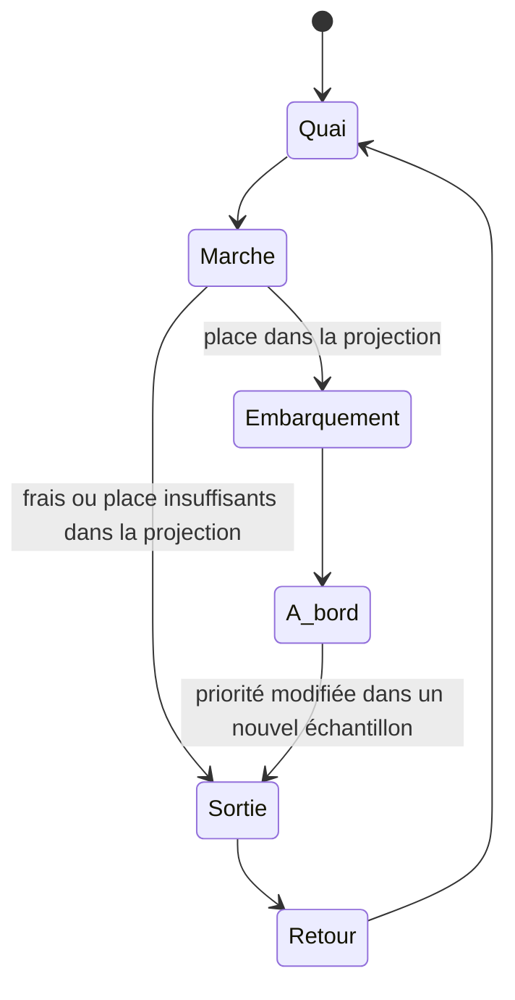

# Voyageurs, wagons et panneau du quai

La scène utilise les transactions validées de la source. Leur statut de réseau et leur état d'animation sont deux données différentes : une transaction peut être **à bord du candidat illustratif** et rester **en attente dans la source**.

## Parcours

Les transactions sont classées selon les frais observés, puis l'identifiant pour stabiliser les égalités. Le candidat possède douze unités **visuelles**. Un voyageur occupe une à trois unités selon ses besoins de ressources : référence de 400 vBytes pour Bitcoin et 100 000 unités de gas pour Ethereum. Le tarif de référence de l'instantané sert de repère pédagogique. Ces règles simplifiées n'intègrent pas les dépendances Bitcoin, les nonces Ethereum, les transactions privées, la sélection des producteurs ni toutes les contraintes du protocole.

Un voyageur moins prioritaire rejoint la porte, revient au quai et peut réessayer. Un nouvel instantané peut déplacer un voyageur précédemment embarqué si un meilleur candidat occupe le budget illustratif. Aucun de ces mouvements n'annonce un rejet du réseau.

Seules les transactions dont la source fournit le statut `confirmed` rejoignent le wagon observé. Une disparition de l'échantillon n'est pas une confirmation. Une réorganisation signalée par un nouveau statut en attente remet le voyageur dans le parcours correspondant. Les départs en direct restent liés au changement du hash du bloc observé ; en simulation, les départs sont fictifs.

Le wagon du haut représente le bloc observé ; celui du bas représente le candidat illustratif. Lorsqu'un nouveau bloc est observé en direct, le candidat rejoint la position du wagon observé. Les voyageurs précédemment embarqués et désormais confirmés par la source restent dans ce transfert. Ceux dont la source fournit encore le statut en attente sortent, reviennent en file et peuvent rejoindre le candidat suivant. Les identifiants disparus de l'échantillon sont retirés sans leur inventer de statut. Un nouveau candidat apparaît au terme de la transition.

Pour Bitcoin, le serveur conserve au plus 120 transactions récemment échantillonnées pendant 30 minutes et vérifie leur identifiant dans le dernier bloc. Cette mémoire volatile aide à retrouver les inclusions ; elle ne représente ni toutes les transactions du bloc ni un suivi historique complet. Une vérification indisponible ne provoque aucune confirmation déduite.

Aucune minuterie n'invente un transfert de candidat en direct. En simulation, l'avancée périodique est fictive et sert à montrer la transition. Pause, vitesse, onglet masqué et mouvements réduits s'appliquent au wagon et à ses voyageurs.

## Taille des têtes

Seule la tête change d'échelle. Elle dépend d'une courbe logarithmique absolue et bornée entre 0,8 et 1,85. La même transaction conserve sa taille lorsque ses voisins changent. Pour Bitcoin, la ressource est sa taille virtuelle en vBytes ; pour Ethereum, c'est sa **limite de gas déclarée**, pas sa taille en octets ni le gas effectivement consommé.

## Horloge et accessibilité

`src/lib/passengerMotion.ts` est un moteur pur, indépendant du dessin. Chaque réseau possède son instance de `src/hooks/usePassengerMotion.ts`, avec une horloge `requestAnimationFrame`, un rendu à environ 24 images par seconde, jusqu'à 80 voyageurs et pas de saut de temps après pause ou retour d'un onglet masqué. Le décor est mémorisé pour éviter de le recalculer à chaque mouvement.

Pause suspend les voyageurs, les wagons, les signaux et le défilement du panneau. Les mouvements réduits placent les voyageurs à leur destination illustrative sans trajet animé. Les personnages restent sélectionnables au clavier, y compris dans les wagons. Les confirmations et la fraîcheur affichées gardent la sémantique de la source.

## Panneau d'informations

Le panneau alterne toutes les huit secondes entre Réseau, Bloc et Voyageurs. Une sélection fixe les données actuelles de la transaction ; Échap ou le bouton de libération permet de retrouver le panneau. Les pages restent accessibles manuellement, avec les flèches du clavier. Les détails sélectionnés suivent l'instantané courant et disparaissent lorsque la transaction n'est plus dans l'échantillon disponible.

Les compteurs du panneau concernent la scène représentée. Le nombre de transactions du réseau reste distinct, et sa valeur absente est affichée comme non mesurée.

## Vue immersive et deux réseaux

Bitcoin et Ethereum restent visibles ensemble. Chaque rue reçoit son propre instantané et conserve son état de connexion, ses frais, ses blocs et son échantillon. Une panne sur une chaîne ne remplace pas les données de l'autre. Les commandes de pause, de vitesse et de mouvements réduits s'appliquent aux deux scènes.

La ville utilise l'espace disponible de la fenêtre ; les détails peuvent être repliés pour libérer la scène. Sur ordinateur, les deux rues sont côte à côte ; sur mobile, les deux réseaux sont disposés en deux scènes compactes. Une sélection est identifiée par le réseau et le hash, afin que des identifiants semblables ne mélangent pas les informations des deux chaînes.
