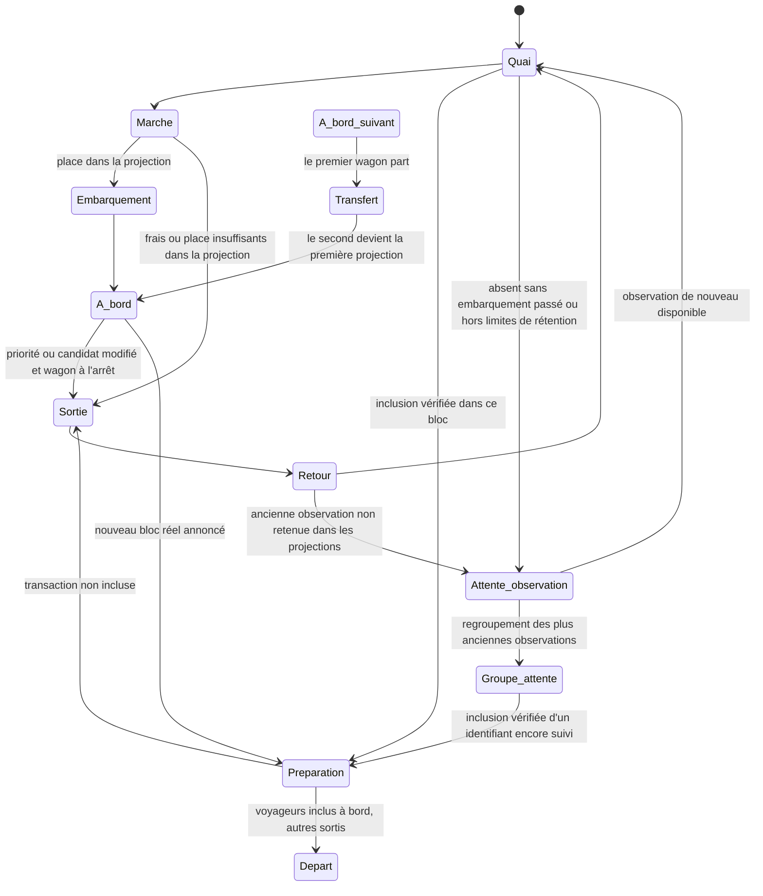

# Voyageurs, wagons et panneau du quai

## Flux aux entrées ordinaires — 16 octobre 2026

La rubrique **Flux** du panneau supérieur privilégie les événements reçus d’une connexion partagée par réseau : ajouts Bitcoin et notifications pending Ethereum. Elle annonce le mode suivi, la durée couverte, un débit moyen et les points disponibles sur environ une minute. Le relevé périodique entre deux inventaires complets reste un secours explicitement nommé, distinct de ces notifications. Aucune valeur ne dépend d’une simple variation nette du pool. Initialisation et coupure ne deviennent jamais un zéro inventé.

Sur Bitcoin, les arrivées réellement identifiées dans le flux rejoignent l’échantillon et entrent par le bord extérieur ordinaire. Jusqu’à 384 détails récents prennent place dans les 1 920 pending ; ils n’ajoutent pas 384 personnages au plafond. Un voyageur déjà connu garde son identité ; le remplacement d’un autre détail peut le laisser comme ancienne observation sous les budgets existants. La source et la date du flux sont annoncées séparément de l’inventaire RPC. Ces personnages restent consultables avec leurs frais propres et leur taille ; leur arrivée n’annonce ni présence dans le candidat GBT ni confirmation. Le groupe latéral Bitcoin « +X hors échantillon » est supprimé, même lors d’un repli du compteur Flux.

Sur Ethereum, le groupe collectif « +X hors échantillon » reste au bord extérieur ordinaire lorsqu’un nouvel intervalle mesure des entrées absentes de la sélection individuelle lors de sa première publication. Il reste distinct de la borne réseau haute, qui représente des inclusions découvertes dans un bloc, et ne rejoint pas un wagon. Quelques pictogrammes neutres représentent la quantité exacte affichée, sans inventer des détails individuels. Un relevé déjà présent au chargement ou repris à l’identique ne rejoue pas ce signal. La pause et l’onglet masqué suspendent son déplacement ; les mouvements réduits gardent une présentation fixe.

Les deux méthodes de mesure restent distinctes : les événements Ethereum peuvent signaler une promotion de queued vers pending, alors que le secours par inventaires compare leur union et ne compte pas ce changement de catégorie comme une entrée. Les notifications sont dédupliquées dans une période bornée ; les reconnexions ou les gaps recréent une base et ne rejouent pas les lots anciens. La réserve individuelle Bitcoin expire après soixante secondes sans delta consécutif validé, sans renouveler sa date à la lecture ; les retraits ou remplacements retirent des métadonnées sans preuve d’inclusion. Les transactions transitoires entre relevés peuvent manquer et les données trop anciennes cessent d’être utilisées. Aucun appel d’enrichissement par transaction n’est créé ; Ethereum ne gagne aucun nouvel individu à partir de ses hashes.

## Reste du réseau et découvertes tardives — 16 octobre 2026

Chaque quai possède une boîte **Reste du réseau — hors échantillon**, sous le grand panneau et au-dessus des arrivées. Elle occupe le bord extérieur : à gauche pour Bitcoin, à droite pour Ethereum. Elle ne compte pas la mempool mondiale et n’atteste aucune présence actuelle dans le pool du fournisseur.

Le repère est désormais une petite borne avec un dessin de nœuds connectés, placée tout en haut. Sa largeur affichée est plafonnée pour qu’elle reste compacte lorsque le quai s’élargit. La file active commence plus bas ; son espace reste distinct des observations historiques. Les arrivées ordinaires entrent toujours horizontalement par le bord extérieur, à hauteur de leur place dans cette file.

La borne s’éclaire pendant l’utilisation réelle de son passage animé, dès la préparation et jusqu’à la fin du parcours des voyageurs concernés, y compris après la fermeture de la porte. Le corps, les nœuds et le contour changent de couleur, avec un halo fixe sans clignotement. À vitesse normale, sur une préparation disposant d’au moins une seconde, l’éclairage précède l’ouverture de 120 ms ; la porte s’ouvre en 80 ms, attend encore 120 ms, puis les nouveaux voyageurs apparaissent et marchent. Elle reste ouverte 150 ms après leur dégagement avant de se fermer en 80 ms. Ces marges diminuent proportionnellement lorsque la preuve arrive en cours de préparation, sans prolonger sa durée prévue. Les personnes déjà connues restent visibles pendant cette séquence. Ce repère décoratif n’est ni un compteur ni une nouvelle preuve d’inclusion ; il ne précède jamais la réception d’une preuve. Une donnée de bloc sans voyageur identifié ne l’allume pas.

Seuls les voyageurs sortant actuellement de la borne réseau portent une traînée plus longue derrière eux. Elle reprend la portion déjà parcourue de leur chemin et ses virages ; elle ne prolonge pas arbitrairement leur direction à travers la route. Elle est limitée à huit points et 110 unités après projection, même sur un quai élargi. Les arrivées ordinaires et autres transactions n’en ont pas ; une ancienne origine réseau ne suffit pas à la réactiver. La trace ne précède pas l’ouverture de la porte et ne reste pas sur une personne arrêtée ou assise. Elle se fige avec la pause ou un onglet masqué ; les mouvements réduits règlent les positions sans traînée animée. Les couleurs de frais et la sélection des voyageurs restent indépendantes de cet effet décoratif.

Lorsque plusieurs voyageurs sont découverts ensemble, leurs apparitions sont légèrement échelonnées et leurs chemins se répartissent sur quatre voies au-dessus de la file. Ils sortent par la même porte, s’éloignent de la borne avant de se déployer, puis rejoignent le couloir et la porte haute du wagon. Un voyageur seul conserve le trajet central habituel. L’écart entre deux apparitions ne dépasse pas 36 ms et la cohorte entière s’étale sur 480 ms au maximum, dans la limite de 40 % du temps de marche restant. Le temps de trajet s’ajuste pour garder l’échéance de préparation, sans retarder artificiellement le bus. Une nouvelle preuve ne déplace ni ne reprogramme les voyageurs déjà engagés. Les grandes cohortes peuvent encore se superposer : aucune personne fictive n’est ajoutée et le reste sans détails conserve sa représentation collective.

Le bouton **Transactions** est placé dans la ligne du temps depuis le dernier départ, avec le libellé **Tx** sur petit écran. Il ne recouvre pas la boîte et ne réduit pas la hauteur du Canvas. La liste reste accessible au clic et au clavier, avec Échap et retour du focus au bouton.

Lorsqu’une preuve exacte d’inclusion apporte les détails d’une transaction jamais représentée ni admise ni archivée, son personnage part de cette boîte. La porte s’ouvre avant la marche ; il rejoint une voie horizontale au-dessus de la file, puis le couloir et la porte haute du premier wagon, sans visiter une place d’attente ni marcher sur la chaussée. La porte se referme une fois le passage dégagé. Ces étapes restent dans la préparation du départ : trois secondes pour Bitcoin et 1,5 seconde pour Ethereum à vitesse normale, après réception du bloc et de ses preuves. Une transaction déjà connue conserve sa position et son origine ; une archive rejoint toujours le wagon depuis le groupe historique. La découverte tardive ne date ni sa diffusion ni son arrivée réelle dans le mempool.

Une preuve ne contenant qu’un hash inconnu n’invente aucun personnage. Pendant la préparation et le départ, le bloc reçu peut porter un complément **collectif**, calculé à partir de son nombre réel de transactions moins les identifiants uniques individualisés dans toute la scène. Bitcoin exclut la coinbase, qui n’est pas passée par la mempool. Ce groupe statique n’a ni hash, ni frais, ni option de sélection ; une incohérence de compte retire le complément plutôt que d’inventer un effectif. Il reste distinct du groupe du candidat Bitcoin, qui disparaît dès la préparation. Le compteur arrière garde son périmètre individuel et le complément possède son propre badge.

Un passage marqué **Inclusions retrouvées** ne redessine pas ce complément complet : il transporte seulement les individus dont la preuve vient d’être retrouvée, pour éviter de montrer une nouvelle fois tout le même bloc. Le pourcentage conserve son périmètre explicite de bloc complet.

La pause et l’onglet masqué figent le trajet et la porte réseau ; les mouvements réduits consomment les preuves sans rejouer d’arrivée, de porte ni de départ. Les données et limites de représentation restent celles du moteur existant. Les tests emploient des blocs et transactions contrôlés, sans service réel ; résultats dans [validation.md](validation.md).

## Fermer les informations — 16 octobre 2026

Le panneau du quai possède toujours une croix **Fermer le panneau d’informations** en haut à droite, même sans transaction sélectionnée. Son en-tête reste visible pendant le défilement. La croix et le bouton **Informations** du bas ferment le panneau, effacent la sélection et rendent le focus à ce bouton ; la prochaine ouverture présente les statistiques du réseau. La commande **Libérer le panneau d’informations** reste distincte : elle abandonne seulement la sélection pour revenir aux statistiques sans fermer.

**Échap** ferme d’abord le navigateur de transactions s’il a consommé cette touche, puis le panneau à la pression suivante. Les pages **Comprendre** et **Les données** gardent leur propre retour à la ville avant la fermeture du panneau sous-jacent. Les boutons d’en-tête ont une cible de 44 pixels ; ces commandes restent disponibles pendant une panne de source et en mouvements réduits.

## Prédécesseurs Ethereum — 15 octobre 2026

Un voyageur aux frais élevés peut attendre une transaction précédente du même compte. Le nonce détermine cet ordre : les frais seuls ne permettent pas de dépasser un nonce manquant. Le moteur tient désormais compte du prédécesseur immédiat connu dans le pool complet, même hors de l’échantillon visible. Aucun personnage supplémentaire n’est créé pour représenter ce parent absent de la scène.

Le motif distingue un parent pending non admis, un parent queued, un trou de nonce connu et un ancien parent devenu inconnu. Un remplacement actualise le parent attendu. Une inclusion exacte du parent permet de réévaluer l’admission ; sa seule disparition ne suffit pas. Si aucun prédécesseur n’a jamais été observé, la projection reste explicitement incertaine et peut suivre la classification pending du fournisseur. Les détails annoncent cette limite même lorsque le voyageur est à bord.

Une panne, une donnée ancienne ou une réorganisation ne transforme pas un parent inconnu en nonce disponible. Les mêmes motifs sont consultables par le navigateur de transactions au clavier, l’infobulle et le panneau. Les sorties passent toujours par la porte après l’arrêt ; une résolution de dépendance ne déclenche pas un départ confirmé. Les règles de pause, de mouvements réduits et les capacités restent inchangées.

## Bilan candidat / bloc Bitcoin — 15 octobre 2026

La rubrique **Comparaison**, dans le grand panneau Bitcoin, résume la part du candidat observé retrouvée dans le dernier bloc. Elle distingue les transactions **prévues et incluses**, **prévues mais non incluses dans ce bloc**, et **incluses hors candidat**. Les trois effectifs portent sur les listes complètes hors coinbase ; ils ne mesurent pas les seuls personnages visibles. Le panneau de détails, rubrique **Bloc**, donne les totaux, la hauteur, les sources et les dates.

Le candidat est conservé avant la première détection du bloc correspondant, avec sa hauteur et son parent. Un relevé ultérieur du prochain candidat ne change pas ce bilan. Sans référence préalable valide ou liste complète vérifiée, le panneau indique qu’il attend un bilan, sans faux zéro. La démonstration ne fournit aucune comparaison réelle. Une panne temporaire conserve les dates d’origine ; l’expiration de l’instantané retire le résultat.

Le bilan ne pilote pas les personnages : les départs restent fondés sur leurs preuves exactes d’inclusion. « Non incluse dans ce bloc » ne signifie pas « encore dans le mempool ». Le candidat d’un nœud peut différer des choix du mineur. La rotation garde son rythme de quatre secondes et respecte pause, sélection, visibilité et mouvements réduits.

## Statuts, recherche et zone historique — 15 octobre 2026

Le bouton **Transactions** de chaque rue propose une recherche par hash complet ou fragment, sans distinction de casse, puis les filtres **Toutes**, **Présentes**, **Différées**, **Historiques** et **Incluses**. Ces groupes décrivent la présence ou l’inclusion connue ; les frais restent affichés séparément. La recherche porte sur les voyageurs individualisés encore représentés, et son compteur ne mesure pas le mempool complet. Les filtres ne retirent aucun personnage de la scène. Sans résultat, les détails sont désactivés et une commande réinitialise recherche et filtres.

La liste, l’infobulle et le panneau partagent le même statut. Une transaction aux détails anciens reste « en attente dans le dernier relevé complet du fournisseur » si ce relevé atteste encore sa présence. La catégorie queued est distincte ; une disparition de l’échantillon seule donne un statut actuel inconnu, jamais une confirmation. Le panneau sépare explicitement **Présence / inclusion**, **État des détails reçus** et les dates disponibles.

En bas du quai, la zone **Observations** accueille les voyageurs au statut actuel inconnu, absents du relevé ou remplacés. Les retours et réobservations passent par le quai ; les occupants d’un wagon gardent leur siège pendant le déplacement. Les observations restent consultables et peuvent se superposer une fois les places propres à leur zone occupées. Ce repère est distinct de l’archive collective placée plus bas. Les bornes de rétention et les preuves nécessaires au départ sont conservées.

## Fidélité du suivi — 15 octobre 2026

Le premier chargement place le stock observé sur le quai, sans simuler une arrivée réseau pour chaque transaction déjà présente. Les observations suivantes arrivent depuis le bord extérieur, avec décalage de départ plafonné à 1,5 seconde par cohorte. Les dates de détails proviennent de leur collecte réelle (candidat pour ses membres, inventaire pour les autres), pas de chaque polling local.

Le moteur distingue détails anciens et présence vérifiée dans l’inventaire. Pending, queued, absence du relevé, alternative du même nonce et statut inconnu ont des motifs lisibles dans l’infobulle et le panneau. Les anciennes observations restent consultables ; aucune disparition du relevé ne déclenche de départ confirmé. Une candidature Bitcoin récente autorise le réembarquement malgré l’âge des détails. Ethereum utilise la base fee exacte de la projection suivante, les plafonds conservés et les prédécesseurs connus. La limite de gas reste une réservation prudente, pas une consommation mesurée.

« Vitesse d’animation » et pause concernent les déplacements ; les données continuent d’être actualisées. La légende précise que la couleur est relative à l’échantillon. Les budgets d’objets, Canvas, ressources de bloc, portes, arrêt avant sortie et inclusion exacte restent applicables.

La scène utilise les transactions validées de la source. Lorsque Bitcoin reçoit un candidat `getblocktemplate` exploitable, le wagon du haut représente ce **candidat du nœud complet**, avec personnages connus et complément collectif ; celui du bas reste une **estimation**. Sans candidat exploitable, les deux wagons Bitcoin reprennent leurs projections habituelles ; Ethereum conserve ses deux projections estimées. Une place embarquée ne prouve aucune inclusion : la transaction individualisée est soit observée en attente dans la source, soit conservée comme ancienne observation avec statut actuel inconnu et horloge. Le dernier bloc reçu est présenté dans les informations, sans wagon historique permanent.

Les bornes courantes sont décrites dans [architecture.md](architecture.md) : jusqu’à 1 920 candidates par chaîne et 24 confirmations séparées, avec une réserve fixe et indépendante de 1 920 anciennes observations et au plus 3 840 résidents ordinaires. Les places libres de la file suivent la géométrie `v20` décrite ci-dessous. Les paragraphes historiques sur les autres animations conservent leurs anciennes limites et leur état de vérification ; consulter [validation.md](validation.md) pour le résultat courant des contrôles.

## Parcours

Les transactions en attente sont classées selon les frais observés, puis l'identifiant pour stabiliser les égalités. En estimation, les plus prioritaires remplissent le premier wagon, les suivantes le second, en utilisant **leur taille native et la capacité d'un bloc**. Avec un candidat Bitcoin actif, l'appartenance au candidat passe avant cette répartition : seuls ses membres connus sont admis dans le premier wagon ; les autres observations encore candidates peuvent rejoindre le second ou rester sur le quai. Un ancien membre peut donc descendre du premier même s'il y reste de la place. Les sièges du même wagon restent stables quand la capacité et l'appartenance le permettent.

Bitcoin additionne `Tx.size` en vBytes face à 1 000 000 vBytes ; le premier wagon respecte en plus `weightLimit / 4` lorsque le candidat du nœud fixe une limite inférieure. Ethereum additionne les limites de gas déclarées face au `gasLimit` du dernier bloc observé. Une taille nulle ou invalide n'est pas admise comme une transaction gratuite en capacité. Le gas déclaré est une estimation prudente, distincte de la consommation réelle ; les ressources de blobs ne sont pas mesurées. Une capacité Ethereum inconnue reste inconnue. Le plan réserve les tailles des voyageurs encore en chemin ; le compteur d'une projection estimée ne les inclut qu'une fois à bord. Le compteur du candidat Bitcoin complet décrit un autre périmètre, détaillé ci-dessous. La recommandation Bitcoin n'est pas un seuil d'admission ; Ethereum conserve l'éligibilité à la base fee observée. Les estimations de secours ne reproduisent pas les paquets et dépendances Bitcoin, les nonces Ethereum, les canaux privés ou toutes les contraintes d'un producteur.

Les **96 emplacements dessinés** restent répartis sur huit colonnes et douze rangées dans un wagon de taille inchangée ; ils servent à la présentation seulement. Les voyageurs peuvent se superposer au-delà de cette grille sans changer leur taille de transaction ni la capacité du bloc. L'ancienne conversion en une à trois unités ne sert plus à l'admission ou au pourcentage.

Un voyageur moins prioritaire revient au quai et peut réessayer. Un nouvel instantané peut déplacer un voyageur précédemment embarqué si un meilleur candidat occupe la capacité native projetée, lorsque le wagon est à l'arrêt. Aucun de ces mouvements n'annonce un rejet du réseau.

L’échantillonnage courant reste limité à **1 920 transactions en attente** et 24 confirmations séparées par chaîne. Bitcoin privilégie désormais jusqu’à 384 vraies arrivées reçues dans le flux, puis complète avec la sélection de base du candidat `getblocktemplate`, classée selon ses propres frais et éventuellement mêlée à l’inventaire RPC indépendant. Si ce candidat n’est pas exploitable, le secours utilise dans l’ordre le top frais du pool RPC complet, le premier bloc projeté mempool.space, puis les seules transactions récentes de cette API. Le résultat final est mixte, sans top mondial ni sélection garantie par un mineur. Ethereum conserve le classement local des pending éligibles via `txpool_content`, avec repli sur le bloc pending disponible. Les preuves d’inclusion restent séparées de ces sélections, même si leurs frais sont faibles. Le repli REST récent reste limité à 1 000 objets amont ; une source plus petite n’est pas remplie artificiellement.

## Candidat du nœud Bitcoin

`Snapshot.blockTemplate` décrit la source, l'heure de réception, la hauteur prévue et le hash parent, ainsi que le compte complet hors coinbase, la somme des poids, leur limite et la médiane complète des frais proposés lorsqu'elle est fournie. `selectedTransactionIds` transmet au plus 4 096 identifiants membres parmi les voyageurs courants et les observations encore suivies. Les frais propres servent au tri des 1 920 nouveaux personnages au maximum, tandis que l'appartenance proposée provient du calcul du nœud. Le dessin individuel ne reconstitue pas toutes ses dépendances.

À l'arrêt, hors préparation et mouvement, la plaque du premier wagon utilise **tout le candidat** : `transactionCount`, `weight / 4` vB sur `weightLimit / 4` vB, soit `100 × weight / weightLimit`. Le reste est représenté par un groupe SVG statique et non interactif, borné à un motif et un rectangle quel que soit son effectif. Il porte le badge de transactions groupées ; ce groupe n'ajoute ni voyageur au moteur ou au Canvas, ni option clavier, ni identifiant, frais ou valeur individuels. Son effectif est le compte complet moins les membres connus individualisés dans toute la scène, y compris les arrivants sur le quai, dédupliqués par identifiant. Une arrivée dans le wagon ne le décrémente donc pas une seconde fois. Exemple : candidat de 5 000 transactions à 99,8 %, avec 960 individus présents et 4 040 transactions groupées. Le groupe ne correspond pas aux anciennes observations regroupées au bas du quai.

Un candidat n'est actif qu'en direct valide sur Bitcoin, rattaché à la tête observée, à la hauteur suivante et âgé d'au plus **30 secondes**. Le serveur et l'interface appliquent cette limite ; un délai ponctuel la fait respecter aussi pendant une requête lente ou une scène en pause, sans rafraîchir les dates ni effectuer une nouvelle collecte. Un candidat expiré, indisponible, incohérent ou rattaché à un autre parent laisse place à l'estimation annoncée. Un candidat valide sans membres connus réserve au contraire le premier wagon vide. La source et la date restent explicites : rien ne prouve qu'un pool minier travaille sur ce candidat.

Les membres historiques connus peuvent viser le premier wagon, y compris depuis le quai sans premier embarquement passé, pendant moins de 30 minutes depuis leur observation. Cette appartenance n'actualise ni leur statut source, ni leurs frais, ni leur date ; l'horloge et la mention « statut actuel inconnu » demeurent. Les autres historiques déjà embarqués et encore éligibles peuvent occuper le second wagon estimé, sous les bornes de 1 920 anciennes observations et 3 840 résidents ordinaires. Les trajets utilisent les portes et le quai, avec sorties nécessaires seulement à l'arrêt. La sélection est conservée pour replanifier après un vrai départ, mais révoquée dès qu'elle ne correspond plus au parent courant ou qu'un repli la remplace.

Le lecteur serveur effectue `getblockchaininfo`, puis `getblocktemplate` avec les règles SegWit, en arrière-plan. Une seule tentative est autorisée à la fois, puis un délai minimal de **15 secondes** après sa fin ; le budget total est de **huit secondes**, avec **16 Mio** de réponse et **30 000 transactions** au maximum. Le réseau annoncé, la synchronisation, le parent, la hauteur, les identifiants, dépendances et poids sont contrôlés. Les octets bruts ne sont ni envoyés au navigateur ni conservés pour l'animation. Ces contrôles de cohérence n'équivalent pas à une validation de consensus complète. Le lecteur utilise `BITCOIN_RPC_URL`, également partagé par le pool complet de secours ; une valeur vide désactive ces deux lectures facultatives. Le cache HTTP de trois secondes, les fournisseurs des blocs et les preuves réelles gardent leurs rôles propres.

Une modification de candidat n'est pas un nouveau bloc et ne déclenche aucun départ réel. Seuls `Tx.blockHash` et les identifiants du journal d'inclusions effectivement vérifiés peuvent réserver la préparation et le départ associés à un bloc reçu. Lors de cette préparation, le premier wagon illustre les inclusions réelles, qui peuvent différer du candidat précédent ; après arrêt, la nouvelle proposition du parent courant peut à nouveau guider sa projection.

Le groupe du candidat est retiré dès la préparation, pendant tout départ, à l'expiration ou lors du repli : il ne part jamais comme des transactions confirmées. La préparation et le départ reprennent leur compteur de voyageurs aux inclusions connues, avec le pourcentage du bloc réel complet ; les projections de secours reprennent leurs compteurs d'échantillon. Les statuts et dates des personnages restent ceux des observations, sans compléter fictivement les preuves pour atteindre le compte du candidat.

## Quai et portes

Chaque rue est verticale. Les wagons partagent une couleur de carrosserie ; le nom du réseau et ses repères orange ou violet identifient la chaîne. Leur position horizontale reste au centre de la chaussée, y compris lorsque le second rejoint la place du premier.

Une plaque à l'arrière de chaque wagon, au-dessus des feux rouges, annonce son périmètre. Le candidat Bitcoin actif utilise ses agrégats complets décrits ci-dessus. Sur une projection estimée, `N TX · ≈P %` compte les identifiants uniques effectivement à bord, y compris dans le passage de la porte : la somme de leurs `Tx.size` est divisée par la capacité native du bloc. Les voyageurs encore hors du wagon, même avec une taille réservée, sont exclus de ce pourcentage ; un wagon vide affiche 0 % si la capacité est connue. Ethereum utilise les limites de gas déclarées, jamais une consommation prétendument mesurée. Une capacité absente donne `—`.

Dès la préparation du premier wagon et pendant son départ, le pourcentage affiche l'utilisation **du bloc réel complet** : `100 × Block.used / Block.capacity`, à partir du bloc associé au hash de ce départ. Le bloc peut venir des blocs courants ou du journal des inclusions vérifiées ; un nouveau dernier bloc ne remplace pas le dénominateur du véhicule déjà en départ. Des métadonnées manquantes pour un bloc attendu donnent `—`, sans repli sur la somme des limites de gas de l'échantillon. Le compteur `N TX` conserve son périmètre de voyageurs représentés, distinct du total des transactions du bloc. Les infobulles et libellés accessibles annoncent cette différence entre échantillon et bloc complet, ainsi qu'entre projection estimée et utilisation observée. Le second wagon conserve son estimation lors de sa promotion ; les textes restent lisibles dans le miroir Bitcoin.

Le pourcentage est affiché avec une décimale, ou deux sous 1 % ; une valeur strictement positive inférieure à 0,01 % apparaît sous la forme `<0,01 %`, sans devenir un faux zéro. Les pieds des projections indiquent les vBytes ou le gas et le pourcentage **réservés par le plan**, y compris pour les voyageurs encore en chemin ; leur infobulle donne la somme et la capacité. Ce périmètre est distinct de celui de la plaque à bord. Aucun budget `/96` ne sert aux ressources. Ce changement reste non validé pendant la suspension des contrôles.

Les voyageurs qui marchent restent sur les quais extérieurs : à gauche de la chaussée Bitcoin et à droite de celle d'Ethereum. L'entrée utilise la porte haute du côté du quai ; la sortie utilise une autre porte, en bas du même côté. Chaque porte s'ouvre pour le passage correspondant. Les trajets d'approche, de sortie et de retour en file ne traversent pas la route. Seul le passage par la porte rejoint l'intérieur du wagon.

Les portes sont sans marches. Les personnages sont dessinés au-dessus des portes pendant leur passage, pour que leur silhouette reste visible.

Les nouvelles transactions entrent horizontalement depuis le bord extérieur, à la hauteur de leur place réservée dans la file, avec des arrivées décalées. Elles viennent de la gauche pour Bitcoin et de la droite pour Ethereum. Le moteur utilise une géométrie canonique de quai droit : `arrivalStart(queueIndex)` part au-delà du bord, à `x = SCENE_WIDTH + 28`, sans coordonnée verticale négative ; le rendu Bitcoin applique le miroir horizontal. La première projection commence toujours à la coordonnée verticale 175. Les sorties et retours en file sont illustrés par le déplacement seul, sans petite flèche au-dessus des voyageurs.

La géométrie de la rue, des wagons, des portes et du quai est partagée dans `src/lib/streetGeometry.ts` entre le moteur de mouvement, les voyageurs Canvas 2D et le décor SVG. Cette référence commune permet aux trajets de rejoindre les portes effectivement affichées. Les mêmes transformations de coordonnées sont appliquées aux voyageurs, places, portes et wagons ; les glyphes et textes restent lisibles, sans miroir global de leurs dessins.

La file conserve les places valides des voyageurs déjà observés dans une même zone, selon leur arrivée dans l'application. Seuls les nouveaux identifiants d'une même collecte sont classés par taux de frais décroissant, avec l'identifiant comme départage stable, pour occuper les places libres restantes. Une actualisation des frais ne déplace pas les personnes déjà placées. Un voyageur parti vers le wagon libère sa place ; s'il doit descendre, il réserve une destination libre avant son retour. L'application ne connaît pas l'ordre d'arrivée mondial des transactions ; une première collecte observe un groupe simultané, pas son historique réseau. Une réobservation qui change le groupe de présence réserve une place dans la zone active.

Les places actives couvrent neuf rangées de `y=200` à `480`, par pas de 35, et les historiques trois rangées de `y=560` à `640`, par pas de 40, entre `x=318` et `408` avant projection. La voie haute du réseau reste à `y=140`, au-dessus des têtes de la première rangée active. Le nombre de colonnes s'adapte à la largeur affichée pour viser au moins 32 unités d'écart horizontal ; la grille par défaut compte trois colonnes, soit 27 places actives et neuf historiques. La superposition commence après occupation des places physiques de la zone correspondante. Lorsqu'un emplacement se libère, un voyageur superposé peut le rejoindre sans déplacer les autres personnes en attente. Ces places visuelles sont indépendantes des 1 920 observations courantes possibles et des capacités natives des wagons.

Un retour vers une place attribuée ou une réorganisation anime une phase `reordering` de 350 à 1 000 millisecondes, toujours par le corridor du quai extérieur. Au redimensionnement, une arrivée ou un retour peut rejoindre sa nouvelle destination depuis sa position courante ; les passages de porte conservent leur trajet, puis rejoignent la destination réservée. Une destination inchangée ne relance pas l'animation. L'attribution des places dans la file ne réorganise pas les sièges occupés à bord, y compris en mouvement réduit lorsque le wagon reste le même. En mouvement réduit, les places sur le quai sont actualisées statiquement.

Un voyageur déjà embarqué reste à bord pendant le déplacement du wagon. Une sortie nécessaire attend son arrivée et emprunte alors la porte basse du côté du quai ; les portes restent fermées pendant le trajet. Le changement visuel de wagon n'altère jamais le statut fourni par la source.

## File collective en bas des rues

Chaque rue dispose d'un bandeau **File globale · fournisseur** sous la scène. Il montre le total exact de la mempool locale observée, distinct des 1 920 voyageurs échantillonnés au maximum, des projections et du groupe des anciennes observations. Le qualificatif « globale » signifie l'ensemble de la file communiquée par ce fournisseur, pas un inventaire mondial. La provenance locale reste indiquée ; l'infobulle et le résumé accessible précisent le nom de la source. Ethereum conserve le détail `pending + queued`, qui ne décrit pas l'admissibilité de toutes ces transactions au prochain bloc.

La représentation reste bornée à **48 silhouettes collectives par chaîne**. Une échelle commune aux deux rues est choisie sur le maximum des comptes utilisables affichés, avec un nombre de transactions par groupe de la forme `1, 2, 5 × 10ⁿ`, assez grand pour couvrir ce maximum en 48 groupes au plus. Ce repère explicite permet de comparer les deux effectifs sans leur attribuer une échelle indépendante. Les groupes complets représentent chacun l'échelle annoncée ; le dernier ne porte que le reste lorsqu'il est partiel. Une variation du total ou de l'échelle reflète une nouvelle présentation du relevé, jamais des arrivées ou confirmations individuelles prouvées.

Ces silhouettes sont statiques, décoratives et non sélectionnables, avec un résumé accessible et une infobulle de provenance. Elles ne portent aucun identifiant, frais, taille de transaction ou chemin de déplacement. Elles n'entrent pas dans les wagons et n'alimentent pas le moteur, ses archives ou ses compteurs d'activité. Aucune animation ou minuterie supplémentaire n'est introduite ; la pause et les mouvements réduits gardent leurs règles existantes.

Le compte est lu avec `providerMempool(snapshot)`, également utilisé par le panneau supérieur. Ethereum utilise l'âge propre de `mempool.observedAt`, avec ancien relevé après 30 secondes et indisponibilité après 120 secondes ; une date récente du bloc ne renouvelle pas ce compteur. Un compte zéro valide donne une file vide. Un compte absent, invalide ou expiré ne produit ni silhouettes fictives, ni zéro, ni repli sur l'échantillon. Les états de simulation et de données anciennes sont indiqués explicitement. La lecture réutilise les instantanés existants et leur actualisation, sans nouvelle API, collecte ou dépendance. Cette représentation reste non validée pendant la suspension des contrôles.

## Transfert et statut réseau

Seule une preuve de la source peut fournir le statut `confirmed`. Le champ facultatif `Tx.blockHash` précise le bloc dans lequel une inclusion a été vérifiée ; le journal facultatif `Snapshot.inclusions` transmet aussi les identifiants suivis retrouvés dans des blocs intermédiaires. Une ancienne confirmation sans hash reste compatible avec le contrat mais ne suffit pas pour emporter son personnage dans un départ. Le moteur exige `status === 'confirmed'` et `blockHash` égal au hash du bloc annoncé. Une disparition de l'échantillon n'est pas une confirmation.

Lorsqu'un nouveau bloc est reçu, le premier wagon reste au quai le temps d'ajuster son contenu au bloc réel : les inclusions connues embarquent rapidement, les voyageurs non inclus sortent par la porte basse du côté du quai avant le départ et restent dans la file. Seules les inclusions vérifiées partent avec le premier wagon. Le second monte à sa place, en conservant ses voyageurs et leurs statuts en attente. Après son arrêt, les priorités peuvent à nouveau évoluer. Un nouveau second wagon entre ensuite depuis le bas.

Une transaction absente du nouvel échantillon conserve sa dernière observation et son personnage. Si elle avait déjà atteint l'intérieur d'une projection, elle peut conserver sa candidature même après être descendue pour laisser partir un bloc réel. Les rafraîchissements pendant la sortie, le retour ou l'attente ne perdent plus cette mémoire. Elle peut réembarquer par la porte haute après l'arrêt si la capacité et l'éligibilité le permettent, sous le plafond de 1 920 historiques et pendant moins de 30 minutes depuis sa dernière observation réelle. Une transaction perdue avant son premier embarquement reste en attente visuelle sur le quai, sauf appartenance connue à un candidat Bitcoin actif ; une observation expirée ou hors de la réserve reste sur le quai ou rejoint le groupe des observations. Son absence et son réembarquement illustré ne modifient jamais son statut réseau ; son libellé et une petite horloge précisent qu'il s'agit d'une observation précédente. Ses détails restent consultables, avec dernière observation connue et statut actuel inconnu. Si la source retrouve une observation encore individualisée, le moteur réutilise son personnage et reprend le parcours approprié.

Jusqu'à 1 920 anciennes observations peuvent rester individualisées. Ce plafond est un budget d’effectif : l’expiration d’une candidature à 30 minutes ne déclenche pas automatiquement un retrait de silhouette sous ce budget. Au-delà, les plus anciennes déjà immobiles en file rejoignent un groupe à la coordonnée canonique `(360, 686)`, projetée sur le quai extérieur de leur réseau. Leur silhouette individuelle fusionne avec la représentation du groupe uniquement à son arrivée ; le compteur augmente dans le même état d'affichage. L'archive de la scène conserve jusqu'à **512 identifiants et leurs dernières observations pendant 30 minutes** depuis leur dernière présence dans l'échantillon. Les observations expirées ou évincées par cette borne restent représentées dans un compteur distinct **sans suivi individuel**, dont le statut actuel est inconnu.

Une inclusion vérifiée réserve l'observation encore suivie pour son bloc, sans créer immédiatement un personnage supplémentaire. La réservation conserve l'identifiant dans l'archive, protégée de l'expiration et de l'éviction pendant l'attente du départ ; la borne de 512 identifiants reste applicable. La durée de 30 minutes concerne les observations encore sans preuve, et une réservation peut donc durer davantage pendant une pause ou une file de départs. À la préparation du départ correspondant, l'observation quitte le groupe et réduit son compteur. Le personnage est réadmis depuis la position du groupe, puis rejoint rapidement la porte haute du côté du quai du wagon associé au hash réellement inclus. Les réservations sont libérées après traitement, annulation ou règlement statique en mouvement réduit.

Si une observation suivie revient simplement dans l'échantillon en attente, son personnage est également réutilisé depuis le groupe. Les observations déjà passées dans le compteur sans suivi ne peuvent plus être rapprochées individuellement d'un bloc. Le total du groupe n'est donc ni un nombre de transactions uniques, ni un nombre de transactions encore en attente sur le réseau. Il est plafonné à un million, puis affiché comme une borne minimale.

Les inclusions connues qui embarquent pour le départ réel peuvent se superposer sur les 96 emplacements dessinés. Leur nombre ne définit ni une limite de transactions dans un bloc, ni son taux de remplissage : la plaque utilise alors les ressources du bloc complet vérifié. La taille de l'échantillon illustré reste bornée et ne représente pas tout le bloc. Les deux projections utilisent les ressources natives disponibles avec les simplifications de sélection décrites plus haut.

Pour chaque chaîne, le serveur conserve au plus **2 048 identifiants observés pendant 30 minutes** et vérifie les blocs nécessaires au suivi. Il conserve un journal roulant de **16 blocs et 2 048 identifiants d'inclusion au total**, séparé de l'échantillon courant de 504 transactions et des trois derniers blocs affichés. Jusqu'à huit blocs peuvent être rattrapés par collecte ; les lacunes non vérifiées restent à réessayer. Cette mémoire volatile aide à retrouver les inclusions, sans représenter tout le réseau ou un historique exhaustif. Une vérification indisponible ne provoque aucune confirmation déduite. Une réorganisation peut invalider une preuve d'inclusion ; inclusion observée et finalité restent distinctes.

La scène conserve une file de **16 départs** afin de traiter plusieurs blocs reçus entre deux rafraîchissements. Le premier chargement initialise les preuves déjà présentes sans faire partir l'ancien journal. Un départ attend une preuve de vérification du bloc ; l'apparition d'un hash seule ne suffit pas à inventer ses passagers. Une preuve complémentaire reçue après un départ peut être illustrée avec le même hash sous le libellé **RATTRAPAGE** : elle ne représente pas un nouveau bloc. Un recul du dernier bloc annule les départs supérieurs encore en file ou en préparation ; les véhicules déjà en mouvement terminent leur trajet. Les bornes du journal, du suivi et de la file peuvent laisser des confirmations non illustrées après une longue interruption, une panne ou une expiration ; l'application ne les déduit jamais de l'absence d'un identifiant.

Les occupants inclus restent visibles avec le premier wagon pendant son départ, jusqu'à sa sortie de l'écran. Ce groupe historique est borné et reste distinct des projections et des compteurs du panneau. Le départ utilise une preuve fournie par la source ; l'animation ne crée aucune preuve supplémentaire.

Pendant ce trajet, le painter prépare une image commune de la cohorte embarquée, avec les mêmes apparences, superpositions et découpes intérieures, puis la translate avec le premier wagon. Les personnages ne sont pas supprimés pour alléger le départ ; leurs poses embarquées sont déjà immobiles dans cette phase. Les personnages du quai et du wagon en promotion continuent leur rendu individuel. La carrosserie, les portes, les feux et le compteur arrière restent en SVG et suivent leur mouvement existant. La préparation d'au moins une seconde, le départ et la promotion en 1,2 seconde puis l'arrivée du remplaçant en 0,7 seconde à vitesse normale gardent leurs durées et conditions.

Une seule image de départ est conservée par rue, avec au plus un million de pixels et 2 048 pixels par dimension. Sa densité suit l'échelle affichée et le ratio de pixels, plafonnée à quatre pixels par unité logique et réduite si nécessaire pour respecter ces bornes. La cohorte, son apparence ou sa projection, les découpes, le miroir et la densité invalident l'image ; le seul déplacement vertical ne la recrée pas. Le cache est libéré au premier dessin sans départ ou au démontage. Un échec de création conserve le dessin individuel de tous les occupants, sans réessayer l'allocation à chaque image avec les mêmes entrées. Le groupe reste décoratif, sans calcul de libellés de frais USD non consultables pendant sa sortie. Cette optimisation reste non validée et son gain n'est pas mesuré pendant la suspension des contrôles.

Le moteur réutilise l'index des inclusions et les ensembles d'identifiants liés à ses collections immuables, conserve les références des admissions ou voyageurs inchangés et calcule les positions interpolées seulement pour les transitions qui les utilisent. Il extrait les poses des seuls occupants qui partent. Les trois passes de préparation gardent leur ordre ; le contrôle final d'embarquement et d'évacuation attend la seconde minimale, puis garde les mêmes exigences avant tout départ. Ces réutilisations n'ajoutent aucun voyageur et ne changent ni les preuves ni les bornes.

Après réception du bloc, à vitesse normale, le premier wagon attend une préparation d’au moins **trois secondes pour Bitcoin** et **1,5 seconde pour Ethereum** avant son départ. Les compléments identifiés pendant cette fenêtre rejoignent le même départ. Les trajets d'embarquement des inclusions et de sortie des autres voyageurs partagent l'échéance fixée au début de cette préparation. Les sorties accélérées durent au plus **500 ms** ; un voyageur inclus venant du second wagon réserve au plus la moitié du temps restant pour sa sortie, puis utilise le reste pour rejoindre le premier. Une sortie ordinaire déjà engagée est accélérée uniquement si nécessaire, depuis la position courante et sur les segments encore à parcourir, sans redémarrage à chaque image ni retour vers la porte.

Le départ reste conditionné à la présence de toutes les inclusions connues à bord du premier wagon et à la sortie de ses autres occupants. Un passage commencé à l'approche de l'échéance ou après une preuve tardive conserve au moins **50 ms** ; l’arrêt peut donc dépasser la durée prévue pour terminer les passages. Ces durées suivent l'horloge d'animation, sa vitesse et sa pause, et ne garantissent pas une durée murale exacte. Les voyageurs passent toujours par les portes et le quai extérieur, avant tout déplacement du wagon.

Le second wagon rejoint ensuite la première position en 1,2 seconde. Son remplaçant entre depuis le bas de la scène pendant 0,7 seconde, puis s'arrête au quai. Les portes restent fermées pendant les mouvements. Ces durées suivent la vitesse, la pause et les mouvements réduits.

Aucune minuterie n'invente un transfert de candidat en direct. Le déplacement des wagons suit la même horloge que leurs voyageurs ; les anciens déplacements CSS indépendants ont été retirés. En simulation, les données et les embarquements sont fictifs. Pause, vitesse, onglet masqué et mouvements réduits s'appliquent au wagon et à ses voyageurs.

Le sélecteur propose 0,5×, 1×, 2×, 5× et 10× pour l'horloge d'animation commune aux voyageurs et aux wagons. À 10×, les durées de préparation et de trajet suivent ce facteur ; la cadence des collectes, le cache API, la fraîcheur des observations et le temps réel depuis le dernier départ ne sont pas accélérés. Le facteur reste borné entre 0,5 et 10, avec le pas de temps brut plafonné à 100 ms avant son application. Pause, onglet masqué et mouvements réduits gardent leurs règles.

Les phares avant s'allument dès le début de la préparation, avant le départ, et restent allumés pendant le trajet. Lorsqu'un second wagon rejoint la première position ou qu'un nouveau second arrive du bas, les feux de freinage arrière deviennent rouges pendant les derniers 30 % du mouvement. Ils s'éteignent après l'arrêt ; le wagon qui quitte la scène ne reçoit pas de phase de freinage. Les halos sont des formes SVG et un gradient, sans filtre, clignotement ou horloge supplémentaire. La pause conserve l'état des feux, et les mouvements réduits ne créent aucun trajet pour les allumer. Ces feux illustrent uniquement le mouvement du véhicule.

Le compteur **« Depuis départ »**, dans une ligne fixe sous le grand panneau de chaque en-tête de chaîne, mesure le temps réel écoulé depuis le début du dernier départ animé, après la préparation et les passages par les portes. Il reste visible quelle que soit la rubrique rotative. Il ne part pas de l'heure du bloc ou de la réception de l'instantané. Un départ de rattrapage compte également, même lorsqu'il illustre une preuve complémentaire du même bloc. Une préparation annulée par une réorganisation ne remet pas le compteur à zéro ; un véhicule déjà en mouvement a bien commencé son départ et conserve ce repère.

Le moteur expose un marqueur persistant du départ et le hook le convertit en date locale pour l'interface. Le compteur se rafraîchit à la seconde, séparément de l'horloge d'animation : une pause, la vitesse choisie ou des données devenues anciennes ne changent pas le temps écoulé. Il n'annonce pas chaque seconde aux lecteurs d'écran. Avant le premier départ, la valeur est `—`. En mouvements réduits, les preuves traitées statiquement ne créent aucun départ ; si un départ a déjà été animé, son compteur est conservé. Un état indisponible temporaire conserve ce dernier repère, tandis qu'un rechargement ou un changement direct / démonstration le réinitialise. En démonstration, la mention de simulation reste explicite. Ce temps décrit la scène de cette session, sans indiquer l'âge du bloc, une échéance du prochain bloc ou une preuve supplémentaire de confirmation. Aucune requête ni modification du cache API n'est ajoutée. Ce comportement reste non validé pendant la suspension des contrôles.

## Taille des têtes

Seule la tête change d'échelle. Les différences sont accentuées par une courbe logarithmique absolue bornée entre **0,8 et 2,5** : la taille de référence (250 vB pour Bitcoin, 21 000 gas pour Ethereum) donne une échelle de 1, et chaque doublement ajoute 0,5 avant plafonnement. La même transaction conserve sa taille lorsque ses voisins changent. Pour Bitcoin, la ressource est sa taille virtuelle en vBytes ; pour Ethereum, c'est sa **limite de gas déclarée**, pas sa taille en octets ni le gas effectivement consommé. Une taille absente, invalide ou négative conserve la tête minimale. La taille du corps, les frais, les places et les capacités natives ne changent pas. Les clics sur les grandes têtes et le dessin mis en cache suivent leur enveloppe, sans dépasser les découpes des wagons.

L’accessoire des transactions classées `contract` dans les données reçues est **bleu cyan**, avec un contour et deux traits foncés. Ce repère distingue leur nature du jaune des faibles frais ; il reste différent du point vert d’inclusion et de l’horloge historique. Sa forme et sa position dans la main restent reconnaissables sans dépendre de la couleur seule. Il ne prouve ni exécution réussie ni inclusion.

## Couleur des t-shirts

La couleur compare le taux de frais de chaque voyageur à la moyenne des transactions **en attente actuellement affichées dans sa chaîne**. La moyenne est calculée séparément pour Bitcoin et Ethereum ; elle exclut les confirmations, les archives et les voyageurs en départ. Ce repère porte sur l'échantillon de la scène, pas sur une moyenne du réseau.

L'interpolation est continue : jaune `#f2d35d` pour des frais faibles, orange `#ef9a42` à la moyenne, rouge `#db4e47` à deux fois la moyenne ou davantage. Une moyenne absente ou nulle et des valeurs invalides donnent l'orange neutre ; zéro face à zéro reste donc orange. Les couleurs Canvas sont actualisées directement à partir des observations, sans l'ancienne transition CSS de 300 millisecondes. La couleur ne prouve ni inclusion ni rejet et les frais restent lisibles dans les détails.

## Voyageurs Canvas 2D

Depuis la migration du 15 octobre 2026, chaque rue superpose un Canvas transparent au décor SVG. Seuls les voyageurs individuels utilisent ce rendu natif ; les wagons, portes, feux, textes, maisons, anciennes observations regroupées et file collective inférieure restent en SVG. React conserve les panneaux, contrôles et détails. Aucun moteur graphique ni dépendance n'est ajouté.

Les têtes, torses et icônes sont préparés dans de petites surfaces mises en cache avec une borne explicite ; jambes, bras et anneau de sélection sont dessinés selon la pose actuelle. Les cheveux, accessoires, tailles de tête, frais colorés, statuts et horloge des anciennes observations sont conservés. Les mises à jour de pose existantes déclenchent le dessin ; il n'existe pas de seconde boucle `requestAnimationFrame` pour Canvas.

Le painter reprend le `viewBox`, l'élargissement du quai et le miroir Bitcoin, puis applique les positions des wagons pendant départ, promotion et arrivée. Les occupants sont découpés par l'union de l'intérieur du wagon et des passages de portes applicables ; ils restent dessinés au-dessus des portes. Le hit test au pointeur utilise les transformations inverses, les mêmes découpes et l'ordre de profondeur du dessin pour sélectionner le voyageur effectivement visible. Le groupe historique qui quitte l'écran reste décoratif.

Le Canvas ne crée aucun bouton ni titre DOM pour chaque personnage. Une commande HTML par rue permet de parcourir les transactions actuellement sélectionnables, choisir un identifiant et ouvrir les détails avec des contrôles natifs au clavier ; Échap permet de fermer ce navigateur avec retour du focus. Les informations de frais, phase et provenance restent disponibles par ce parcours. Les anciennes observations individualisées restent sélectionnables, avec leur dernière observation et leur statut actuel inconnu explicitement signalés. Si Canvas est indisponible, un message explicite le signale et le navigateur HTML ainsi que les panneaux restent utilisables.

La surface suit la taille de sa rue et un ratio de pixels plafonné à 2, avec un maximum de quatre millions de pixels et de 8 192 pixels par dimension. Les observations de taille, événements et caches sont nettoyés à leur fin de vie. Ces bornes concernent le dessin seulement ; les 1 920 voyageurs courants, les 3 840 résidents ordinaires, les 96 emplacements visuels par wagon et les bornes temporaires de préparation ou d'archive sont conservés. La capacité d'admission est désormais calculée en ressources natives. Les contrôles, mesures et limites de validation sont consignés dans [validation.md](validation.md), séparément de ces bornes de représentation.

## Horloge et accessibilité

`src/lib/passengerMotion.ts` est un moteur pur, indépendant du dessin. Chaque réseau possède son instance de `src/hooks/usePassengerMotion.ts`, avec une horloge `requestAnimationFrame`, un rendu à environ 24 images par seconde et un échantillon courant de 1 920 voyageurs en attente au maximum. Le fonctionnement normal conserve jusqu'à 3 840 personnages résidents et 1 920 admissions différées. Une préparation peut temporairement conserver jusqu'à **10 112 résidents**, dont jusqu'à **6 272 inclusions vérifiées** pouvant se superposer sur les emplacements du premier wagon ; ces bornes couvrent les observations résidentes, archivées et différées que le moteur peut retrouver. Elles restent des limites de représentation, pas les tailles réelles des blocs. Le groupe historique en départ est limité à 6 272 silhouettes et reste distinct des résidents et des compteurs courants.

La préparation réserve des places pour ses inclusions en regroupant au besoin les anciennes observations déjà sur le quai. Les rafraîchissements remplacent le tampon d'admission par les observations actuelles, sans accumuler une liste illimitée. Il n'y a pas de saut de temps après pause ou retour d'un onglet masqué. Le décor est mémorisé pour éviter de le recalculer à chaque mouvement. La réserve historique reste fixée à 1 920 individus, indépendante du plafond des arrivées courantes. Les résultats des contrôles et leurs limites figurent dans [validation.md](validation.md).

Le moteur réutilise les poses et projections inchangées des voyageurs immobiles ; le painter Canvas réutilise ses images préparées. Les libellés, couleurs de frais, formateurs numériques et médianes natives sont recalculés seulement lorsque leurs entrées changent. Les voyageurs en déplacement gardent leurs positions, orientations et gestes animés. La sélection utilise des commandes stables. Les effectifs de la scène remontent vers les panneaux au plus toutes les 250 ms, séparément des mouvements à environ 24 images par seconde, afin de ne pas redessiner toute l'interface sur chaque changement d'effectif. Aucun personnage n'est supprimé pour cette optimisation, et les 1 920 voyageurs courants, la grille visuelle de 96 emplacements, compteurs arrière, file collective, portes et preuves sont conservés. Le banc de mesure local permet de comparer les tailles d’échantillon sans utiliser les API publiques ; les résultats disponibles et leurs limites sont séparés dans [validation.md](validation.md).

Le moteur conserve les références des personnages et collections inchangés et mémorise les longueurs et directions des segments de leurs chemins. Une archive sans changement ne recopie pas sa table. Le hook ne publie pas un nouvel état React lorsque la géométrie et les informations visibles sont identiques ; l'horloge interne continue toutefois de traiter les échéances et admissions. La boucle `requestAnimationFrame` est annulée dans un onglet masqué puis relancée au retour, avec son repère de temps réinitialisé. La pause et les mouvements réduits conservent leurs règles, sans rattrapage du temps passé hors écran.

La fraîcheur ne dépend pas des mouvements : des délais ponctuels réveillent les affichages à l'expiration du cours USD après cinq minutes et aux seuils de 30 puis 120 secondes du pool Ethereum. Ils recalculent aussi les états au retour dans un onglet visible après une échéance. La file collective et son échelle commune, les panneaux et les libellés de frais restent ainsi soumis aux mêmes limites d'âge lorsque la scène est immobile ou l'API en attente. Les délais sont retirés lorsque leurs métadonnées changent ou que le composant disparaît ; aucun intervalle ni appel réseau n'est ajouté.

Pause suspend les voyageurs, les wagons, les signaux et le défilement du panneau. Les mouvements réduits traitent les preuves statiquement, sans trajet ni transition de couleur : les transactions en attente rejoignent leurs projections, les inclusions prouvées quittent la scène sans être remises en attente sur le quai, et les anciennes observations peuvent rejoindre le groupe collectif. Une preuve retrouvée met aussi à jour un personnage déjà présent. Cette préférence conserve les observations et ne bloque pas indéfiniment une préparation. Les personnages individualisés courants et historiques restent sélectionnables au clavier via le navigateur HTML de leur rue, y compris dans les wagons ; les observations historiques sont explicitement signalées. Les confirmations et la fraîcheur affichées gardent la sémantique de la source.

## Panneau d'informations

Un grand panneau est visible **en haut de chaque blockchain**, dans son en-tête, sans ouvrir les détails. Il remplace les métriques statiques par cinq rubriques communes toutes les **quatre secondes** : **Mempool**, **Frais médians**, **Bloc**, **Valeur** et **Voyageurs**, avec une valeur principale écrite en grand. Bitcoin ajoute une sixième rubrique **Comparaison**. Le même panneau se compacte selon l'espace disponible sur ordinateur, portable ou petit écran. Le décor SVG reste disponible pour la ville et le campus HEG, sans panneau superposé à la chaussée ni aux trajets des quais extérieurs.

Les rubriques se choisissent aussi manuellement, avec une commande de pause du défilement. La rotation s'arrête pendant la pause générale, avec les mouvements réduits, une sélection, un onglet masqué ou une source dont le statut n'est pas valide. Elle reprend sans rattraper plusieurs pages d'un coup. Le délai de quatre secondes concerne la présentation ; les lectures et le cache de l'API blockchain restent à trois secondes. La rotation ne garantit pas une nouvelle observation à chaque page.

Le panneau de détails alterne également toutes les quatre secondes entre Réseau, Bloc et Voyageurs, avec une information principale plus lisible. Une sélection fixe les données disponibles de la transaction ; Échap ou le bouton de libération permet de retrouver le panneau. Les pages restent accessibles manuellement, avec les flèches du clavier. Les détails sélectionnés suivent l'instantané courant ou une inclusion exacte ; hors de ces sources, ils conservent la dernière observation avec statut actuel inconnu. Consulter un voyageur ne rafraîchit pas sa date et ne le réadmet pas dans les projections. La pause et la préférence de mouvements réduits restent respectées.

La rubrique **Mempool** décrit la vue locale du fournisseur de la chaîne. Pour Bitcoin, le compte provient de mempool.space. Pour Ethereum, le serveur essaie facultativement `txpool_status` et affiche le total `pending + queued`, distinct du seul bloc `pending`. Les deux catégories et l'heure du comptage restent consultables ; une dernière observation conservée est explicitement signalée. Le rafraîchissement Ethereum fonctionne en arrière-plan avec un délai de 30 secondes après chaque tentative, une seule requête simultanée et une rétention maximale de 120 secondes. L'interface évalue cette ancienneté indépendamment de l'heure des blocs : un compte expiré devient non mesuré même si les autres données restent utilisables.

Il ne s'agit ni d'un mempool mondial, ni d'un nœud local sur le Mac, ni du nombre de personnages visibles. Si le fournisseur n'expose pas ce compte, il reste **non mesuré**, sans substitution par zéro ou par la longueur de l'échantillon. Une observation réelle égale à zéro reste, elle, affichable. Les valeurs de démonstration sont présentées comme simulées.

Les frais médians Bitcoin utilisent `medianFeeSats` de l'ensemble du candidat actif hors coinbase lorsqu'il est fourni, avec la mention « Candidat complet » et son effectif. Le serveur calcule cet agrégat avant le choix des 1 920 personnages ; la moyenne des deux frais centraux d'un effectif pair peut valoir une demi-satoshi. Il s'agit de frais proposés, pas de frais confirmés ni d'une médiane du mempool. À défaut, la médiane reprend les coûts estimés de l'échantillon courant `pending`, au plus 1 920 candidates, et annonce ce périmètre. Le switch natif / USD change la présentation ; les réserves concernant la limite de gas Ethereum et le cours reçu restent visibles. La rubrique Bloc décrit le dernier bloc observé, pas un wagon historique permanent. La rubrique Voyageurs décrit les personnages de l'échantillon courant ; ni le groupe du candidat ni les observations précédentes ne gonflent ces compteurs. Le compte du mempool fournisseur est une métrique séparée.

La rubrique **Valeur** décrit le bloc complet identifié par son hash, sa hauteur et son nombre de transactions, indépendamment de l'échantillon visible ou du groupe en départ. Le montant natif **BTC ou ETH** reste principal, même lorsque les frais sont en USD ; une conversion `≈` secondaire utilise un cours spot utilisable, avec source et limites explicites, jamais un prix historique du bloc. Un montant non disponible reste non mesuré ; la démonstration ne reçoit aucun total réel fictif.

Bitcoin reprend `totalOutputAmt` des statistiques mempool.space : les sorties de la coinbase sont exclues et la monnaie rendue est incluse. Cette somme ne mesure pas les transferts économiques nets. Ethereum additionne avec `BigInt` les champs `value` déclarés de toutes les transactions du dernier bloc complet, avant limitation de l'échantillon : tokens, transferts internes et frais exclus ; une transaction échouée peut contribuer faute de lecture des reçus. Le contrat facultatif nullable `latestBlockValue` conserve les sommes en chaînes décimales exactes de satoshis ou wei et les rattache au dernier bloc. Les fournisseurs actuels suffisent ; cette mesure n'ajoute aucun service réseau.

Le grand panneau, le défilement à quatre secondes, le total du dernier bloc, la préparation d'une seconde et le nouveau compte Ethereum restent **non validés pendant la suspension des contrôles demandée par le propriétaire**. Lecture statique, formatage et aperçu de remise ne remplacent pas les contrôles décrits dans `docs/validation.md`.

La rubrique « Comprendre » explique pourquoi deux wagons sont représentés : avec `getblocktemplate`, le premier illustre l'échantillon du candidat Bitcoin et le second reste une estimation ; sans candidat, les deux illustrent les blocs à venir selon la projection habituelle. Elle décrit aussi l'ajustement au bloc réel, le départ du premier wagon, la promotion du second et l'arrivée de son remplaçant. Le panneau du dernier bloc distingue les inclusions reçues des projections à l'arrêt.

## Vue immersive et deux réseaux

Bitcoin et Ethereum restent visibles ensemble. Chaque rue reçoit son propre instantané et conserve son état de connexion, ses frais, ses blocs et son échantillon. Une panne sur une chaîne ne remplace pas les données de l'autre. Les commandes de pause, de vitesse et de mouvements réduits s'appliquent aux deux scènes.

La ville utilise toute la largeur disponible du desktop. Une unique colonne de maisons et de bâtiments HEG sépare les chaussées, commune aux deux réseaux. Les deux rues restent côte à côte ; les quais sont symétriques et orientés vers les bords extérieurs. De gauche à droite : **arrivées Bitcoin, file Bitcoin, passage Bitcoin, wagons Bitcoin, maisons communes, wagons Ethereum, passage Ethereum, file Ethereum, arrivées Ethereum**. Les détails peuvent être repliés pour libérer la scène.

Les en-têtes, scènes et pieds de couverture partagent leurs lignes de grille pour conserver l'alignement vertical des deux réseaux. Le campus se compacte, ainsi que les barres et commandes, selon l'espace disponible. Le SVG de chaque rue adapte sa largeur logique au rapport largeur / hauteur du viewport, à partir d'une hauteur de référence de 740 et d'une largeur minimale de 236. L'espace supplémentaire élargit les colonnes du quai après le corridor canonique `x=298`, avec la même projection des coordonnées du moteur et du dessin. Les wagons, glyphes des voyageurs et textes conservent une échelle uniforme ; la ville n'est pas étirée horizontalement en bloc. Le miroir Bitcoin conserve une orientation lisible des textes et des personnages. Une sélection est identifiée par le réseau et le hash, afin que des identifiants semblables ne mélangent pas les informations des deux chaînes.

Cette nouvelle disposition et ses arrivées latérales restent **non validées pendant la suspension des contrôles**. Les résultats historiques des anciennes scènes ne couvrent pas le miroir, le redimensionnement ou les nouveaux trajets.
