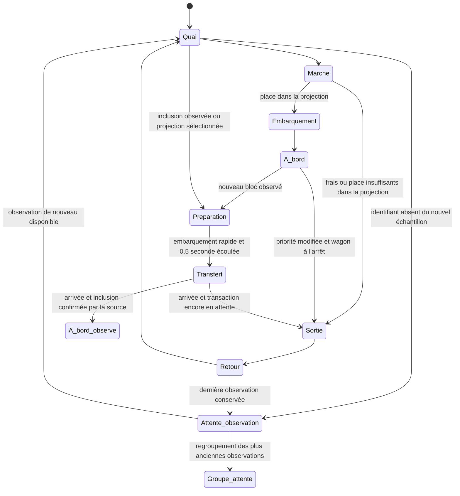

# Voyageurs, wagons et panneau du quai

La scène utilise les transactions validées de la source. Leur statut de réseau et leur état d'animation sont deux données différentes : une transaction peut être **à bord du candidat illustratif** et rester **en attente dans la source**.

## Parcours

Les transactions sont classées selon les frais observés, puis l'identifiant pour stabiliser les égalités. Le candidat possède douze unités **visuelles**. Un voyageur occupe une à trois unités selon ses besoins de ressources : référence de 400 vBytes pour Bitcoin et 100 000 unités de gas pour Ethereum. Le tarif de référence de l'instantané sert de repère pédagogique. Ces règles simplifiées n'intègrent pas les dépendances Bitcoin, les nonces Ethereum, les transactions privées, la sélection des producteurs ni toutes les contraintes du protocole.

Un voyageur moins prioritaire revient au quai et peut réessayer. Un nouvel instantané peut déplacer un voyageur précédemment embarqué si un meilleur candidat occupe le budget illustratif, lorsque le wagon est à l'arrêt. Aucun de ces mouvements n'annonce un rejet du réseau.

## Quai et portes

Chaque rue est verticale. Les wagons partagent une couleur de carrosserie ; le nom du réseau et ses repères orange ou violet identifient la chaîne. Leur position horizontale reste au centre de la chaussée, y compris pendant le transfert vers le bloc observé.

Les voyageurs qui marchent restent sur le quai à droite de la chaussée. L'entrée utilise la porte en haut à droite du wagon ; la sortie utilise une autre porte, en bas à droite. Chaque porte s'ouvre pour le passage correspondant. Les trajets d'approche, de sortie et de retour en file ne traversent pas la route. Seul le passage par la porte rejoint l'intérieur du wagon.

Les portes sont sans marches. Les personnages sont dessinés au-dessus des portes pendant leur passage, pour que leur silhouette reste visible.

Les nouvelles transactions entrent depuis le haut du quai, avec des arrivées décalées, puis rejoignent leur place dans la file. Le wagon observé commence à la coordonnée verticale 175 pour dégager cette zone. Les petites flèches au-dessus des voyageurs indiquent une sortie ou un retour en file illustré ; elles n'indiquent pas une annulation de transaction.

La géométrie de la rue, des wagons, des portes et du quai est partagée dans `src/lib/streetGeometry.ts` entre le moteur de mouvement et le dessin SVG. Cette référence commune permet aux trajets de rejoindre les portes effectivement affichées.

Un voyageur déjà embarqué reste à bord pendant le déplacement du wagon. Une sortie nécessaire attend son arrivée et emprunte alors la porte basse à droite ; les portes restent fermées pendant le trajet. Le changement visuel de wagon n'altère jamais le statut fourni par la source.

## Transfert et statut réseau

Seule la source peut fournir le statut `confirmed`. Un voyageur encore en attente peut rester temporairement dans le véhicule arrivé pour en sortir, sans être présenté comme confirmé. Une disparition de l'échantillon n'est pas une confirmation. Une réorganisation signalée par un nouveau statut en attente remet le voyageur dans le parcours correspondant. Les transferts en direct restent liés au changement du hash du bloc observé.

Le wagon du haut représente le bloc observé ; celui du bas représente le candidat illustratif. Lorsqu'un nouveau bloc est observé en direct, le candidat rejoint la position du wagon observé. Les voyageurs précédemment embarqués restent dans ce transfert, quelle que soit leur priorité actuelle. Après l'arrivée, ceux dont la source confirme l'inclusion restent à bord. Ceux dont la source fournit encore le statut en attente sortent par la porte basse à droite, reviennent en file et peuvent rejoindre le candidat suivant. Le nouveau candidat entre depuis le bas au terme du transfert.

Une transaction absente du nouvel échantillon conserve sa dernière observation et son personnage. Celui-ci reste à bord pendant un déplacement, puis quitte le wagon à l'arrêt par la porte basse et revient dans la file du quai droit. Il y reste en attente visuelle, sans remonter vers la sortie de la scène ni tenter un nouvel embarquement. Son absence ne modifie jamais son statut réseau ; son libellé et une petite horloge précisent qu'il s'agit d'une observation précédente. Les détails courants ne s'ouvrent plus pour cet identifiant. Si la source retrouve une observation encore individualisée, le moteur réutilise son personnage et reprend le parcours approprié.

Jusqu'à 80 anciennes observations peuvent rester individualisées en attente. Au-delà, les plus anciennes déjà immobiles en file rejoignent un groupe à la coordonnée `(360, 686)`, toujours sur le quai droit. Leur silhouette individuelle fusionne avec la représentation du groupe uniquement à son arrivée ; le compteur augmente dans le même état d'affichage. Ce compteur conserve des **observations regroupées**, avec suivi individuel indisponible. Il n'est ni un nombre de transactions uniques, ni un nombre de transactions encore en attente dans le réseau. Il est plafonné à un million, puis affiché comme une borne minimale. Le groupe reste visible sans accumuler une liste illimitée d'identifiants.

Les occupants du wagon observé peuvent se superposer sur les douze emplacements dessinés. Le moteur ne fait pas sortir un voyageur confirmé simplement pour dégager un emplacement visuel. Le budget de douze unités du candidat reste une règle pédagogique indépendante.

Pour Bitcoin, le serveur conserve au plus 120 transactions récemment échantillonnées pendant 30 minutes et vérifie leur identifiant dans le dernier bloc. Cette mémoire volatile aide à retrouver les inclusions ; elle ne représente ni toutes les transactions du bloc ni un suivi historique complet. Une vérification indisponible ne provoque aucune confirmation déduite.

Les occupants du wagon précédent sont conservés dans une représentation visuelle figée pendant son dernier départ, jusqu'à sa sortie de l'écran. Ce groupe historique est limité au plafond de 160 personnages résidents et reste distinct des données courantes et des compteurs du panneau. Il ne devient pas une nouvelle preuve d'inclusion et n'ouvre pas les détails d'une transaction ancienne.

À vitesse normale, le candidat reste à l'arrêt pendant une préparation de 0,5 seconde avant son départ. Les transactions confirmées dans le nouveau bloc, les voyageurs de la projection sélectionnée et les occupants déjà présents rejoignent rapidement le candidat par la porte haute à droite. Les confirmations ne sont fournies que par la source ; les voyageurs encore en attente gardent ce statut pendant ce regroupement. Le wagon précédent reste visible pendant cette attente.

Le transfert du candidat dure ensuite 1,2 seconde. Son remplaçant entre depuis le bas de la scène pendant 0,7 seconde, puis s'arrête au quai. Les portes du candidat restent fermées tant qu'il arrive et les voyageurs attendent pour embarquer. Ces durées suivent la vitesse, la pause et les mouvements réduits.

Aucune minuterie n'invente un transfert de candidat en direct. Le déplacement des wagons suit la même horloge que leurs voyageurs ; les anciens déplacements CSS indépendants ont été retirés. En simulation, les données et les embarquements sont fictifs. Pause, vitesse, onglet masqué et mouvements réduits s'appliquent au wagon et à ses voyageurs.

## Taille des têtes

Seule la tête change d'échelle. Elle dépend d'une courbe logarithmique absolue et bornée entre 0,8 et 1,85. La même transaction conserve sa taille lorsque ses voisins changent. Pour Bitcoin, la ressource est sa taille virtuelle en vBytes ; pour Ethereum, c'est sa **limite de gas déclarée**, pas sa taille en octets ni le gas effectivement consommé.

## Horloge et accessibilité

`src/lib/passengerMotion.ts` est un moteur pur, indépendant du dessin. Chaque réseau possède son instance de `src/hooks/usePassengerMotion.ts`, avec une horloge `requestAnimationFrame`, un rendu à environ 24 images par seconde et un échantillon courant de 80 voyageurs au maximum. Jusqu'à 160 personnages peuvent coexister avec les observations précédentes, avec 80 admissions différées au maximum si cette limite est atteinte et jusqu'à 160 silhouettes historiques pendant le départ du wagon précédent. Le regroupement des anciennes observations en attente libère des places pour les nouvelles arrivées. Les rafraîchissements remplacent le tampon d'admission par les observations actuelles, sans accumuler un historique illimité. Il n'y a pas de saut de temps après pause ou retour d'un onglet masqué. Le décor est mémorisé pour éviter de le recalculer à chaque mouvement.

Pause suspend les voyageurs, les wagons, les signaux et le défilement du panneau. Les mouvements réduits placent les observations actuelles à leur destination illustrative sans trajet animé ; une préparation ou un transfert déjà commencé reste figé avec ses occupants. Les observations précédentes restent visibles pendant cette suspension. Les personnages de l'échantillon courant restent sélectionnables au clavier, y compris dans les wagons. Les confirmations et la fraîcheur affichées gardent la sémantique de la source.

## Panneau d'informations

Le panneau alterne toutes les huit secondes entre Réseau, Bloc et Voyageurs. Une sélection fixe les données actuelles de la transaction ; Échap ou le bouton de libération permet de retrouver le panneau. Les pages restent accessibles manuellement, avec les flèches du clavier. Les détails sélectionnés suivent l'instantané courant et disparaissent lorsque la transaction n'est plus dans l'échantillon disponible.

Les compteurs du panneau concernent les voyageurs de l'échantillon courant. Les observations précédentes conservées en attente restent hors de ces compteurs. Le nombre de transactions du réseau reste distinct, et sa valeur absente est affichée comme non mesurée.

La rubrique « Comprendre » explique pourquoi deux wagons sont représentés : le haut montre un échantillon d'un bloc observé et le bas illustre une projection pour le prochain bloc. Elle décrit aussi l'embarquement rapide, le remplacement du wagon du haut, l'arrivée du candidat vide et la distinction entre mouvement illustré et inclusion fournie par la source. Le panneau du dernier bloc rappelle ces rôles.

## Vue immersive et deux réseaux

Bitcoin et Ethereum restent visibles ensemble. Chaque rue reçoit son propre instantané et conserve son état de connexion, ses frais, ses blocs et son échantillon. Une panne sur une chaîne ne remplace pas les données de l'autre. Les commandes de pause, de vitesse et de mouvements réduits s'appliquent aux deux scènes.

La ville utilise l'espace disponible de la fenêtre ; les détails peuvent être repliés pour libérer la scène. Les deux rues restent côte à côte, y compris sur les petits écrans pour conserver une hauteur utile à chaque scène. Les barres, les métriques et les commandes se compactent selon la largeur et la hauteur disponibles, notamment sur les ordinateurs portables. À 700 pixels de largeur ou moins, le cadrage montre la route et le quai droit en retirant le campus décoratif à gauche. Sur les grands écrans, le panneau de détails utilise le côté gauche disponible pour dégager le quai. Les SVG gardent leurs proportions. Une sélection est identifiée par le réseau et le hash, afin que des identifiants semblables ne mélangent pas les informations des deux chaînes.
