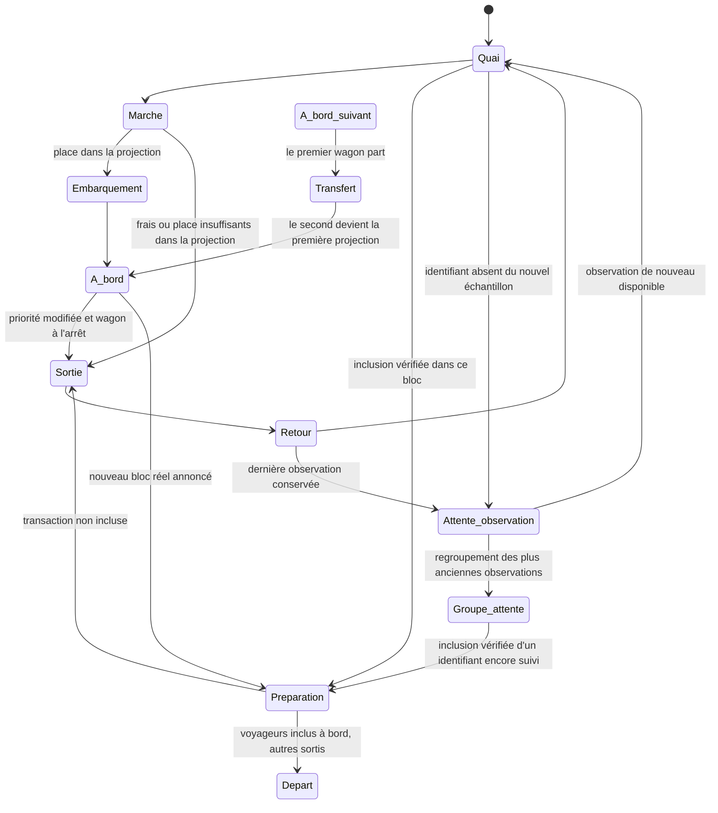

# Voyageurs, wagons et panneau du quai

La scène utilise les transactions validées de la source. Les deux wagons à l'arrêt sont des projections : le haut représente le prochain bloc estimé, le bas le suivant. Une transaction embarquée dans ces projections reste **en attente dans la source**. Le dernier bloc reçu est présenté dans les informations, sans wagon historique permanent.

## Parcours

Les transactions en attente sont classées selon les frais observés, puis l'identifiant pour stabiliser les égalités. Chaque projection possède douze unités **visuelles** : les plus prioritaires remplissent le premier wagon, les suivantes le second, puis la file. Un voyageur occupe une à trois unités selon ses besoins de ressources : référence de 400 vBytes pour Bitcoin et 100 000 unités de gas pour Ethereum. Le tarif de référence de l'instantané sert de repère pédagogique. Ces règles simplifiées n'intègrent pas les dépendances Bitcoin, les nonces Ethereum, les transactions privées, la sélection des producteurs ni toutes les contraintes du protocole.

Un voyageur moins prioritaire revient au quai et peut réessayer. Un nouvel instantané peut déplacer un voyageur précédemment embarqué si un meilleur candidat occupe le budget illustratif, lorsque le wagon est à l'arrêt. Aucun de ces mouvements n'annonce un rejet du réseau.

L'échantillonnage privilégie les frais élevés dès la collecte. Bitcoin lit les transactions du premier bloc projeté de mempool.space par WebSocket, puis retient les meilleurs taux de frais de cette liste ; ce n'est pas un classement exhaustif de tous les mempools. Si cette liste est indisponible, la source annonce explicitement son repli sur les transactions récentes. Ethereum classe les transactions du bloc `pending` disponible par prix effectif du gas avant de limiter l'échantillon. Il s'agit du `pending` du fournisseur, sans mesure d'un mempool mondial. Les preuves d'inclusion restent séparées de cette sélection, même si leurs frais sont faibles.

## Quai et portes

Chaque rue est verticale. Les wagons partagent une couleur de carrosserie ; le nom du réseau et ses repères orange ou violet identifient la chaîne. Leur position horizontale reste au centre de la chaussée, y compris lorsque le second rejoint la place du premier.

Les voyageurs qui marchent restent sur les quais extérieurs : à gauche de la chaussée Bitcoin et à droite de celle d'Ethereum. L'entrée utilise la porte haute du côté du quai ; la sortie utilise une autre porte, en bas du même côté. Chaque porte s'ouvre pour le passage correspondant. Les trajets d'approche, de sortie et de retour en file ne traversent pas la route. Seul le passage par la porte rejoint l'intérieur du wagon.

Les portes sont sans marches. Les personnages sont dessinés au-dessus des portes pendant leur passage, pour que leur silhouette reste visible.

Les nouvelles transactions entrent horizontalement depuis le bord extérieur, à la hauteur de leur place réservée dans la file, avec des arrivées décalées. Elles viennent de la gauche pour Bitcoin et de la droite pour Ethereum. Le moteur utilise une géométrie canonique de quai droit : `arrivalStart(queueIndex)` part au-delà du bord, à `x = SCENE_WIDTH + 28`, sans coordonnée verticale négative ; le rendu Bitcoin applique le miroir horizontal. La première projection commence toujours à la coordonnée verticale 175. Les petites flèches au-dessus des voyageurs indiquent une sortie ou un retour en file illustré ; elles pointent dans la direction du segment réellement parcouru, horizontal ou vertical, avec angle et orientation adaptés au miroir Bitcoin. Les segments nuls sont ignorés. Elles n'indiquent pas une annulation de transaction.

La géométrie de la rue, des wagons, des portes et du quai est partagée dans `src/lib/streetGeometry.ts` entre le moteur de mouvement et le dessin SVG. Cette référence commune permet aux trajets de rejoindre les portes effectivement affichées. Les mêmes transformations de coordonnées sont appliquées aux voyageurs, places, portes et wagons ; les glyphes et textes restent lisibles, sans miroir global de leurs dessins.

La file conserve les places des voyageurs déjà observés, selon leur arrivée dans l'application. Seuls les nouveaux identifiants d'une même collecte sont classés par taux de frais décroissant, avec l'identifiant comme départage stable, pour occuper les places libres restantes. Une actualisation des frais ne déplace pas les personnes déjà placées. Les anciennes places des voyageurs embarqués restent réservées pour un éventuel retour. L'application ne connaît pas l'ordre d'arrivée mondial des transactions ; une première collecte observe un groupe simultané, pas son historique réseau. Un identifiant historique qui revient dans l'échantillon reçoit une place libre dans la file courante.

La tête de file est face à la porte haute, à la coordonnée verticale 239 ; les quatre colonnes se prolongent vers le bas avec un pas de 20. Les positions courantes excédant les 80 emplacements dessinés se superposent de façon répartie sur ces 80 places, sans déplacer les personnages déjà présents. Les anciennes observations sans statut actualisé restent dans la partie basse du quai, hors file courante ; leurs anciens emplacements sont libérés lorsqu'ils ne sont plus réservés pour un passage ou un départ.

Un retour vers une place attribuée ou un déplacement vers les anciennes observations anime une phase `reordering` de 350 à 1 000 millisecondes, toujours par le corridor du quai extérieur. Une arrivée ou un retour finit d'abord son trajet capturé, puis rejoint sa place ; une destination inchangée ne relance pas l'animation. Les voyageurs peuvent se superposer. L'attribution des places dans la file ne réorganise pas les sièges occupés à bord, y compris en mouvement réduit lorsque le wagon reste le même. En mouvement réduit, les places sur le quai sont actualisées statiquement.

Un voyageur déjà embarqué reste à bord pendant le déplacement du wagon. Une sortie nécessaire attend son arrivée et emprunte alors la porte basse du côté du quai ; les portes restent fermées pendant le trajet. Le changement visuel de wagon n'altère jamais le statut fourni par la source.

## Transfert et statut réseau

Seule une preuve de la source peut fournir le statut `confirmed`. Le champ facultatif `Tx.blockHash` précise le bloc dans lequel une inclusion a été vérifiée ; le journal facultatif `Snapshot.inclusions` transmet aussi les identifiants suivis retrouvés dans des blocs intermédiaires. Une ancienne confirmation sans hash reste compatible avec le contrat mais ne suffit pas pour emporter son personnage dans un départ. Le moteur exige `status === 'confirmed'` et `blockHash` égal au hash du bloc annoncé. Une disparition de l'échantillon n'est pas une confirmation.

Lorsqu'un nouveau bloc est reçu, le premier wagon reste au quai le temps d'ajuster son contenu au bloc réel : les inclusions connues embarquent rapidement, les voyageurs non inclus sortent par la porte basse du côté du quai avant le départ et restent dans la file. Seules les inclusions vérifiées partent avec le premier wagon. Le second monte à sa place, en conservant ses voyageurs et leurs statuts en attente. Après son arrêt, les priorités peuvent à nouveau évoluer. Un nouveau second wagon entre ensuite depuis le bas.

Une transaction absente du nouvel échantillon conserve sa dernière observation et son personnage. Celui-ci reste à bord pendant un déplacement, puis quitte le wagon à l'arrêt par la porte basse et revient dans la file du quai extérieur. Il y reste en attente visuelle, sans remonter vers la sortie de la scène ni tenter un nouvel embarquement. Son absence ne modifie jamais son statut réseau ; son libellé et une petite horloge précisent qu'il s'agit d'une observation précédente. Les détails courants ne s'ouvrent plus pour cet identifiant. Si la source retrouve une observation encore individualisée, le moteur réutilise son personnage et reprend le parcours approprié.

Jusqu'à 80 anciennes observations peuvent rester individualisées en attente. Au-delà, les plus anciennes déjà immobiles en file rejoignent un groupe à la coordonnée canonique `(360, 686)`, projetée sur le quai extérieur de leur réseau. Leur silhouette individuelle fusionne avec la représentation du groupe uniquement à son arrivée ; le compteur augmente dans le même état d'affichage. L'archive de la scène conserve jusqu'à **512 identifiants et leurs dernières observations pendant 30 minutes** depuis leur dernière présence dans l'échantillon. Les observations expirées ou évincées par cette borne restent représentées dans un compteur distinct **sans suivi individuel**, dont le statut actuel est inconnu.

Une inclusion vérifiée réserve l'observation encore suivie pour son bloc, sans créer immédiatement un personnage supplémentaire. La réservation conserve l'identifiant dans l'archive, protégée de l'expiration et de l'éviction pendant l'attente du départ ; la borne de 512 identifiants reste applicable. La durée de 30 minutes concerne les observations encore sans preuve, et une réservation peut donc durer davantage pendant une pause ou une file de départs. À la préparation du départ correspondant, l'observation quitte le groupe et réduit son compteur. Le personnage est réadmis depuis la position du groupe, puis rejoint rapidement la porte haute du côté du quai du wagon associé au hash réellement inclus. Les réservations sont libérées après traitement, annulation ou règlement statique en mouvement réduit.

Si une observation suivie revient simplement dans l'échantillon en attente, son personnage est également réutilisé depuis le groupe. Les observations déjà passées dans le compteur sans suivi ne peuvent plus être rapprochées individuellement d'un bloc. Le total du groupe n'est donc ni un nombre de transactions uniques, ni un nombre de transactions encore en attente sur le réseau. Il est plafonné à un million, puis affiché comme une borne minimale.

Les inclusions connues qui embarquent pour le départ réel peuvent se superposer sur les douze emplacements dessinés. La taille de cet échantillon reste bornée et ne représente pas tout le bloc. Les budgets des deux projections restent des règles pédagogiques indépendantes de la capacité du réseau.

Pour chaque chaîne, le serveur conserve au plus **2 048 identifiants observés pendant 30 minutes** et vérifie les blocs nécessaires au suivi. Il conserve un journal roulant de **16 blocs et 2 048 identifiants d'inclusion au total**, séparé de l'échantillon courant de 120 transactions et des trois derniers blocs affichés. Jusqu'à huit blocs peuvent être rattrapés par collecte ; les lacunes non vérifiées restent à réessayer. Cette mémoire volatile aide à retrouver les inclusions, sans représenter tout le réseau ou un historique exhaustif. Une vérification indisponible ne provoque aucune confirmation déduite. Une réorganisation peut invalider une preuve d'inclusion ; inclusion observée et finalité restent distinctes.

La scène conserve une file de **16 départs** afin de traiter plusieurs blocs reçus entre deux rafraîchissements. Le premier chargement initialise les preuves déjà présentes sans faire partir l'ancien journal. Un départ attend une preuve de vérification du bloc ; l'apparition d'un hash seule ne suffit pas à inventer ses passagers. Une preuve complémentaire reçue après un départ peut être illustrée avec le même hash sous le libellé **RATTRAPAGE** : elle ne représente pas un nouveau bloc. Un recul du dernier bloc annule les départs supérieurs encore en file ou en préparation ; les véhicules déjà en mouvement terminent leur trajet. Les bornes du journal, du suivi et de la file peuvent laisser des confirmations non illustrées après une longue interruption, une panne ou une expiration ; l'application ne les déduit jamais de l'absence d'un identifiant.

Les occupants inclus restent visibles avec le premier wagon pendant son départ, jusqu'à sa sortie de l'écran. Ce groupe historique est borné et reste distinct des projections et des compteurs du panneau. Le départ utilise une preuve fournie par la source ; l'animation ne crée aucune preuve supplémentaire.

À vitesse normale, le premier wagon attend une préparation d'au moins **une seconde** avant son départ. Les trajets d'embarquement des inclusions et de sortie des autres voyageurs partagent l'échéance fixée au début de cette préparation. Les sorties accélérées durent au plus **500 ms** ; un voyageur inclus venant du second wagon réserve au plus la moitié du temps restant pour sa sortie, puis utilise le reste pour rejoindre le premier. Une sortie ordinaire déjà engagée est accélérée uniquement si nécessaire, depuis la position courante et sur les segments encore à parcourir, sans redémarrage à chaque image ni retour vers la porte.

Le départ reste conditionné à la présence de toutes les inclusions connues à bord du premier wagon et à la sortie de ses autres occupants. Un passage commencé à l'approche de l'échéance ou après une preuve tardive conserve au moins **50 ms** ; l'arrêt peut donc dépasser une seconde pour terminer les passages. Ces durées suivent l'horloge d'animation, sa vitesse et sa pause, et ne garantissent pas une durée murale exacte. Les voyageurs passent toujours par les portes et le quai extérieur, avant tout déplacement du wagon.

Le second wagon rejoint ensuite la première position en 1,2 seconde. Son remplaçant entre depuis le bas de la scène pendant 0,7 seconde, puis s'arrête au quai. Les portes restent fermées pendant les mouvements. Ces durées suivent la vitesse, la pause et les mouvements réduits.

Aucune minuterie n'invente un transfert de candidat en direct. Le déplacement des wagons suit la même horloge que leurs voyageurs ; les anciens déplacements CSS indépendants ont été retirés. En simulation, les données et les embarquements sont fictifs. Pause, vitesse, onglet masqué et mouvements réduits s'appliquent au wagon et à ses voyageurs.

Les phares avant s'allument dès le début de la préparation, avant le départ, et restent allumés pendant le trajet. Lorsqu'un second wagon rejoint la première position ou qu'un nouveau second arrive du bas, les feux de freinage arrière deviennent rouges pendant les derniers 30 % du mouvement. Ils s'éteignent après l'arrêt ; le wagon qui quitte la scène ne reçoit pas de phase de freinage. Les halos sont des formes SVG et un gradient, sans filtre, clignotement ou horloge supplémentaire. La pause conserve l'état des feux, et les mouvements réduits ne créent aucun trajet pour les allumer. Ces feux illustrent uniquement le mouvement du véhicule.

Le compteur **« Depuis départ »**, dans une ligne fixe sous le grand panneau de chaque en-tête de chaîne, mesure le temps réel écoulé depuis le début du dernier départ animé, après la préparation et les passages par les portes. Il reste visible quelle que soit la rubrique rotative. Il ne part pas de l'heure du bloc ou de la réception de l'instantané. Un départ de rattrapage compte également, même lorsqu'il illustre une preuve complémentaire du même bloc. Une préparation annulée par une réorganisation ne remet pas le compteur à zéro ; un véhicule déjà en mouvement a bien commencé son départ et conserve ce repère.

Le moteur expose un marqueur persistant du départ et le hook le convertit en date locale pour l'interface. Le compteur se rafraîchit à la seconde, séparément de l'horloge d'animation : une pause, la vitesse choisie ou des données devenues anciennes ne changent pas le temps écoulé. Il n'annonce pas chaque seconde aux lecteurs d'écran. Avant le premier départ, la valeur est `—`. En mouvements réduits, les preuves traitées statiquement ne créent aucun départ ; si un départ a déjà été animé, son compteur est conservé. Un état indisponible temporaire conserve ce dernier repère, tandis qu'un rechargement ou un changement direct / démonstration le réinitialise. En démonstration, la mention de simulation reste explicite. Ce temps décrit la scène de cette session, sans indiquer l'âge du bloc, une échéance du prochain bloc ou une preuve supplémentaire de confirmation. Aucune requête ni modification du cache API n'est ajoutée. Ce comportement reste non validé pendant la suspension des contrôles.

## Taille des têtes

Seule la tête change d'échelle. Elle dépend d'une courbe logarithmique absolue et bornée entre 0,8 et 1,85. La même transaction conserve sa taille lorsque ses voisins changent. Pour Bitcoin, la ressource est sa taille virtuelle en vBytes ; pour Ethereum, c'est sa **limite de gas déclarée**, pas sa taille en octets ni le gas effectivement consommé.

## Couleur des t-shirts

La couleur compare le taux de frais de chaque voyageur à la moyenne des transactions **en attente actuellement affichées dans sa chaîne**. La moyenne est calculée séparément pour Bitcoin et Ethereum ; elle exclut les confirmations, les archives et les voyageurs en départ. Ce repère porte sur l'échantillon de la scène, pas sur une moyenne du réseau.

L'interpolation est continue : jaune `#f2d35d` pour des frais faibles, orange `#ef9a42` à la moyenne, rouge `#db4e47` à deux fois la moyenne ou davantage. Une moyenne absente ou nulle et des valeurs invalides donnent l'orange neutre ; zéro face à zéro reste donc orange. Les changements de couleur utilisent une transition de 300 millisecondes, désactivée en mouvement réduit. La couleur ne prouve ni inclusion ni rejet et les frais restent lisibles dans les détails.

## Horloge et accessibilité

`src/lib/passengerMotion.ts` est un moteur pur, indépendant du dessin. Chaque réseau possède son instance de `src/hooks/usePassengerMotion.ts`, avec une horloge `requestAnimationFrame`, un rendu à environ 24 images par seconde et un échantillon courant de 80 voyageurs en attente au maximum. Le fonctionnement normal conserve jusqu'à 160 personnages résidents et 80 admissions différées. Une préparation peut temporairement conserver jusqu'à **912 résidents**, dont jusqu'à **752 inclusions vérifiées** pouvant se superposer sur les emplacements du premier wagon ; ces bornes couvrent les observations résidentes, archivées et différées que le moteur peut retrouver. Elles restent des limites de représentation, pas les tailles réelles des blocs. Le groupe historique en départ est limité à 752 silhouettes et reste distinct des résidents et des compteurs courants.

La préparation réserve des places pour ses inclusions en regroupant au besoin les anciennes observations déjà sur le quai. Les rafraîchissements remplacent le tampon d'admission par les observations actuelles, sans accumuler une liste illimitée. Il n'y a pas de saut de temps après pause ou retour d'un onglet masqué. Le décor est mémorisé pour éviter de le recalculer à chaque mouvement. **Ces nouvelles bornes et leur coût de rendu restent à valider : les tests et les contrôles de compilation sont suspendus à la demande du propriétaire.**

Pause suspend les voyageurs, les wagons, les signaux et le défilement du panneau. Les mouvements réduits traitent les preuves statiquement, sans trajet ni transition de couleur : les transactions en attente rejoignent leurs projections, les inclusions connues conservent leur statut et leur hash vérifiés comme observations sur le quai, et les anciennes observations peuvent rejoindre le groupe collectif. Une preuve retrouvée met aussi à jour un personnage déjà présent. Cette préférence conserve les observations et ne bloque pas indéfiniment une préparation. Les personnages de l'échantillon courant restent sélectionnables au clavier, y compris dans les wagons. Les confirmations et la fraîcheur affichées gardent la sémantique de la source.

## Panneau d'informations

Un grand panneau est visible **en haut de chaque blockchain**, dans son en-tête, sans ouvrir les détails. Il remplace les métriques statiques par cinq rubriques toutes les **quatre secondes** : **Mempool**, **Frais médians**, **Bloc**, **Valeur** et **Voyageurs**, avec une valeur principale écrite en grand. Le même panneau se compacte selon l'espace disponible sur ordinateur, portable ou petit écran. Le décor SVG reste disponible pour la ville et le campus HEG, sans panneau superposé à la chaussée ni aux trajets des quais extérieurs.

Les rubriques se choisissent aussi manuellement, avec une commande de pause du défilement. La rotation s'arrête pendant la pause générale, avec les mouvements réduits, une sélection, un onglet masqué ou une source dont le statut n'est pas valide. Elle reprend sans rattraper plusieurs pages d'un coup. Le délai de quatre secondes concerne la présentation ; les lectures et le cache de l'API blockchain restent à trois secondes. La rotation ne garantit pas une nouvelle observation à chaque page.

Le panneau de détails alterne également toutes les quatre secondes entre Réseau, Bloc et Voyageurs, avec une information principale plus lisible. Une sélection fixe les données actuelles de la transaction ; Échap ou le bouton de libération permet de retrouver le panneau. Les pages restent accessibles manuellement, avec les flèches du clavier. Les détails sélectionnés suivent l'instantané courant et disparaissent lorsque la transaction n'est plus dans l'échantillon disponible. La pause et la préférence de mouvements réduits restent respectées.

La rubrique **Mempool** décrit la vue locale du fournisseur de la chaîne. Pour Bitcoin, le compte provient de mempool.space. Pour Ethereum, le serveur essaie facultativement `txpool_status` et affiche le total `pending + queued`, distinct du seul bloc `pending`. Les deux catégories et l'heure du comptage restent consultables ; une dernière observation conservée est explicitement signalée. Le rafraîchissement Ethereum fonctionne en arrière-plan avec un délai de 30 secondes après chaque tentative, une seule requête simultanée et une rétention maximale de 120 secondes. L'interface évalue cette ancienneté indépendamment de l'heure des blocs : un compte expiré devient non mesuré même si les autres données restent utilisables.

Il ne s'agit ni d'un mempool mondial, ni d'un nœud local sur le Mac, ni du nombre de personnages visibles. Si le fournisseur n'expose pas ce compte, il reste **non mesuré**, sans substitution par zéro ou par la longueur de l'échantillon. Une observation réelle égale à zéro reste, elle, affichable. Les valeurs de démonstration sont présentées comme simulées.

Les frais médians portent seulement sur les transactions en attente de l'échantillon courant privilégiant les frais élevés, jusqu'à 96 candidates par chaîne. Le switch natif / USD change leur présentation ; les réserves concernant la limite de gas Ethereum et le cours reçu restent visibles. La rubrique Bloc décrit le dernier bloc observé, pas un wagon historique permanent. La rubrique Voyageurs décrit les personnages de l'échantillon courant ; les observations précédentes conservées en attente restent hors de ces compteurs. Le compte du mempool fournisseur est une métrique séparée.

La rubrique **Valeur** décrit le bloc complet identifié par son hash, sa hauteur et son nombre de transactions, indépendamment de l'échantillon visible ou du groupe en départ. Le montant natif **BTC ou ETH** reste principal, même lorsque les frais sont en USD ; une conversion `≈` secondaire utilise un cours spot utilisable, avec source et limites explicites, jamais un prix historique du bloc. Un montant non disponible reste non mesuré ; la démonstration ne reçoit aucun total réel fictif.

Bitcoin reprend `totalOutputAmt` des statistiques mempool.space : les sorties de la coinbase sont exclues et la monnaie rendue est incluse. Cette somme ne mesure pas les transferts économiques nets. Ethereum additionne avec `BigInt` les champs `value` déclarés de toutes les transactions du dernier bloc complet, avant limitation de l'échantillon : tokens, transferts internes et frais exclus ; une transaction échouée peut contribuer faute de lecture des reçus. Le contrat facultatif nullable `latestBlockValue` conserve les sommes en chaînes décimales exactes de satoshis ou wei et les rattache au dernier bloc. Les fournisseurs actuels suffisent ; cette mesure n'ajoute aucun service réseau.

Le grand panneau, le défilement à quatre secondes, le total du dernier bloc, la préparation d'une seconde et le nouveau compte Ethereum restent **non validés pendant la suspension des contrôles demandée par le propriétaire**. Lecture statique, formatage et aperçu de remise ne remplacent pas les contrôles décrits dans `docs/validation.md`.

La rubrique « Comprendre » explique pourquoi deux wagons sont représentés : les deux illustrent des blocs à venir, dans l'ordre de priorité. Elle décrit aussi l'ajustement au bloc réel, le départ du premier wagon, la promotion du second et l'arrivée de son remplaçant. Le panneau du dernier bloc distingue les inclusions reçues des projections à l'arrêt.

## Vue immersive et deux réseaux

Bitcoin et Ethereum restent visibles ensemble. Chaque rue reçoit son propre instantané et conserve son état de connexion, ses frais, ses blocs et son échantillon. Une panne sur une chaîne ne remplace pas les données de l'autre. Les commandes de pause, de vitesse et de mouvements réduits s'appliquent aux deux scènes.

La ville utilise toute la largeur disponible du desktop. Une unique colonne de maisons et de bâtiments HEG sépare les chaussées, commune aux deux réseaux. Les deux rues restent côte à côte ; les quais sont symétriques et orientés vers les bords extérieurs. De gauche à droite : **arrivées Bitcoin, file Bitcoin, passage Bitcoin, wagons Bitcoin, maisons communes, wagons Ethereum, passage Ethereum, file Ethereum, arrivées Ethereum**. Les détails peuvent être repliés pour libérer la scène.

Les en-têtes, scènes et pieds de couverture partagent leurs lignes de grille pour conserver l'alignement vertical des deux réseaux. Le campus se compacte, ainsi que les barres et commandes, selon l'espace disponible. Le SVG de chaque rue adapte sa largeur logique au rapport largeur / hauteur du viewport, à partir d'une hauteur de référence de 740 et d'une largeur minimale de 236. L'espace supplémentaire élargit les colonnes du quai après le corridor canonique `x=298`, avec la même projection des coordonnées du moteur et du dessin. Les wagons, glyphes des voyageurs et textes conservent une échelle uniforme ; la ville n'est pas étirée horizontalement en bloc. Le miroir Bitcoin conserve une orientation lisible des textes et des personnages. Une sélection est identifiée par le réseau et le hash, afin que des identifiants semblables ne mélangent pas les informations des deux chaînes.

Cette nouvelle disposition et ses arrivées latérales restent **non validées pendant la suspension des contrôles**. Les résultats historiques des anciennes scènes ne couvrent pas le miroir, le redimensionnement ou les nouveaux trajets.
