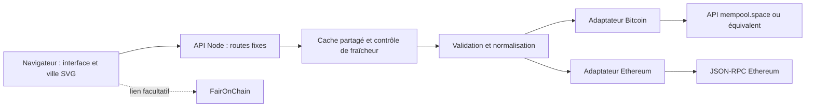

# Architecture et choix durables

## Recommandation

Construire une application web portable : **React + TypeScript + Vite, SVG/CSS pour la scène, petit serveur HTTP Node 24 et adaptateurs de données en lecture seule**. Un seul langage, un contrat explicite et aucun service de stockage pour la version initiale. Le serveur sert les fichiers compilés et l'API sur le même domaine.

TxStreet fournit la référence de métaphore. Son dépôt décrit Vue, Bulma, Phaser, des communications socket.io et un backend distinct historiquement accompagné de nœuds, MongoDB et Redis. Ce projet propose une implémentation originale avec une infrastructure plus petite ; il ne dépend ni du backend ni des ressources TxStreet. [Source : dépôt TxStreet](https://github.com/txstreet/txstreet).

## Options de rendu

| Option             | Atouts                                                                                               | Coût d'entretien                                                        | Décision                                                |
| ------------------ | ---------------------------------------------------------------------------------------------------- | ----------------------------------------------------------------------- | ------------------------------------------------------- |
| SVG/CSS avec React | Dessins nets, éléments inspectables, accessibilité, tests DOM, aucun moteur graphique supplémentaire | Limiter les objets animés et le travail React                           | Retenue pour l'échantillon pédagogique initial          |
| Canvas/PixiJS      | Adapté à des milliers d'objets et effets GPU                                                         | Cycle de rendu, hit testing, accessibilité et tests visuels spécifiques | À introduire seulement après profilage d'un besoin réel |
| Moteur de jeu / 3D | Grande liberté de caméra et de mise en scène                                                         | Assets, GPU, compatibilité mobile et dépendances supplémentaires        | Différé ; aucune nécessité pour comprendre les chaînes  |

Une belle scène ne nécessite pas une transaction visible pour chaque transaction du réseau. Le serveur limite les données et la scène regroupe les voyageurs. Le design privilégie la composition, les couleurs, les détails vectoriels et des mouvements sobres. Le texte et les statistiques restent utilisables lorsque les animations sont en pause ou réduites.

## Flux et responsabilités

- `src/` : interface, scène, textes et personnalisation ; aucune clé ni interprétation brute du RPC.
- `server/` : configuration, HTTP, appels upstream, cache, erreurs et adaptateurs.
- `shared/` : schéma Zod et types du contrat commun.
- Les données de démonstration sont identifiées comme telles et séparées des adaptateurs directs.

Le backend n'accepte aucune méthode blockchain fournie par les visiteurs. Il effectue les appels nécessaires à ses propres adaptateurs. La configuration du fournisseur appartient à l'opérateur. Tous les clients consomment des instantanés normalisés.

## Contrat et nouvelles chaînes

Le schéma partagé est la référence exacte. Un instantané associe une chaîne, une provenance, une date de collecte, un état de fraîcheur, des blocs, des transactions échantillonnées et les métriques disponibles. Les unités et la disponibilité des métriques doivent être explicites ; une absence est distincte de zéro.

Pour ajouter une chaîne :

1. Décrire ses capacités : vue des transactions en attente, unités de frais, blocs, finalité et limites du fournisseur.
2. Étendre le registre de chaînes et le schéma commun si nécessaire, sans changer implicitement les unités existantes.
3. Créer un adaptateur qui valide les réponses externes puis les normalise ; limiter les données à la frontière serveur.
4. Fournir des fixtures valides, invalides, incomplètes et en panne. Tester la provenance et la distinction attente / confirmation.
5. Ajouter les textes pédagogiques, la couleur et les liens d'explorateur. Réutiliser la scène ; ne pas lui faire interpréter le RPC.
6. Vérifier l'affichage d'une métrique absente et le retour arrière de version. Documenter le fournisseur retenu.

## Ce que signifie « direct »

**Bitcoin.** Les blocs et le mempool proviennent du fournisseur configuré. Le mempool est une vue observée, et la scène un échantillon. Le minage fournit un rythme moyen, pas une heure de départ garantie ; ne pas afficher un compte à rebours exact du prochain bloc. [Source : protocole et difficulté Bitcoin](https://developer.bitcoin.org/devguide/block_chain.html).

**Ethereum.** `eth_getBlockByNumber` accepte notamment `latest` et `pending`. L'adaptateur essaie les données en attente disponibles puis présente les transactions du dernier bloc avec leur état confirmé si le fournisseur ne fournit pas de vue exploitable. Ce repli reste une donnée réelle, avec une sémantique différente et annoncée. [Source : API JSON-RPC](https://ethereum.org/developers/docs/apis/json-rpc/).

Un slot Ethereum dure actuellement 12 secondes ; un slot peut manquer et ne garantit ni inclusion ni finalité. La vue en attente d'un fournisseur est locale et exclut potentiellement des flux privés. La version initiale n'annonce pas une mesure de mempool global. [Source : consensus Ethereum](https://ethereum.org/developers/docs/consensus-mechanisms/pos/).

Le cache serveur évite un appel upstream par visiteur : fenêtre de 10 secondes, une récupération en cours partagée, timeout de 8 secondes, réponse limitée à 2 MiB, jusqu'à 120 transactions et 3 blocs par chaîne. Une réponse récente peut être signalée comme ancienne jusqu'à 120 secondes ; après, l'API annonce l'indisponibilité. Le client actualise toutes les 10 secondes en direct et toutes les 5 secondes en démonstration. Ces limites doivent être modifiées avec leurs tests et leur documentation.

## Fournisseurs ou nœuds propres

| Approche                  | Avantages                                                 | Contraintes                                                                  | Usage proposé                                               |
| ------------------------- | --------------------------------------------------------- | ---------------------------------------------------------------------------- | ----------------------------------------------------------- |
| API publiques partagées   | Mise en route rapide, pas de nœud à gérer                 | Quotas, disponibilité variable, fonctionnalités partielles, aucun SLA local  | Première version et validation pédagogique                  |
| Fournisseur dédié         | Quota explicite, support et options de flux selon contrat | Budget, confidentialité, dépendance commerciale                              | Application publique avec trafic et disponibilité attendus  |
| Nœuds administrés par HEG | Contrôle de la provenance et de la politique de collecte  | Stockage, synchronisation, sécurité, supervision et expertise d'exploitation | Recherche ou autonomie lorsqu'une équipe peut les exploiter |

Un nœud propre observe lui aussi un mempool local. Aucun prestataire ne rend automatiquement exhaustive la connaissance des transactions privées. Pour le choix du fournisseur, vérifier le support `pending`, les quotas, l'emplacement des données, les règles d'utilisation et la rotation des clés. Ne pas figer des prix ou des promesses fournisseur dans le code.

## Hébergement et évolution

| Option                                          | Coût opérationnel relatif                          | Portabilité          | Condition                                                                    |
| ----------------------------------------------- | -------------------------------------------------- | -------------------- | ---------------------------------------------------------------------------- |
| Serveur Linux + conteneur + reverse proxy HTTPS | Faible infrastructure, administration à assurer    | Très bonne           | Recommandation avec un opérateur identifié                                   |
| Plateforme de conteneurs gérée                  | Moins d'administration système, budget fournisseur | Bonne avec image OCI | Vérifier accès sortant, secrets, processus actif, journaux et retour arrière |
| Infrastructure HEG                              | Selon les services déjà disponibles                | Très bonne           | Confirmer domaine, responsable, réseau sortant et sauvegardes                |

L'état du cache est volatile ; un redémarrage demande un nouvel instantané. Cela évite une base de données inutile. Ajouter SQLite ou un stockage d'historique seulement si des analyses historiques, exports ou travaux de recherche le nécessitent. Ajouter un cache distribué uniquement si plusieurs instances doivent partager le budget d'appels ; actuellement chaque processus possède son propre cache.

La publication doit avoir un domaine HTTPS, des limites au reverse proxy, une surveillance de santé et de fraîcheur des sources, un accès opérateur et une image précédente conservée. Le conteneur portable facilite une migration d'hébergeur. Aucune publication automatique n'est activée.

## HEG et FairOnChain

`src/config/brand.ts` centralise les paramètres de marque. La proposition de design HEG n'est pas une certification institutionnelle. Remplacer les textes ou intégrer un logo officiel après validation des droits et de la charte.

Le lien FairOnChain est optionnel et désactivé par défaut. Il ouvre une ressource externe ; aucun appel vers ce service n'est nécessaire à l'application. Une future intégration devra rester derrière une capacité facultative avec validation de données et état d'indisponibilité indépendant.

## Décisions initiales — 14 octobre 2026

- Retenir SVG et un échantillon limité pour réduire l'entretien et garder une interface accessible.
- Garder un backend HTTP natif et un contrat Zod, sans framework serveur, base ou broker initial.
- Démarrer sur des sources publiques remplaçables, en rendant leurs limites visibles.
- Conserver les clés et les appels fournisseur côté serveur.
- Séparer la démonstration des données directes et conserver la distinction Ethereum attente / confirmation.
- Préparer CI, Dependabot et maintenance Codex ; garder la revue et la livraison sous contrôle humain.
