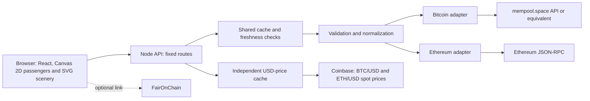

# Architecture and durable choices

## Recommendation

Build a portable web application: **React + TypeScript + Vite, native Canvas 2D for individual passengers and SVG/CSS for scenery, a small Node 24 HTTP server and read-only data adapters**. One language, an explicit contract and no storage service for the initial version. The server serves built files and the API on the same domain.

TxStreet supplies the metaphor reference. Its repository describes Vue, Bulma, Phaser, socket.io communication and a separate backend historically accompanied by nodes, MongoDB and Redis. This project proposes an original implementation with smaller infrastructure; it depends on neither TxStreet's backend nor its resources. [Source: TxStreet repository](https://github.com/txstreet/txstreet).

## French/English interface and English documentation — decision of 16 October 2026

Repository documentation is maintained in English. The interface supports French and English through a small React context and typed translation catalogs/pairs, without a new internationalization dependency. On first use, browser preferences from `navigator.languages` determine the supported language; English is the fallback. An explicit selection is persisted locally and takes priority on later visits. Controls, accessible labels, status explanations and number/date formatting use the selected locale.

Language changes affect presentation only. They do not modify provider data, units, sources, observation timestamps, inclusion evidence, fee ordering or capacity calculations. They must not restart the motion engine, replay departures, clear a selection, change timing or create network requests. Typed call sites require both French and English strings, and locale values are limited to `fr` and `en`. Branding and optional FairOnChain access remain independent of language.

## Individual Bitcoin arrivals — decision of 16 October 2026

The owner requests identified Bitcoin passengers at the ordinary entrance instead of a “+X outside the sample” group. The shared connection switches from `track-mempool-txids` to `track-mempool` and receives `mempool-transactions.added` objects, without a new connection or per-hash HTTP enrichment. `server/bitcoinLiveArrivals.ts` retains only metadata needed for a pending `Tx`: valid identifier, own fee in integer satoshis and exact virtual size. For a complete object, `weight / 4` preserves quarter-byte increments; compact-object `vsize` is also accepted. No effective package rate, acceleration, amount, script or additional classification is used.

The reserve retains at most **384 details** in observed receipt order, newest first. Updating a retained ID creates no new arrival and does not change its rank. The latest validated consecutive delta, even empty, dates the group's observed continuity; this date does not certify each transaction's first broadcast. TTL is **sixty seconds** from that delta, without renewal on read. At browser expiry, details supported exclusively by the stream leave the active selection; the engine retains their avatars and last details as historical observations within existing budgets. A confirmation or still-fresh independent RPC-presence or GBT-membership evidence preserves the corresponding detail. Disconnection, loading or sequence discontinuity resets the reserve; removals/mining/replacements remove metadata without creating confirmation. Validation bounds a delta's total work to 20,000 useful identifiers/objects, and an error clears the reserve rather than publishing partial details.

Selection prioritizes these arrivals, then fills remaining places from the GBT/pool/projection/recent base selection: **at most 384 within 1,920, not 1,920 + 384**. Duplicates occupy one place; an incomplete reserve leaves room available. The base selection can already mix candidate and independent RPC inventory; its final share shrinks if needed to accommodate arrivals. This mixed selection is neither a global fee ranking nor guaranteed boarding in the GBT candidate. An already represented transaction retains its identity; another displaced detail may become historical under the existing limits of 1,920 historical observations and 3,840 ordinary residents.

`Snapshot.bitcoinArrivals` exposes only a sanitized source, `mempool-transactions` method, independent timestamp and up to 384 pending identifiers actually present in the response. Source and clock remain independent of the RPC inventory; an arrival is not artificially added to its presence list. Confirmations still come from block verification. Bitcoin removes its ordinary lateral collective and brings these passengers in from the side; the upper late-inclusion network station and Ethereum behavior remain separate and unchanged. No service, persistent storage, dependency or new character limit is added.

Sources: [WebSocket documentation](https://mempool.space/docs/api/websocket), [complete-delta types](https://github.com/mempool/mempool/blob/master/backend/src/mempool.interfaces.ts#L97-L103), [added emission and removal](https://github.com/mempool/mempool/blob/master/backend/src/api/websocket-handler.ts#L663-L668), [official compaction](https://github.com/mempool/mempool/blob/master/backend/src/api/common.ts#L749-L758). Checks and one-off observations remain recorded in [validation.md](validation.md), without a provider-availability commitment.

## Shared event streams — decision of 16 October 2026

The owner approves more regular arrival tracking. A small internal Node 24 module uses native WebSocket, without another package or external service: one connection per chain per instance, shared between visitors. URLs remain server-side WSS configuration, with WS permitted only on loopback. Public streams are enabled by default only while the associated HTTP provider remains the intended one; a custom HTTP provider requires its own explicit event URL. Source labels are sanitized and independent of block sources. Test-injected transports and providers open no public connection.

Bitcoin now tracks mempool.space `track-mempool`; the first stage's identifier-only stream is replaced with `mempool-transactions`. The first sequence number establishes a baseline, and only consecutive advances open a measured period. A gap, rollback or backend loading interrupts the period; no missed history is replayed. This sequence is specific to mempool.space, separate from Bitcoin Core `mempool_sequence`. Only addition notifications feed the counter; neither removals nor the mined field replace existing block evidence. Ethereum validates mainnet and subscription acknowledgement before counting `newPendingTransactions` notifications. A queued-to-pending promotion or re-emission may be observed: this counter does not mean first arrivals in a worldwide mempool. Bitcoin retains only the compact reserve above; no individual HTTP call enriches notifications.

Optional `eventFlow` remains separate from `poolFlow`, which still requires complete inventories. Its independent timestamp may be later than block data: attaching recent flow does not renew the blockchain observation. Each period has an opaque numeric epoch, initialized from a random 48-bit seed to distinguish process restarts, and disabled, connecting, warming, live, interrupted or limited states. Batches publish at most every three seconds against the first publication's pending selection; outside-sample counts are then frozen. A current reader retains at most twelve points ending within the last sixty seconds. A read interrupted for more than fifteen seconds recreates a baseline and discards the visual backlog without redating the last network message. No transaction or subscription identifier leaves this context.

Private identifiers and the current batch are bounded to 20,000; deduplication slides over sixty seconds. A Bitcoin message is limited to two MiB to accept a large block's removals/mining; an Ethereum message is limited to 256 KiB because the subscription requests hashes only. Each network remains limited to one hundred messages per second and eight MiB per minute, with budgets retained across reconnections. An attempt has eight seconds to establish, silence interrupts after thirty seconds, and one minute without a read closes the connection. Reconnection uses exponential backoff capped at thirty seconds. Old-connection callbacks are ignored and HTTP shutdown disposes transports. The message limit is checked on receipt through the native WebSocket API; this API cannot cap its internal buffer before delivering the message.

The panel prefers valid event flow and announces its mode; a complete periodic observation remains a clearly named fallback. The lateral collective remains on Ethereum; Bitcoin replaces it with its real-arrival reserve. Zero means only no distinct notification received in the covered period, never an absence of worldwide activity. Interruptions, limits and expired data do not fabricate throughput. The 1,920 pending-detail limit and native capacities remain unchanged; integrating Bitcoin arrivals turns no notification into confirmation. Pause, hidden tabs and reduced motion remain respected.

Sources: [mempool.space protocol](https://mempool.space/docs/api/websocket), [official handler and sequences](https://github.com/mempool/mempool/blob/master/backend/src/api/websocket-handler.ts), [Geth subscriptions and recovery limits](https://geth.ethereum.org/docs/interacting-with-geth/rpc/pubsub), [Geth full-notification support](https://github.com/ethereum/go-ethereum/blob/master/eth/filters/api.go), [Ethereum PublicNode](https://ethereum.publicnode.com/). One-off probes and implementation checks are in [validation.md](validation.md); they constitute no provider-availability commitment.

## Observed inventory flow — decision of 16 October 2026

To make activity visible despite a stable detail sample, adapters compare identifiers from two complete inventories already collected. Bitcoin uses `getrawmempool` only after reconciling all required details; Ethereum uses the union of `pending` and `queued` from validated `txpool_content`. A queued-to-pending promotion therefore does not count as a new entry. This flow is not the pool-size net change: entries and disappearances are separate set differences. Disappearance proves neither inclusion nor abandonment, and a reappearing identifier may count again as an entry.

The private tracker retains the preceding inventory and, temporarily, only the latest interval's new identifiers, within existing limits of 100,000 Bitcoin and 50,000 Ethereum transactions. It publishes at most twelve points ending in the last sixty seconds. The outside-sample count is calculated against the final pending selection at that interval's first publication, including the GBT mixture, then frozen; details may subsequently change without replaying the counter. Older intervals never published keep this partition unknown. No flow identifier is sent to the browser.

The first success and any recovery after error, backward clock, branch reset or interval over ninety seconds establish a new baseline, without an initial burst or invented zero. The flow's independent timestamp is never renewed by a cache read or new block alone. The HTTP cache and interface remove flow after ninety seconds; stale data remains labeled before that limit. An ordinary Ethereum head change does not reset inventory measurement, which is independent of the next-block estimate.

In this first inventory stage, the upper board receives a Flow section with interval, average rate and small chart; one bounded collective SVG group signals outside-sample entries at the ordinary outer edge. The Bitcoin evolution above later replaces its lateral collective with real individual details; Ethereum retains this group. The decorative group, exceptionally animated at the owner's request, creates no individual passenger DOM, identity, fee, resource or wagon place. Its short CSS animation respects pause, visibility and reduced motion; individuals remain in Canvas on the engine clock. Intervals already received at load are not replayed.

This approach retains existing cadences, RPCs and budgets without another dependency, database or service. It measures the provider's view between observations: transient transactions can be missed, and continuity of that local view matters, particularly behind an endpoint distributed across nodes. It establishes neither worldwide flow, first broadcast nor private block construction. Event flow and the individual Bitcoin reserve have the separate decisions above.

## Spreading network arrivals — decision of 16 October 2026

New passengers with exact known inclusion share a stable rank within their admission cohort. Four canonical lanes (`y=140,122,104,86`) fan out after clearing the station at `x=410`, then meet corridor `x=298` and the upper door. The central route and geometry of already-known people remain unchanged. Lanes sit above the active queue and cross neither waiting places nor roadway. Existing mirroring and projection apply to paths and trails.

Appearance spacing is bounded to 36 ms and the total window to 480 ms or forty percent of remaining walking time, whichever is smaller. Calculation uses the absolute preparation deadline: `duration = deadline - phaseStartedAt`, avoiding a fractional-offset rounding error that delays departure by one frame. Phases already underway are not rescheduled when an addition arrives. The door retains the maximum opening needed by passages; clock, pause, visibility and reduced motion remain shared.

This spreading uses only individually detailed, proven transactions. It increases no sample or budget and creates no per-passenger DOM element, new loop, API field, dependency or provider call. Very dense populations may still overlap; the collective addition without details remains separate.

## Contract and resource readability — decision of 16 October 2026

The `contract` accessory uses cyan with an outline and two dark marks, independent of fee-related torso color. It retains one small reused image per renderer. Head size switches to an absolute logarithmic curve bounded between 0.8 and 2.5; the engine and Canvas share these bounds. Mapping is `1 + 0.5 × log2(size / reference)`, with references of 250 vB and 21,000 gas, followed by clamping and defensive handling of invalid sizes. This emphasizes presentation without reordering the queue or seats or changing reserved resources.

The selection target and stationary-cache envelope cover the largest heads and their hair; vehicle clipping and overlap order still apply. Object, pixel, dimension and surface limits remain unchanged. No API field, provider, service, dependency or new animation loop is added.

## Preparation duration per chain — decision of 16 October 2026

At the owner's request, `preparationDurationMs(chain)` sets the minimum before movement to **3,000 ms for Bitcoin** and **1,500 ms for Ethereum**. Remaining-time calculation, visible progress and departure threshold use the same duration. The delay begins after receipt of the block and its evidence; additions identified before the deadline join the current departure without restarting its counter or replaying a block. Known passages must finish before any movement, even at the deadline.

This visual window changes neither finality, collection, the three-second cache nor wagon movement durations. It follows speed, pause and visibility; reduced motion still consumes evidence without replaying a route. Network signal and door retain their usual 320 ms margins before walking, reduced only when remaining time is short. No service, dependency, route or API contract is added.

## Outside-sample origin of the received block — decision of 16 October 2026

The owner wants transactions discovered at the last moment in a received block to be visible. An SVG landmark per platform represents the rest of the network outside the sample. Its canonical geometry and exit point are shared with the engine and mirrored for Bitcoin. Individuals remain drawn in Canvas 2D and available through the existing HTML browser.

The landmark then becomes a compact portal at the upper outer edge, illustrated by connected nodes and equipped with a door. The active queue moves down, and late inclusions follow a dedicated upper route to the corridor: they use neither a queue place nor the ordinary outer-edge arrival. Portal SVG width is capped without changing the exit point shared with Canvas. Numeric door progress comes from the engine clock and participates in the hook's visible-frame comparison; no interval, CSS loop or request is added. Opening before walking and closing after clearance remain inside existing preparation. Reduced motion handles evidence without replaying the door.

Geometry `v20` retains an exit at `(447, 116)` and vestibule at `y=140`, then reaches corridor `x=298`. The nine active rows start at `y=200`, spaced by 35; three historical rows retain forty-unit spacing. Door-opening time before walking is taken from travel time without extending the chain's planned preparation duration. The character remains stationary without gait during opening. Closing waits for doorway clearance; simultaneous passages share the maximum opening needed.

Network lighting comes from an internal indicator of actual use of this passage, retained in the engine's visible frame. It is not inferred from a passenger's old arrival kind alone or block metadata without individual details. A fixed SVG halo and body/node colors follow this indicator, without a blur filter, pulse or additional clock.

The network passage uses the preparation clock: a 120 ms light signal, door open 200 ms before walking (eighty milliseconds opening then 120 ms waiting), a 150 ms hold after clearance and eighty milliseconds closing. Margins scale down with remaining preparation time. A new character waits behind the door at zero opacity until its route begins; no known resident is hidden. The pose cache accounts for this visibility boundary even when progress is still zero. This sequence adds no wall-clock delay or new loop; it fits within the chain's planned preparation time.

Trails are reserved for current network exits: preparation, identified inclusion and this passage's own opening wait, then actual exterior walking. An old arrival kind alone is insufficient, and ordinary transactions are unaffected. Points come from the already-traveled part of the current path, over at most 110 units and eight points, without retained position history, per-passenger bitmap or timer. Turns remain those of the route; the scene projects the same coordinates as characters, and Canvas also enforces a 110-unit limit after projection to avoid an oversized desktop effect. One translucent stroke, without per-person gradient or blur, stays below the character. The renderer also rejects trails unrelated to a confirmed network passage. Trails are absent at rest, aboard and during the pre-opening wait. They use the same mirroring and clipping as the character without changing hit testing, selection or block resources. Stationary-group and departure caches remain applicable.

Only the transaction-browser button is rendered through a React portal in an explicit host within its chain header. The host sits in the existing departure-time line: no additional bar or height is reserved in the scene. The dialog, its state, focus references and shortcuts remain in the Canvas component. This placement prevents box overlap without moving passenger geometry.

The engine internally distinguishes initial stock, new observation and late-discovered inclusion. It captures genuinely unknown identifiers before reconciling residents, admissions and archives, avoiding artificial provenance changes for an admission consumed between steps. This information follows queued departures; merging remains bounded by transactions retained in the departure cohort. Only confirmed details linked to the exact block hash can trigger network origin. A hash alone does not fabricate details, and already-known objects retain their existing routes. Doors and movement protections remain intact; preparation durations are defined separately per chain.

A pure reader separately calculates the received block's collective remainder: complete transaction count, minus Bitcoin coinbase, minus unique identifiers confirmed in that same block and represented anywhere in the scene. A missing or contradictory count produces no remainder. The SVG pattern and badge add no individual object, fee, identity or keyboard entry. They remain distinct from the complete Bitcoin candidate, which proves no inclusion. This decision changes representation semantics without changing the shared contract, adapters, RPCs, cadences, native capacities, Canvas budgets or individual bounds. No additional service, storage or dependency.

The remainder is reserved for the first passage of a new block. Catch-up departures, already labeled as such by the engine, retain only their proven individuals; they do not replay the same block's complete collective.

## Current sample raised to 1,920 — decision of 16 October 2026

The owner requests more passengers after rendering optimizations. The current limit rises from 960 to **1,920 pending transactions per chain**, with 24 separate confirmations and a **1,944-object** response. Historical retention becomes an independent shared constant, kept at **1,920 individuals**: it does not double with the sample. The ordinary limit therefore reaches **3,840 residents**, with 1,920 deferred admissions and a 512-identifier archive. Native block capacities and the 96 visual places do not change.

The same limit feeds highest-fee selections, demonstration and engine guards. Bitcoin reserves **384 details outside the candidate** when the independent inventory is usable, or more if the candidate supplies fewer than 1,536 details; an unfilled reserve creates no character. The REST `/mempool/recent` reader retains its 1,000-entry bound; a smaller source stays smaller. The demonstration produces 1,920 pending and twelve simulated confirmations, or 1,932 objects per chain.

Server tracking remains bounded to **4,096 identifiers** for thirty minutes; its journal retains at most sixteen blocks and 4,096 total inclusion identifiers. Transit may retain old IDs plus 1,920 arrivals, or **6,016 IDs**, then returns to 4,096 before publication. A departure cohort remains bounded by 3,840 residents, 512 archived IDs and 1,920 admissions, or **6,272 inclusions**; preparation may temporarily retain **10,112 residents**. This representation bound does not guarantee server knowledge of every inclusion in a block.

The extension retains network caches, cadences, durations, Canvas surfaces, transport limits, RPCs and receipt budgets. No extra call, service or dependency is added. Maximum sorting and drawing work increases; checks and measurements specific to this size are in [validation.md](validation.md). The local benchmark accepts `--sample-size 960` and `--sample-size 1920` on one build; its default follows the current limit and historical retention remains independent. Decisions dated 15 October below retain historical figures; the current-bounds table is authoritative.

## Reusing stationary drawings — 16 October 2026

The loaded benchmark's browser profile attributes most work to the Canvas renderer: the same arms, legs and silhouettes are redrawn while another passenger moves. The existing departure cache remains useful but does not cover stationary platform passengers or stationary wagons. Reproducible measurements and limitations are in [validation.md](validation.md).

The renderer now retains images of **contiguous** segments of at least eight strictly stationary passengers. It waits for two identical drawings before allocating a surface, avoiding rasterization on each change in a walker's depth order. Each segment keeps its position in draw order, with existing group clips and offsets. The cache includes selection and hover rings; hit testing remains individual. Pose references, colors, interaction, clips, offsets, mirroring, projection and density determine reuse. Logical origins and dimensions follow the physical-pixel grid, including fractional densities.

The additional reserve is bounded to **1,000,000 RGBA pixels, sixteen surfaces and 2,048 pixels per dimension per renderer**, at most four MB of pixels per street, independently of already-bounded glyphs and departure cache. No per-transaction bitmap is retained. Removed, resized or disposed surfaces release their backing stores. Refused allocations are not retried every frame for the same signature; an oversized or over-budget segment continues individual drawing. Passenger and main-surface limits remain unchanged.

Two smaller reuses reduce repeated calculations: a `WeakMap` retains normalized membership for an immutable Bitcoin-candidate object; a weak passenger-collection cache avoids realigning an already-stable queue with the same layout and count. Instant alignment and `reordering` phases, dependent on clock and proximity threshold, remain outside this cache. A new collection or layout is reassessed. These choices redate no data and change neither selection, capacity, arrival order, routes, evidence nor durations.

`scripts/benchmark-scene.ts` uses already-installed development tools without an additional dependency, service or product parameter. It does not change application runtime; `scripts` is included in TypeScript checking to catch future contract drift. CPU profiling attributes cost; before/after comparisons use unprofiled passes and actually observed durations. Mobile emulation on the Mac is not measurement on a physical phone, and rAF intervals are not screen FPS.

## Ethereum nonce dependencies — 15 October 2026

Fee ranking may select a transaction while leaving its cheaper predecessor outside the 960 animated details. The scene must preserve this constraint without inventing a character or assuming nonce availability. The adapter reuses the already-validated complete `txpool_content` to return optional compact `ethereumDependencies`, tied to parent hash, next height and the pool's own timestamp. It adds no `eth_getTransactionCount`, receipt or other RPC call. Pool reads, cadence and the 50,000-entry bound remain unchanged.

Edges concern the immediately preceding nonce of the same sender. A pending parent must be admitted before its child; a queued parent, known gap or disappeared old parent holds the child. A gap requires a lower nonce actually present in the compatible pool; an old confirmed nonce or the child's queued category alone is insufficient. A same-nonce replacement updates the expected identifier without confirming the old one. Exact inclusion-journal evidence can resolve the parent; neither a higher nonce nor absence proves inclusion. Nonce zero is a known root. For a first pending nonce above zero with no predecessor ever observed, selection may remain estimated with explicit uncertainty: systematically blocking these transactions would turn missing knowledge into an established missing nonce.

Retained children and parents share the 4,096-identifier tracking limit and thirty-minute retention. Expiry of an old parent identifier preserves an unknown marker on the still-tracked child instead of releasing it. Public context expires after sixty seconds independently of blockchain details; an incompatible head or reorganization invalidates resolutions. Without a usable complete pool, context remains absent and the engine preserves known resident constraints. Original timestamps remain separate from interface refreshes. Tracking stays volatile and provider-local without another database, service or dependency.

Reasons appear in existing accessible information, including a transaction admitted with an unobserved predecessor. Character limits, native capacity, doors and movement protection remain intact. This graph improves estimation; it neither reproduces a validator's private builder, measures the account's canonical nonce nor guarantees inclusion or finality. Sources: [Geth local pool, accounts and nonces](https://geth.ethereum.org/docs/interacting-with-geth/rpc/ns-txpool), [Ethereum transaction structure](https://ethereum.org/developers/docs/transactions/).

## Comparing the Bitcoin candidate with the received block — 15 October 2026

The comparison uses the last complete candidate actually published against the old head and the block succeeding it. The server retains private identifiers; it does not reconstruct comparison from 960 animated details or 4,096 tracked identifiers. On first detecting a new head, it freezes the candidate only if height and parent explicitly match and the observation is at most thirty seconds old. A candidate received after detection never replaces this reference. “Before the block” means before application detection, not proof of production time.

Complete block identifiers are already retrieved and validated for inclusion tracking: uniqueness, format, count matching the block count and consistent parent. The first coinbase transaction is excluded. Intersection yields `commonCount`, candidate-only members yield `candidateOnlyCount`, and block-only members yield `blockOnlyCount`. Both sums must reconstruct the compared totals exactly. Public output contains only these aggregates and provenance; no additional complete list or raw data is sent to the browser.

Only the latest published candidate and the candidate frozen for the current head are retained, at most two sets of 30,000 identifiers. A transaction-read error leaves the frozen reference available for up to thirty minutes to retry through existing inclusion collection. A head change, reorganization, absent or mismatched parent, over-age candidate or incomplete list produces no misleading comparison. Output concerns only `blocks[0]`; another head removes it. Restart does not reconstruct an unobserved candidate.

`Snapshot.candidateComparison` is optional and nullable, reserved for available or stale live Bitcoin data. Demonstration invents no real comparison. A stale result retains timestamps, then is removed with the snapshot after 120 seconds without valid data. The Comparison section and Block detail show complete non-coinbase coverage, height, both sources and available timestamps. The main proportion is the candidate share found in this block, without predictive promise; an empty candidate has no percentage.

The candidate comes from an observed node distinct from the block producer. Planned transactions absent from this block may still be present, replaced or no longer observed; comparison does not decide current state. It changes neither character status nor routes and supplies no finality proof. No network call, service, dependency, collection timer or Canvas capacity is added. Sources: [GBT non-coinbase content](https://bitcoincore.org/en/doc/30.0.0/rpc/mining/getblocktemplate/), [Esplora complete identifier list](https://github.com/Blockstream/esplora/blob/master/API.md#get-blockhashtxids), [Bitcoin block transaction ordering](https://developer.bitcoin.org/reference/block_chain.html).

## Consistent statuses and platform zones — 15 October 2026

`src/lib/passengerStatus.ts` supplies classification shared by descriptions, HTML browser, panel and queue engine. Known inclusion takes priority; then come pending presence, queued presence, absence from the latest complete observation or candidate replacement, then source observation or unknown status. Verified presence retains its current group even when individual details are old. The presence observation's date is separate from detail date. Absence or replacement is never confirmation.

Geometry `v19` reserves nine active rows (`y=160…480`) and three historical rows (`y=560…640`) on the same adaptive columns `x=318…408`. Free places and overlaps are allocated independently per zone. Only platform passengers change zone; aboard passengers are not moved by this classification. Recovered presence or usable candidacy allows routes to resume through platform and doors. The “Observations” scenery is separate from the collective archive and anonymous Bitcoin-candidate group.

Each chain's browser searches a case-insensitive literal hash fragment, limited to 128 characters and combinable with an exclusive group: All, Present, Deferred, Historical or Included. It consults only represented interactive characters, not the network. A filter keeps selection if still matching, otherwise chooses the first result or disables details when no result exists. It hides no Canvas character and changes no admission, status or request. Collective groups lacking identifiers do not become fictitious options.

## Continuity of the observed mempool — 15 October 2026

The optional complete inventory and Bitcoin candidate are maintained independently. GBT retains priority for the first wagon; up to 192 of 960 details are reserved for transactions outside the RPC-index candidate, or more if the candidate supplies fewer than 768 details. The count and `sampling` describe the RPC index when available, with its timestamp and source; blocks and recommendations still come from REST. These observations may differ in time and are neither atomic nor worldwide. Extra RPC collection retains existing limits and caches without traversing the whole index on every client request. An RPC error or incremental-addition budget overflow forces a complete baseline at the next thirty-second cycle; no second attempt is added to the current cycle. Explicit refusal of incremental methods (numeric codes -32601/-32602) suspends this mode for five minutes. Full reconstruction transfers more data; size and time limits remain mandatory.

`poolObservation` attests only pending presence, queued presence or tracked-ID absence in a validated complete inventory. The three lists are disjoint, normalized and jointly bounded to 4,096 IDs. Absence proves neither inclusion nor replacement. The client expires this evidence after sixty seconds, even while a request is suspended. Individual details retain their own date, and recent GBT candidacy may reactivate an ID whose details are over thirty minutes old. Retained characters separately display detail age, presence and waiting reason.

Ethereum supplies `ethereumProjection`, tied to parent and next height, with exact next base fee calculated in wei according to [EIP-1559](https://eips.ethereum.org/EIPS/eip-1559). A pending candidate is used only if consistent with that reference. Projection expires after thirty seconds. Known caps are no longer reassessed against the latest block's base fee when this next reference is unavailable; waiting then becomes explicitly unknown. Optional `Tx.ethereum` metadata retains account, nonce and exact caps; still-known candidate predecessors and newer same-nonce alternatives can therefore be distinguished without claiming to reconstruct every builder choice. Predecessors outside this selection and complete account state are not reconstructed. `Tx.size` remains declared gas limit, never gas actually consumed.

Initial stock is already positioned on the platform; new-observation delays are limited to 1.5 seconds per cohort. Speed affects only movement. Rendering remains Canvas 2D with SVG scenery and unchanged budgets, without another database or service. Sequence tests and results are recorded in `docs/validation.md`.

## Node-proposed Bitcoin candidate — decision of 15 October 2026

The `getblocktemplate` candidate becomes Bitcoin's priority source. It represents a selection actually calculated by the configured RPC node without presenting it as a certain future block or proof that a mining pool is mining it. The vehicle metaphor remains inspired by [TxStreet](https://github.com/txstreet/txstreet), with an original scene; provenance and confirmations belong to BlockLane adapters. Fallback remains **complete RPC pool → mempool.space projection → recent transactions**. Live responses are never silently replaced with demonstration.

One reader per instance runs background `getblockchaininfo` checks (`main`, initial synchronization finished), then `getblocktemplate` with the `segwit` rule. Calls, validation and ranking share a **total eight-second budget**, with **16 MiB maximum** for GBT and **30,000 transactions**. It permits only one in-flight collection, separates attempts by at least **fifteen seconds after completion**, and keeps a candidate usable for **thirty seconds after receipt**. The reader is independent of the optional complete pool and does not block the blockchain response. It reuses `BITCOIN_RPC_URL`, disabled with an empty value, without a new route, key, environment variable, dependency, node to operate or durable storage.

The reader validates RPC envelopes, hexadecimal formats and identifier uniqueness, integer fees, BIP141 weights, dependency indices pointing to earlier transactions and cumulative bounds. Repeated parents are accepted: Bitcoin Core adds one reference per input spending their outputs without requiring deduplication. Witness hash is compared with the data's double SHA256; SegWit `txid` remains provider-declared. This does not reproduce a consensus or script validator. Raw data is discarded after validation. The highest **960 own-fee rates per `weight / 4`** among candidate members are compared exactly before rounding; this sorting may omit parents and does not return a directly mineable CPFP package.

`Snapshot.blockTemplate` is optional nullable and separate from `sampling`, which may simultaneously describe the RPC inventory. It exposes source, independent timestamp, height, parent, complete **non-coinbase** count and weight sum, weight limit, proposed-fee median, then at most **4,096 selected identifiers**: candidate intersection with known IDs and up to 960 current IDs, the latter prioritized. The server compares height and parent with the REST head before activating this source. Reorganization, another head, failure or expired timestamp removes priority; if inclusion catch-up outlasts validity, one fallback collection follows without returning the expired candidate. Consumers must account for candidate age even in a retained snapshot.

While stationary, the first Bitcoin wagon represents the **complete candidate**: count from `transactionCount`, size from `weight / 4` in vB and percentage from `100 × weight / weightLimit`. Known members keep individual characters; others become an explicitly announced static SVG group. One repeated pattern and rectangle avoid an avatar or DOM element per extra transaction. The group counts `transactionCount` minus unique `pending` member identifiers actually represented in the scene, including platform or arrivals: boarding therefore does not change the total. It invents no identifier, individual fee, value, status or transaction-browser entry. Example: 5,000 transactions, 3,992,000 WU and 960 individual members give **5,000 TX · 99.8%**, with **4,040 grouped**. The second wagon remains an estimated sample projection.

`medianFeeSats` is calculated with `BigInt` over integer fees of **all candidate non-coinbase transactions**, before selecting 960 details. Averaging the central two values may give half a satoshi; zero is valid, an empty candidate has no median. This optional field preserves compatibility with older responses: without it, the interface returns to the estimated sample median and says so. The complete median remains proposed fees, neither a mempool median nor confirmed fees. No additional call is needed.

The group is removed as soon as departure preparation begins, during movement, on fallback or candidate expiry. Projection counts then return to sampled scope; during a real departure, percentage describes the complete verified block and TX count only included tracked passengers. The anonymous group never becomes a confirmed cohort. Proposed membership supplies neither `Tx.blockHash` nor the inclusion journal. Exact real-block evidence retains priority over any estimate and triggers departure under existing rules. Mempool count retains its independent source: available complete RPC observation, otherwise REST. Candidate-member count does not replace it. Bounds of **2,880 residents, 1,920 historical observations, 960 current transactions and 984 objects per response** remain unchanged, as do Canvas surfaces.

This choice adds optional bounded network, hashing and ranking costs, without a smoothness measurement or provider-availability commitment. Checks are recorded separately in [validation.md](validation.md). Sources: [Bitcoin Core GBT RPC](https://bitcoincore.org/en/doc/30.0.0/rpc/mining/getblocktemplate/), [miner template customization](https://developer.bitcoin.org/devguide/mining.html#getblocktemplate-rpc), [BIP141](https://github.com/bitcoin/bips/blob/master/bip-0141.mediawiki#block-size), [Bitcoin Core 30 dependency construction](https://github.com/bitcoin/bitcoin/blob/v30.0/src/rpc/mining.cpp#L850-L856).

## Current bounds — 1,920 current transactions and 1,920 historical observations per chain

Since 16 October 2026 the shared contract accepts **1,944 transactions**: 1,920 candidates and 24 separately reserved confirmations. The historical reserve of **1,920 observations** is fixed independently of the current limit. A smaller observation remains smaller; live mode receives no fictitious additions. Demonstration produces 1,920 pending transactions and twelve fictitious confirmations, or 1,932 per chain, with a separate simulated pool count (4,320 Bitcoin, 3,840 Ethereum).

| Bounded object per chain           | Current limit                              | Meaning                                                                   |
| ---------------------------------- | ------------------------------------------ | ------------------------------------------------------------------------- |
| Response transactions              | 1,944                                      | Up to 1,920 pending and 24 confirmations                                  |
| Active queue                       | 1 to 64 columns × 9 rows                   | Free places before overlap in the active zone                             |
| Historical platform zone           | 1 to 64 columns × 3 rows                   | Free places before overlap in the historical zone                         |
| Ordinary residents                 | 3,840                                      | `1,920 + 1,920`, sample and retained observations                         |
| Deferred admissions                | 1,920                                      | Await room in the representation                                          |
| Individual historical observations | 1,920                                      | Count bound; candidacy expiry is separate from visual presence            |
| Tracked presentation archive       | 512                                        | Unchanged bound and thirty-minute delay for observations without evidence |
| Departure cohort                   | 6,272                                      | `3,840 + 512 + 1,920`, verified inclusions that may overlap               |
| Residents during preparation       | 10,112                                     | `3,840 + 6,272`, temporary maximum                                        |
| Server-tracked identifiers         | 4,096                                      | For thirty minutes after their last observation                           |
| Transient server tracking          | 6,016                                      | `4,096 + 1,920`, verification before eviction then return to 4,096        |
| Inclusion journal                  | Sixteen blocks and 4,096 total identifiers | Separate from the 1,944 current transactions                              |
| Canvas appearance cache            | 8,192 hashes                               | Appearance metadata only, without larger surfaces                         |

Geometry `v19` retains `v18` adaptive columns and separates active from historical places. Native block capacities and percentages remain unchanged: Bitcoin vBytes against 1,000,000 vBytes; Ethereum declared gas limits against observed `gasLimit`. The wagon's 96 places remain visual only; a larger sample creates no room in a block. Observed arrival order in the queue and assignments of already-boarded passengers remain intact under the stability rules below.

The three-second API cache, animation cadence, one-second preparation, durations, eight-block catch-up, upstream transport/object limits, optional pool collection and Canvas texture/surface limits remain unchanged. No provider call, pagination, service or dependency is added. Maximum ranking and rendering cost increases; no measured performance gain or smoothness level is claimed. Checks for this extension and their limitations are recorded in [validation.md](validation.md).

Dated decisions below preserve the limits in force when implemented. This table and current-contract sections take precedence for replaced limits; historical validation status does not describe the current campaign.

## Free queue places — 15 October 2026

`createQueueLayout(projectionScale)` calculates the queue grid and passes it to the engine so drawing and movement destinations use the same places. It covers `x=318…408` before projection, with nine active rows `y=160…480` and three historical rows `y=560…640`, spaced by forty units. Column count targets displayed horizontal spacing of at least 32 units and remains bounded from one to 64; the default canonical grid has 27 active and nine historical places. These are visual places, unrelated to mempool or block capacity.

Known-present passengers and historical observations use two distinct zones; each allocates free places before overlap. Passengers aboard or walking toward a wagon no longer reserve their old place. Already-valid positions remain; free places serve newcomers and returns before overlap when the grid is full. Already-overlapping passengers can occupy released places without reordering others. Disappearance from the latest sample retains details and directs passengers lacking known current presence to the historical zone; it supplies no confirmation.

`reflowPassengerQueue` reassigns destinations when column count changes and routes reordering through the platform. It preserves clock, transactions, observation dates and vehicles. The hook applies the new layout before publishing the scene, including reduced motion; no collection or extra animation loop is added. Pause rules, inclusion evidence and native capacities remain independent of this grid. Targeted scenarios and overall limitations are recorded in [validation.md](validation.md).

## Inspecting historical passengers — 15 October 2026

Individual passengers retained outside the sample remain selectable by pointer and in the HTML browser. Hit testing retains transformations, clipping and departure-cohort exclusions; absent `sourceObserved` means historical provenance without removing interaction. Tooltip and list share the panel's presence status: recently attested pending or queued presence remains current despite old details; without attestation, status remains unknown. Color still represents known fees without promising current priority. The label also explains waiting for an Ethereum transaction currently observed below base fee or without available/known projection capacity.

The panel resolves selection through current transaction, then exact journal inclusion, resident observation and finally the last selected transaction. This final reference is unique and released by existing controls; it extends neither archive nor server tracking. An absent observation without evidence remains historical: its last state is not presented as current mempool state. The displayed date, when available, comes from engine `lastObservedAt`, never click time. Selection causes no provider call, date refresh, boarding or confirmation. A reobserved transaction or received evidence takes priority at the next update. Collective groups without individual data stay decorative.

## Late inclusions and data replay — 15 October 2026

A verified inclusion must not become a pending observation again after departure. The engine distinguishes already-scheduled receipts from still-active cohorts: these finish preparation and travel, then residents, deferred admissions and archives identified by the evidence are removed. In reduced motion, the same evidence is consumed statically instead of restoring the passenger to the platform. Initial receipts also prevent contradictory `pending` responses from creating an already-included character. Protection remains bounded to 32 retained receipts; a contradicted hash at the same height or a backward latest-block movement removes incompatible receipts and permits a new pending observation after reorganization. Absence without evidence remains unknown.

Ethereum retains recent-block identifiers under a total bound of 65,536, independently of sixteen block metadata entries. New candidates are matched against these identifiers before limiting and admission, even if not tracked at the block's first read. Still-tracked observations lacking inclusion also receive targeted background verification: at most sixteen identifiers per pass, two in parallel, at least fifteen seconds after the previous pass finishes and at least sixty seconds between attempts for the same identifier. Still-present candidates become eligible after thirty seconds; absent ones can qualify sooner. Network time adds to these delays, which do not guarantee checking each observation before expiry.

A receipt must carry the correct identifier, valid block hash and height, and not exceed the observed head. A block freshly read by number must confirm height, hash and identifier presence. Failed execution remains inclusion; a null, invalid, inconsistent or failed response remains without evidence. Verification shares existing transport bounds and does not block the main collection. A branch change invalidates in-flight results. Results replay in `Snapshot.inclusions`, with the same sixteen-block and 4,096-identifier bounds; new nonempty proofs have priority so an old inclusion can reach the browser. No new endpoint, dependency or visitor-requested inventory is added.

Tracking remains volatile and limited to 4,096 identifiers for thirty minutes after last observation. An old character kept only in the browser after server restart cannot be reconciled until that server reobserves its identifier. The interface then keeps status unknown. Sources: [Ethereum JSON-RPC receipts](https://ethereum.org/developers/docs/apis/json-rpc/#eth_gettransactionreceipt), [blocks by number](https://ethereum.org/developers/docs/apis/json-rpc/#eth_getblockbynumber). Controlled fixtures and live observations are recorded separately in [validation.md](validation.md).

## Rendering options

| Option                            | Benefits                                                               | Maintenance cost                                                              | Decision                                                         |
| --------------------------------- | ---------------------------------------------------------------------- | ----------------------------------------------------------------------------- | ---------------------------------------------------------------- |
| SVG/CSS with React                | Sharp drawings, inspectable elements, native accessibility             | DOM and reconciliation cost for many passengers                               | Retained for wagons, scenery, text and collective groups         |
| Native Canvas 2D                  | One raster drawing per street, reusable prepared images, no dependency | Clipping, pointer selection and keyboard access must be maintained explicitly | Chosen for individuals on 15 October 2026 at the owner's request |
| PixiJS or another graphics engine | More elaborate effects and graphics management                         | Another dependency and render cycle                                           | Deferred; no additional concrete need                            |
| Game engine / 3D                  | Extensive camera and staging freedom                                   | Extra assets, GPU needs, mobile compatibility and dependencies                | Deferred; unnecessary for understanding chains                   |

An attractive scene does not require one visible transaction for every network transaction. The server limits data and the scene groups passengers. Design favors composition, colors, vector details and restrained movement. Text and statistics remain usable when animation is paused or reduced.

### Rendering decision of 15 October 2026

The owner requests migration to Canvas 2D after noticing slowdown with the expanded sample. The decision reduces individual DOM elements without reducing the then-current sample of 240 passengers or projections' 48 units. The expansion to 480 passengers has a separate decision below. This choice is explicit; it is not a profiling conclusion and no measured gain is claimed.

React retains panels, controls, details and selection data. Each street receives a transparent Canvas for individual passengers. Wagons, doors, lights, text, houses and static collective groups remain SVG. A bounded small-surface cache prepares heads, torsos and icons; limbs and selection follow poses. T-shirt color applies directly on each observation without the old 300 ms CSS transition. The painter consumes existing updates and adds no animation loop, graphics engine, dependency or service.

The pure engine remains rendering-independent. The painter reproduces `viewBox`, platform projection, Bitcoin mirror, wagon positions and interior/door clipping. Hit testing uses inverse transforms and the same clips in drawing depth order; a hidden occupant does not become a target through bodywork. Historical departure cohorts remain non-interactive. Keyboard selection uses a native HTML browser per street, with transaction choice, detail opening, Escape and focus management, instead of an SVG element or button per avatar. Unavailable Canvas displays an explanation while retaining HTML controls.

Pixel ratio is capped at two. Each main Canvas is bounded to four million pixels and 8,192 pixels per dimension, adapting to viewport and cleaning up size observers and events. Small cached surfaces are also bounded: twelve head variants, 256 torso colors and four icons, at four pixels per scene unit. The appearance cache now retains at most 8,192 hashes per street; surfaces release on unmount. Migration preserves resident/archive limits, inclusion evidence, minimum one-second preparation, four-second panels and three-second blockchain cache. It remains unvalidated during suspended checks; old DOM tests based on SVG characters must be adapted when authorized validation resumes.

Existing reuse still applies: stationary poses, platform projections, fee labels, shared bounded number formatters and weak-reference transaction caches. Native medians depend on the snapshot while price and pool ages are still assessed separately. Scene and campus are memoized with stable selection controls; count publication to the interface is spaced by at least 250 ms without changing movement cadence of roughly 24 frames per second. No profiling or cost/benefit measurement is performed.

The engine retains unchanged character and collection references, with `WeakMap` caches for path geometry, transaction appearance and poses. Segment lengths and directions are calculated once per immutable path; the archive table is copied only on change. The hook compares actually drawn information before publishing React state while advancing its internal clock for deadlines and admissions. It cancels its `requestAnimationFrame` loop when the document becomes hidden and restarts with a fresh time reference on return. Limits, evidence, reservations, doors, last-departure marker, pause and reduced motion remain independent of reuse; no cache becomes a blockchain-data source.

`src/hooks/useSourceFreshness.ts` retains age safeguards despite memoization: a one-off delay wakes display beyond five minutes for a usable USD price, then at thirty-second stale and 120-second expiry thresholds for the Ethereum count. States are reread on return to a visible tab after the deadline. Each delay and listener is cleaned up when deadlines change or the component disappears, without an interval or new collection. Panels and scene invalidate USD labels on expiry; the application recalculates usable counts and the collective queue's shared scale even when the API is waiting and characters stationary.

Characters absent from the new sample remain visually waiting on the platform with their last observation, without being declared still pending on the network. At this rendering decision's date the engine retained at most 1,920 residents and 960 deferred admissions per chain; current bounds replace these historical limits. Up to 960 stationary older observations stay individual; further ones join a collective representation. A client-side archive retains up to 512 identifiers for thirty minutes after last presence in the sample. Expired or evicted observations remain in a counter without individual tracking, separate from still-tracked identifiers. The total represents neither unique transactions nor a current mempool.

Recovered evidence reserves the tracked archive identifier until preparation of its departure. Reservation is protected from expiry and eviction, possibly beyond thirty minutes during pause or a departure queue, within the same 512-identifier bound; retention time concerns observations still without evidence. At preparation, the character is readmitted from the group's position and its count falls. A sixteen-departure queue handles intermediate blocks; initial loading does not replay the old journal. Evidence received after its block's departure carries the CATCH-UP label. At this historical stage, temporary preparation limits were 5,312 residents and 3,392 overlapping inclusions; checks and limits are recorded in [validation.md](validation.md). Reduced mode marks evidence statically and retains observations. Reservations release after processing, cancellation or static settlement. This memory remains volatile without another storage service.

## Lighter departures — decision of 15 October 2026

The owner requests lighter wagon departures after expansion to 480 pending passengers per chain. The painter reuses an image of the complete cohort aboard the first wagon: once occupants and clipping are drawn, the route moves this image instead of redrawing each avatar in every frame. Bodywork, doors, lights and rear count remain SVG. Platform and promoting-wagon passengers retain individual rendering; the departing group remains non-interactive.

The cache contains at most one extra surface per renderer, thus per street: **one million pixels**, **2,048 pixels per dimension** and maximum density of **four pixels per logical unit**. Density adapts to drawing scale and pixel ratio, then decreases to respect bounds. This budget is separate from the main Canvas's four million pixels and existing small glyph caches. Identity of the drawn cohort, its appearance/projection, shared clips, mirror and density trigger rebuilding; vertical translation does not invalidate it. The first drawing without a departure and unmounting release the surface. If creation fails, every occupant remains individually drawn; failure is remembered to avoid reallocation every frame with unchanged inputs.

The departure cohort is exposed separately from still-active passengers. It reuses a stable collection while projected poses and colors do not change; USD labels are not constructed because the cohort is not selectable. The rear counter also reuses its count while its cohort is identical.

In the engine, `WeakMap` caches reuse inclusion indices and identifier sets for immutable residents and cohorts. Arrays and objects copy only when admission or a real change requires it; an admission impossible for lack of room retains existing references. Interpolated positions are calculated only for transitions using them. The departure cohort extracts poses only for its occupants without building a complete presentation state. Three preparation passes and their order remain unchanged; the final check requiring every included passenger aboard and others outside the first wagon is assessed only after the minimum preparation second, then continues to govern every departure. Reuse creates no evidence and changes neither bounds nor movement conditions.

This cache changes neither identifiers nor inclusion evidence. Limits of 480 current passengers, 48 units per projection, 1,952 departure inclusions and 2,912 preparation residents remain. Minimum one-second preparation, departure and promotion in 1.2 seconds, then replacement arrival in 0.7 seconds at normal speed retain their conditions. No dependency, animation loop, request or contract change is added. The change targets repeated work; no profiling, benchmark or measured benefit yet establishes its effect. It remains unvalidated during suspended checks.

## Sample doubled to 480 — historical decision of 15 October 2026

This first expansion's limits are replaced by the current-bounds table near the beginning of this document.

After individual passengers migrate to Canvas 2D, the owner requests more represented transactions. Scene and adapters move from 240 to **480 pending transactions per chain**; the shared contract now accepts **504 transactions**, with 24 separately reserved confirmations. Selection continues to favor high fees in the provider's available view and may be smaller; no fictitious data is added to live mode. Demonstration produces 480 pending transactions and twelve simulated confirmations per chain, or 492 transactions. The median covers all valid pending transactions received without claiming network representativeness.

The queue has sixteen columns and thirty rows spaced vertically by fourteen, from `y=239` to `y=645`, between canonical `x=318` and `x=408`. Columns share the same horizontal space as before and may overlap; current places stay stable during new collections. Historical indices start at 960. Bitcoin mirroring, desktop projection, routes and each wagon's 48 units remain unchanged.

The engine bounds ordinary residents to 960, deferred admissions to 480 and individual older observations to 480. The archive retains 512: a departure may illustrate at most **1,952 inclusions** (`960 + 512 + 480`) and preparation at most **2,912 residents** (`960 + 1,952`). These limits coordinate data and representation; they describe neither real block size nor a complete mempool.

Server tracking retains its durable 2,048-identifier limit for thirty minutes; its transient maximum becomes **2,528** (`2,048 + 480`) before verification and eviction. The journal's sixteen blocks, 2,048 total proofs, eight-block catch-up, shared three-second cache, delays and network limits remain unchanged. Canvas caches and surface bounds remain unchanged. Expansion reuses existing responses without another request, dependency or service. It raises work and memory limits; no measured smoothness or capacity gain is claimed. Tests and checks remain suspended at the owner's request: new bounds, rendering cost and contract effects remain unvalidated.

## 96-unit capacity and wagon counter — decision of 15 October 2026

This initial decision is retained as history. Its illustrative budget and percentage are replaced by the native-resource decision below; only the 96-place grid remains in effect.

At the owner's request to increase characters per wagon, each of the two projections' budgets rises from 48 to **96 illustrative units**. The shared geometry's `WAGON_SEAT_COUNT` constant sets both the 96 drawn places and engine `CANDIDATE_CAPACITY`. The grid has eight columns and twelve rows: columns share the interval from `WAGON_X + 17.5` to `WAGON_X + 66.5`; rows remain `y=80` to `y=179` in nine-unit steps. Wagon size, doors, clipping and routes remain unchanged; characters may overlap more. Geometry version moves from `v14` to `v15`.

A passenger retains a cost of one to three units; 96 units permit at most 96 one-unit passengers without promising 96 transactions for every size distribution. Verified inclusions prepared for departure may exceed this grid and overlap within existing representation bounds. The sample remains 480 current passengers, with 960 ordinary residents, 1,952 departure inclusions and 2,912 preparation residents. The archive and departure Canvas cache bounded to one million pixels per street remain; no measured capacity or performance improvement is claimed. Previous rendering/expansion decisions above retain their then-current capacities.

The rear `N TX · P %` plate counts unique identifiers actually represented aboard, including cohorts captured for departure or promotion. Percentage is the rounded integer `100 × sum of resourceUnits of unique IDs aboard / CANDIDATE_CAPACITY`, a 96-unit budget. It excludes places reserved outside the vehicle, is zero percent when empty and may exceed one hundred percent when verified inclusions overlap beyond this budget. Both values follow the same cohort and vehicle transform, with readable text in Bitcoin mirroring. Its tooltip and accessible label distinguish passenger count, illustrative units and overflow from a real block's total or network fill rate. The current 480-passenger sample, archives, server tracking, contracts, calls, caches and durations remain unchanged. No service or dependency is added. Capacity and plate remain unvalidated during suspended checks; tests and fixtures based on the old budget must be adapted when authorized validation resumes.

## Native capacity and block occupancy — decision of 15 October 2026

The owner requests percentage based on transaction size versus available block room. The 96-unit budget therefore no longer drives admission or the counter. The 96 places in eight columns and twelve rows remain a presentation grid, with overlap when necessary. Characters per wagon now depend on admissible native sizes and the bounded sample, without an artificial 96-transaction limit.

`src/lib/blockCapacity.ts` centralizes `capacityForSnapshot`, `transactionBlockSize`, `blockUsagePercent` and `wagonBlockOccupancy`. The engine exposes nullable `candidateCapacity`, native-resource `used` reservations and the complete `departingBlock` tied to departure/catch-up hash. Geometry moves to `v16`. Planning retains fee-rate sorting and snapshot reference threshold, then sums `Tx.size` to reserve capacity in two successive projections; zero or invalid size is not admitted. Bitcoin size is vBytes with a **1,000,000-vByte** budget, equivalent to the 4,000,000 weight-unit limit. Ethereum `Tx.size` is the **declared gas limit**, compared with the latest observed block's `gasLimit`. This sum is a conservative estimate: actual consumption can be lower and the next block's budget can change. No Ethereum capacity is inferred from the visual grid or fallback constant; without a source value it stays unavailable. Bitcoin dependencies, Ethereum nonces, private channels, blob resources and producer choices remain outside this educational projection. Sources: [BIP 141, weight and virtual size](https://github.com/bitcoin/bips/blob/master/bip-0141.mediawiki), [Ethereum blocks, `gas_used` and `gas_limit`](https://ethereum.org/developers/docs/blocks/).

The rear plate distinguishes two scopes. At rest, `N TX · ≈P %` counts unique represented identifiers aboard and divides their summed native sizes by projection capacity. Passengers still traveling reserve size in the plan but stay outside percentage until boarding. From first-wagon preparation through departure, percentage uses **the entire verified block**: `100 × Block.used / Block.capacity`. The block stays with its departure event and hash; intermediate blocks also come from `Snapshot.inclusions`. Receiving a newer block does not replace that reference. `N TX` continues counting only visible sample passengers, not the block total. Tooltip and accessible label explain these scopes and projected declared gas versus observed consumed gas. Absence gives `—`, without invented zero or capacity; an expected block lacking metadata does not fall back to characters' gas-limit sum. Display uses one decimal, two below one percent, and `<0.01%` for smaller positive values. Projection footers show reserved resources and percentages in vBytes or gas, with sum and capacity in the tooltip, without `/96`.

The correction reuses existing `Tx.size`, `Block.used`, `Block.capacity` and journal blocks. It adds no Ethereum receipt, request, dependency or service. The 480 current passengers, 960 ordinary residents, 1,952 departure inclusions, 2,912 preparation residents, archive, departure Canvas cache, durations and three-second API cache remain bounded as before. Tests and checks remain suspended at the owner's request: this new semantics is unvalidated and cannot rely on historical results for illustrative budgets.

## Stability of boarded passengers — decision of 15 October 2026

The Bitcoin recommendation remains an indicator and is no longer a wagon-admission threshold. Ethereum reassesses available exact caps with the next projection's base fee and respects known nonce order; partial coverage remains an estimate. Ranking takes current candidates' native resources and those of retained observations previously aboard. It preserves existing assignments and seats when all candidates fit, then fills remaining room. If allocation exceeds budgets, it reselects by descending fee rate across both native capacities. A fee change alone therefore no longer triggers a free transfer between vehicles.

Absence from a partial sample no longer forces an aboard passenger to leave. The engine may retain at most 1,920 `pending` observations that have reached a projection's interior, for less than thirty minutes since `lastObservedAt`. A per-resident boolean records first boarding, including reduced motion, and survives exit or return to the platform. The same bounded filter feeds refreshes and post-departure recalculation: temporary exit no longer removes candidacy; retained passengers may reboard through the door after stopping if native resources and Ethereum base fee permit. A reservation remains active during return and queue repositioning. Their `presentInSample` stays false, timestamps do not refresh, and the clock identifies historical observation. They count toward reservations and actually represented occupancy, but not current mempool metrics or fee median. An observation lost before reaching the wagon does not gain this candidacy. The count bound or expiry releases a place through the door, then retains the passenger on the platform or archive; this establishes no network removal. Already-started grouping is not canceled by this memory, and consumed inclusions retain priority over old `pending` data.

Second-wagon promotion recalculates reservations at its new position. Reduced motion also retains eligible observations aboard. Doors, the no-exit-during-movement rule, minimum preparation second and exact-evidence departures still apply: first-wagon occupants without verified inclusion leave before departure. This correction preserved the then-current bounds; the next expansion raised ordinary residents to 1,920 and deferred admissions to 960, with cohort bounds described near the document's beginning and the same Canvas surfaces. No API-contract, geometry, dependency or collection change is added. Targeted tests and limitations of earlier suites are recorded in [validation.md](validation.md).

## Mempool ranking and updates — decision of 15 October 2026

The owner authorizes a local trial of ranking over the provider's complete mempool, then asks to load it once and retrieve only arrivals afterward. The decision retains **optional background collection**, without turning the scene into an exhaustive inventory or adding a service, dependency or durable storage. Only up to the 960 highest native rates, counts and observation time are transmitted to visitors; complete RPC responses are not.

As fallback to the prioritized GBT candidate, **Bitcoin** uses server-configured `BITCOIN_RPC_URL`, defaulting to Bitcoin PublicNode and disabled with an empty value. Initial `getrawmempool(true)` is accompanied by `getblockchaininfo`, mainnet and completed initial-synchronization checks. The server retains a compact table bounded to **100,000 entries**. Each update requests `getrawmempool(false, true)`, a validated inventory/sequence under **eight MiB**, removes disappeared IDs and requests `getmempoolentry` only for newcomers: at most **500 additions per cycle**, batches of **25**, at most two concurrent with **128 KiB per response**, in a **total eight-second budget for the entire Bitcoin cycle**. A complete baseline is reread after **ten minutes**. Reconciliation failure removes the public complete ranking and triggers explicit fallback. Network, HTTP, RPC, timeout or size errors retain only the previous private index until its ten-minute deadline for retry without a complete redownload; partial metadata from the attempt is discarded. Invalid data, wrong network, baseline error, inconsistent clock or expiry clears the index and requires a full load next time. Base fees per `weight / 4` are compared exactly without CPFP packages, fee adjustments or node-policy-adjusted `vsize`. Represented block size separately uses `weight / 4`.

This Bitcoin strategy reduces redownloaded metadata but still rereads all identifiers to detect removals. Observation results from successive calls rather than an atomic snapshot; an entry disappearing during its read cannot become invented metadata. Pool removal never proves confirmation. mempool.space retains blocks, recommended fees, evidence and fallbacks: combined provenance is stated, and complete-ranking count comes from the same RPC observation and its timestamp. Another provider's counter never replaces that count.

**Ethereum** continues `txpool_content` on its existing RPC after network/latest-block validation under a **50,000-entry `pending + queued`** limit. It retains compact pending candidates for at most thirty seconds to rerank against the new base fee; `queued` remains excluded from wagons. Effective prices are compared exactly in wei, but neither nonce dependencies nor producer choices promise upcoming inclusions. `Snapshot.mempool` counts remain separate and derive from `txpool_status` at their own date.

The PublicNode RPC accepted creation, empty read and deletion of an arrival filter during a one-off trial. This mechanism supplies no complete removals, evictions or `queued` journal and therefore cannot maintain the complete ranking alone. Prioritizing an honest ranking leads to **retaining complete Ethereum reads**. Future incremental collection requires reconciliation, recovery after stream loss and handling of providers distributing requests among nodes; an arrival-only stream is insufficient.

Each complete-pool reader retains one in-flight collection shared among visitors, **at least thirty seconds after completion** and **thirty-second complete-ranking validity from observation**. Blockchain response does not wait for this capability and keeps its three-second cache. A dedicated transport, eight seconds per request and **32 MiB** maximum, protects these reads without raising the ordinary two-MiB bound; all calls and processing within a Bitcoin cycle additionally share the total budget above. Bitcoin waits thirty seconds after failure; Ethereum sixty seconds, or five minutes after RPC refusal. Over-limit results are never truncated and then called complete. No endpoint lets a visitor select the upstream destination.

Optional nullable `Snapshot.sampling` carries method, sanitized source, timestamp and observation counts; Bitcoin adds `update: 'full' | 'incremental'`. Method is tied to chain and real context is forbidden in demonstration or unavailability. Its freshness is separate from blocks, and the interface must check it even when the API retains a stale snapshot. Inclusion tracking, its journal and Canvas bounds do not extend to the whole pool.

Sanitized diagnostics log only failure-category changes, phase, type and any addition count over 500, without raw response or secret. Extra costs concern network, the in-memory Bitcoin table, deserialization and ranking. The cache avoids a collection per visitor or every three seconds; it does not measure Mac or HEG-hosting capacity. No persistent WebSocket, job queue, full node or new operational component is added. This decision and contract remain **unvalidated**: the authorized manual trial is in [validation.md](validation.md), without availability promises; resumed checks and limitations are described there. Sources: [Bitcoin Core `getrawmempool`](https://bitcoincore.org/en/doc/30.0.0/rpc/blockchain/getrawmempool/), [`getmempoolentry`](https://bitcoincore.org/en/doc/30.0.0/rpc/blockchain/getmempoolentry/), [Geth txpool](https://geth.ethereum.org/docs/interacting-with-geth/rpc/ns-txpool#txpool-content), [Geth subscriptions](https://geth.ethereum.org/docs/interacting-with-geth/rpc/pubsub).

## Shared city and desktop space

The scene fills available width with three main columns: flexible Bitcoin network, shared campus and flexible Ethereum network. The campus gathers one row of houses and HEG buildings, with desktop width from 128 to 240 pixels. Streets are symmetrical: wagons near central houses, then movement corridor, waiting queue and arrival column toward each outer edge. Large boards stay above their network; header, scene, lower collective queue and coverage rows align through `subgrid`, with an internal fallback grid. This property shares the parent's grid tracks and has had cross-browser availability since September 2023 according to [MDN](https://developer.mozilla.org/en-US/docs/Web/CSS/Guides/Grid_layout/Subgrid). Campus and controls become compact on narrower screens.

The engine retains one canonical right-platform geometry, independent of blockchain. Bitcoin is mirrored with doors/platform on the left; Ethereum retains them on the right. Passenger glyphs and text remain readable. New characters arrive horizontally from `x = SCENE_WIDTH + 28` at their canonical queue-place height, then reach that place. Mirroring moves this entrance to Bitcoin's left edge. Returns, older observations and archive recovery still use the outer platform; no route crosses the road.

Each SVG adapts logical width to `max(236, 740 × viewportWidth / viewportHeight)`. Reference height remains 740; projection widens the platform beyond canonical corridor `x=298`. Wagons and characters retain uniform proportional size rather than overall horizontal stretching. The same transform projects doors, queues, paths and individual positions with mirror-aware orientation. Resizing changes presentation, not provenance, priorities or engine phases. Minimum one-second preparation, verified departures, lights, four-second panel pages and existing counters remain unchanged. No service, adapter, API field, secret or dependency is added. This layout remains unvalidated during suspended checks.

## Provider's collective queue

The lower **provider-wide queue** strip collectively represents the local mempool, separate from the passenger engine and observation archive. It reads `providerMempool(snapshot)`; the same reader feeds the upper panel and preserves Ethereum-count provenance/expiry rules. The Bitcoin total comes from the configured provider, Ethereum's from `pending + queued` only while usable. Exact total and local provenance are readable; tooltip and accessible summary identify the source and local/network distinction. A missing measure is never inferred from the sample.

Rendering is bounded to 48 silhouettes per chain. The interface calculates a shared scale from the largest displayable count, rounding upward to a sufficient value in `1, 2, 5 × 10ⁿ`. Each group carries this quantity except a partial final group. Legend and accessible summary explicitly state scale and total; silhouettes stay decorative, static and non-selectable. They have no individual identifier or fee and establish no inclusion evidence. Real zero, absence, stale observation and simulation each keep an explicit state.

The strip occupies a 92-pixel row below each network before coverage; a green shared-campus strip aligns with it. The grid's four rows share heights across both streets and campus. The scene now retains up to 1,920 current passengers, older observations and all routes. No individual data, HTTP route, collection, timer, dependency or contract change is added. Updates use snapshots already received; scale describes observed counts without promising simultaneous network comparison or worldwide mempool knowledge. This change remains unvalidated during suspended checks.

## Flow and responsibilities

- `src/`: interface, scene, text and customization; no key or raw RPC interpretation.
- `server/`: configuration, HTTP, upstream calls, cache, errors and adapters.
- `shared/`: Zod schema and shared-contract types.
- Demonstration data is identified as such and separate from live adapters.

The backend accepts no visitor-supplied blockchain method. It makes calls needed by its own adapters. Provider configuration belongs to the operator. Every client consumes normalized snapshots.

## Contract and new chains

The shared schema is the exact reference. A snapshot associates chain, provenance, collection date, freshness state, blocks, sampled transactions and available metrics. Units and metric availability must be explicit; absence is distinct from zero.

Optional `Tx.blockHash` ties a confirmation to a verified block. Bitcoin sets it after comparing the identifier with block transactions; Ethereum uses the hash of the confirmed block actually read. A pending transaction cannot carry this field. Older confirmations lacking a hash remain compatible but are not used as animated-departure membership proof. The two stationary wagons project upcoming blocks in native resources; upon real-block evidence, the first adjusts to known inclusions then departs. This follows the [TxStreet metaphor](https://github.com/txstreet/txstreet/blob/main/src/components/street.js#L677-L846), with a bounded sample and documented selection simplifications.

`Snapshot.inclusions` adds an optional journal of `BlockInclusions = { block, transactionIds }`. It contains at most sixteen blocks and 4,096 total identifiers, exclusively tracked observations whose inclusion was verified in that hash. It remains separate from the current snapshot's 1,944 transactions and three blocks; its historical blocks need not be among the latest three. Hashes and heights are unique; at a height shared with `blocks`, hashes must match. Live identifier/hash formats are chain-specific. An unavailable snapshot cannot carry this journal. Optionality preserves older consumers and demonstrations without tracking.

To add a chain:

1. Describe capabilities: pending-transaction view, fee units, blocks, finality and provider limits.
2. Extend the chain registry and shared schema if necessary without implicitly changing existing units.
3. Create an adapter validating external responses then normalizing them; bound data at the server boundary.
4. Supply valid, invalid, incomplete and failing fixtures. Test provenance and pending/confirmed distinction.
5. Add educational text, color and explorer links. Reuse the scene rather than making it interpret RPC.
6. Check missing-metric display and version rollback. Document the chosen provider.

## What “live” means

**Bitcoin.** Blocks and indicators come from the configured API; prioritized GBT candidate and complete fallback ranking use the separately configured Bitcoin RPC, with combined provenance stated. The mempool is an observed view and the scene a sample. Mining has an average pace, not a guaranteed departure time; do not display an exact next-block countdown. [Source: Bitcoin protocol and difficulty](https://developer.bitcoin.org/devguide/block_chain.html).

**Ethereum.** `eth_getBlockByNumber` accepts `latest` and `pending`, among other tags. The adapter tries available pending data, then shows latest-block transactions as confirmed if the provider supplies no usable view. This fallback remains real data with different, announced semantics. [Source: JSON-RPC API](https://ethereum.org/developers/docs/apis/json-rpc/).

Counting transactions from the **observed provider** adds optional `txpool_status` capability to the existing Ethereum adapter. Total `pendingCount` is then the observed RPC node's `pending + queued`; future-execution queued transactions are not all eligible for the next block. New optional nullable `Snapshot.mempool` retains both counts, method and millisecond receipt date with `ok` or `stale` state. It remains live-Ethereum-only. Each count and their sum are safe integers validated after strict hexadecimal quantities. Bitcoin total comes from the same RPC observation as the complete ranking when available; on fallback it retains `/mempool` provenance. The visible sample and Ethereum candidate block never justify inventing an absent total.

The Ethereum provider retains this count in its own in-memory closure without another service, dependency or environment variable. After chain/latest-block validation, it starts a background request to the server-fixed RPC: at most one concurrent request, **thirty seconds minimum after each attempt**, eight-second timeout and **64 KiB** response limit. An RPC refusing this method leaves the total unavailable. Failure explicitly retains the last value as stale for at most **120 seconds after receipt**; after expiry, total and details become `null`. No optional call is awaited by the blockchain response and no count failure changes block freshness. The client must compare count time with current time even in a retained stale blockchain snapshot. The cache is shared across an instance's visitors and injected transport/clock remain in use; fixtures must simulate this capability too. Sources: [Geth `txpool` namespace](https://geth.ethereum.org/docs/interacting-with-geth/rpc/ns-txpool#txpool-status), [Geth count implementation](https://github.com/ethereum/go-ethereum/blob/master/internal/ethapi/api.go).

After GBT-candidate and complete-ranking fallbacks described above, Bitcoin uses a short connection to a compatible mempool.space provider's WebSocket and requests first-projected-block transactions. Connection follows existing time/size limits and closes after receiving the list. Unavailability triggers an explicitly announced recent-sample fallback. Ethereum sorts the validated `pending` block by effective gas price before truncation; this ranking remains provider-local. Verified inclusions are reserved separately to preserve provenance even at low fees.

An Ethereum slot currently lasts twelve seconds; a slot may be missed and guarantees neither inclusion nor finality. A provider's pending view is local and may exclude private streams. The initial version does not claim a global mempool measure. [Source: Ethereum consensus](https://ethereum.org/developers/docs/consensus-mechanisms/pos/).

The server cache avoids one upstream call per visitor: at least three seconds after successful or failed collection, one shared in-flight retrieval, eight-second timeout per external HTTP request, ordinary response limited to two MiB (32 MiB reserved for complete-pool reads), up to 1,944 transactions (1,920 pending and 24 reserved confirmations) and three current blocks per chain, plus the bounded inclusion journal. A recent response can be marked stale for up to 120 seconds; afterward the API reports unavailability. The client waits three seconds in live mode and five seconds in demonstration after each response before reading the local API again; it neither overlaps requests nor continues them in a hidden tab. One collection remains in flight per chain; its duration and catch-up add to cache delay and cannot guarantee new data every three seconds. Two chains represent at most roughly forty local requests per minute per visible tab, below the default 120-per-client-address limit; multiple tabs or a shared address may reach that limit. Changes to these limits require matching tests and documentation.

Each adapter retains up to 4,096 sampled identifiers for thirty minutes after last observation to match against received real blocks. Eviction waits for verification: a collection may temporarily retain 4,096 older observations and 1,920 new ones, or 6,016 transient identifiers, then returns to 4,096 before responding. Catch-up examines at most eight blocks per collection and retains gaps for retry after failure. The journal replays in later responses: the first visitor's read does not consume evidence intended for others. In the scene, recovered evidence reserves its tracked identifier until block preparation, then readmits it from the group's position. Failure does not turn sample absence into confirmation. A reorganization invalidates evidence incompatible with received hashes; a backward latest-block movement cancels higher queued/preparing departures while allowing an already-moving vehicle to finish. Knowledge remains limited to actually verified blocks, without finality or exhaustive historical recovery promises. Sources: [Esplora block-identifier route](https://github.com/Blockstream/esplora/blob/master/API.md#get-blockhashtxids), [mempool.space Bitcoin routes](https://github.com/mempool/mempool/blob/master/backend/src/api/bitcoin/bitcoin.routes.ts), [Ethereum JSON-RPC](https://ethereum.org/developers/docs/apis/json-rpc/).

## Providers or own nodes

| Approach           | Advantages                                                   | Constraints                                                              | Proposed use                                              |
| ------------------ | ------------------------------------------------------------ | ------------------------------------------------------------------------ | --------------------------------------------------------- |
| Shared public APIs | Quick startup, no node to manage                             | Quotas, variable availability, partial features, no local SLA            | First version and educational validation                  |
| Dedicated provider | Explicit quota, support and streaming options under contract | Budget, privacy and commercial dependency                                | Public application with expected traffic and availability |
| HEG-managed nodes  | Control of provenance and collection policy                  | Storage, synchronization, security, monitoring and operational expertise | Research or autonomy when a team can operate them         |

An own node also observes a local mempool. No provider automatically gives exhaustive knowledge of private transactions. When choosing a provider, check `pending` support, optional availability of `getrawmempool(true)`, `txpool_content` and `txpool_status`, quotas, data location, usage rules and key rotation. Do not hardcode prices or provider promises.

## Native value of the complete latest block

Displaying the latest block's total value extends the contract with optional nullable `Snapshot.latestBlockValue`, without another service, dependency, storage or network collection. The aggregate carries hash, height, complete count, millisecond collection date, method and exact integer serialized as a canonical decimal string of at most 83 digits. Zod ties `sat` to `bitcoin-output-sum` and `wei` to `ethereum-transaction-value-sum`, checks chain and requires a match with `blocks[0]`. Demonstration and unavailable snapshots cannot report this real aggregate. A stale snapshot retains its date and observed-block value; no fictitious data replaces absence.

Bitcoin reads `extras.totalOutputAmt` from the enriched block already received through `/v1/blocks`, after independent optional validation. It must be a nonnegative safe integer; missing or invalid value yields `null` without invalidating blocks. Its origin is `getblockstats.total_out`, sum of outputs **excluding coinbase**, including change. This raw value does not measure net economic volume. The retained count is the complete block count, including coinbase for contract consistency even though its value is excluded. Sources: [Mempool enriched-block aggregate](https://github.com/mempool/mempool/blob/master/backend/src/api/blocks.ts), [Bitcoin Core `total_out` definition](https://bitcoincore.org/en/doc/30.0.0/rpc/blockchain/getblockstats/).

Ethereum sums all transaction `value` fields in the complete validated latest block using `BigInt`, before any passenger truncation. These **declared** native values may include failed calls: no receipt or trace measures execution. Fees, ERC20 tokens, internal contract transfers and validator withdrawals are excluded. Inputs stay limited to 256 bits per quantity, 50,000 transactions and the existing two-MiB HTTP bound; exact bounded representation avoids floating-point precision loss. [Source: Ethereum JSON-RPC](https://ethereum.org/developers/docs/apis/json-rpc/).

The interface presents a fifth **Value** page on the large upper board and a detail under **Block**, with a native BTC/ETH amount. A still-usable current price permits a secondary USD equivalent marked `≈`; it does not become a historical block price. Visible rounding does not alter the contract's exact integer. Boards rotate every **four seconds**, independently of blockchain polling/cache retained at three seconds. Fee ranking and passenger semantics remain unchanged. The new contract/display remain **unvalidated** during the explicit suspension of tests, TypeScript, build, lint, audit and visual validation.

## Optional USD fee conversion

The requirement is a display-unit change shared by both chains. `server/marketPrices.ts` adds a price reader to the existing Node process without another dependency, deployed service or storage. It calls only fixed public routes `https://api.coinbase.com/v2/prices/BTC-USD/spot` and `https://api.coinbase.com/v2/prices/ETH-USD/spot`. No visitor chooses a URL and no key is required. Price renewal starts in the background without blocking the blockchain response; the reader immediately returns a still-usable old price or `null`, and a later read retrieves the new price.

Two price caches, one per chain and shared among an instance's visitors, limit attempts to one every sixty seconds after completion and deduplicate simultaneous requests. Each call retains an eight-second timeout and 16-KiB HTTP limit. The reader validates envelope, BTC/ETH pair, USD currency and a positive finite decimal amount bounded to one billion. After failure the last price stays marked stale for at most five minutes after receipt, then becomes `null`. Availability is independent of the blockchain.

Optional nullable `Snapshot.usdQuote` carries `{ usdPerCoin, observedAt, source: 'Coinbase', status: 'ok' | 'stale' }`. Its millisecond timestamp is receipt time, not market-transaction time. Source and time remain visible. Demonstration mode does not call the reader and cannot carry a non-null live price. Price readers, transports and clocks are injectable; injected blockchain providers stay isolated from price calls unless the USD reader is explicitly injected.

`src/lib/feeDisplay.ts` converts presentation only: a Bitcoin rate in USD/vB is `feeRate * usdPerCoin / 100_000_000`; an Ethereum rate in USD/gas is `feeRate * usdPerCoin / 1_000_000_000`. A passenger's estimated total multiplies that rate by Bitcoin virtual size or Ethereum gas limit and carries `≈`. This gas limit is neither consumed gas nor the amount actually paid. The observed price does not become a historical confirmation price. Native fields, ranking, colors and animations retain their semantics. An invalid or expired conversion shows absence; small positive amounts are not rounded to fake zeroes.

With an active Bitcoin candidate supplying `medianFeeSats`, the main metric uses its complete non-coinbase median with its own count and timestamp, under the GBT decision above. Without that aggregate, the metric uses the median estimated individual costs of the received snapshot's `pending` transactions, with count and unique same-chain identifiers. For an even count it averages the central two values. Confirmations and older scene observations are excluded; the highest-fee sample is not network-representative. Median is expressed in BTC/ETH or converted to USD without a new price call. Recommended Bitcoin and Ethereum base rates remain secondary native details. Ethereum transactions' observed gas price includes any tip; median remains based on gas limit and gives no paid amount.

Hosting must allow outbound `api.coinbase.com:443` for conversion. There is no new environment parameter or direct browser call. The sixty-second price cache remains separate from the three-second blockchain cache. Sources: [Coinbase spot-price API](https://docs.cdp.coinbase.com/coinbase-app/track-apis/prices), [Ethereum fee units/calculation](https://ethereum.org/developers/docs/gas/).

## Hosting and evolution

| Option                                         | Relative operational cost                     | Portability         | Condition                                                         |
| ---------------------------------------------- | --------------------------------------------- | ------------------- | ----------------------------------------------------------------- |
| Linux server + container + HTTPS reverse proxy | Small infrastructure, administration required | Very good           | Recommended with an identified operator                           |
| Managed container platform                     | Less system administration, provider budget   | Good with OCI image | Check outbound access, secrets, active process, logs and rollback |
| HEG infrastructure                             | Depends on existing services                  | Very good           | Confirm domain, owner, outbound network and backups               |

Cache, identifier tracking and inclusion-journal state are volatile; restart requires a new snapshot and does not restore forgotten observations. The presentation archive also disappears on browser reload. This avoids an unnecessary database for current scope. Add SQLite or historical storage only if durable recovery, historical analysis, exports or research require it. Add distributed caching only if multiple instances must share call budgets; currently each process owns its cache and tracking.

Publication needs an HTTPS domain, reverse-proxy limits, health/source-freshness monitoring, operator access and a retained previous image. The portable container facilitates changing hosts. No automatic publication is enabled.

## HEG and FairOnChain

`src/config/brand.ts` centralizes branding settings. The proposed HEG design is not institutional certification. Replace text or integrate an official logo after validating rights and brand guidelines.

The FairOnChain link is optional and disabled by default. It opens an external resource; the application requires no call to that service. Future integration must remain behind an optional capability with data validation and independent unavailability state.

## Initial decisions — 14 October 2026

- Initially choose SVG and a limited sample to reduce maintenance and retain accessibility; passenger rendering is replaced with Canvas 2D in the 15 October 2026 decision above.
- Keep a native HTTP backend and Zod contract without an initial server framework, database or broker.
- Start with replaceable public sources while showing their limits.
- Keep keys and provider calls server-side.
- Separate demonstration from live data and preserve Ethereum pending/confirmed distinction.
- Prepare CI, Dependabot and Codex maintenance; keep review and delivery under human control.
- Extend the contract with an optional verified-inclusion journal, volatile tracking of 2,048 identifiers, thirty-minute expiry and bounded catch-up; retain an independent 512-identifier presentation archive and explicitly identify untracked observations.
- Color t-shirts against the mean of displayed pending passengers in their chain only: low yellow, orange at the mean, red from twice the mean; this is not a network mean.
- Add optional USD conversion through an independent bounded Coinbase price without changing native rates or claiming actual paid Ethereum fees.
- Count the Ethereum provider's local mempool through optional `txpool_status`, with independent timestamp/cache; absence remains unknown and is not inferred from the candidate block.
- Add an optional exact aggregate of the complete latest block from already-received responses: Bitcoin non-coinbase outputs, declared Ethereum values. Tie provenance to hash and height; keep native total, visual rounding and current-price USD equivalent distinct.
- Share one central campus between two symmetrical streets filling desktop width. Retain one canonical geometry engine, mirror Bitcoin and widen platforms to viewport without stretching characters; bring new passengers in through outer edges.
- Collectively represent the provider-local count in a lower queue bounded to 48 silhouettes per network, with exact total and explicit shared scale. Keep this strip independent of sampled passengers, archives and confirmations, without inventing a worldwide total or adding collection.
- Reduce repeated React/render-calculation work by reusing immutable values and bounded/weak-reference caches without reducing the sample or adding an engine. Separate count updates from movement cadence, retaining independent provenance, freshness and network caches. Require prior measurements for any benefit claim.

## Evolution — 15 October 2026

- Double the current maximum again, from 480 to 960 pending transactions per chain and 504 to 984 objects per response; coordinate 4,096-identifier server tracking, 4,096-proof journal, 32-column queue and transient bounds. Retain native capacities, passenger retention, Canvas surfaces and network limits; do not promise smoothness without measurement.

- Locally try highest-fee ranking from optional complete `getrawmempool(true)` and `txpool_content` reads, shared in the background with separate bounds; transmit only the top 480, provenance and counts. Bitcoin retains a compact table, reconciles identifiers and reads only newcomers' metadata, with periodic complete resynchronization; Ethereum keeps complete reads without a reliable removal journal. Announce Bitcoin's dual source and fallbacks, retain observation-specific freshness and keep tests suspended.

- Replace illustrative budgets with native transaction size and block capacity for admission/percentage: vBytes / 1,000,000 vBytes for Bitcoin; declared gas limits / latest-block `gasLimit` for Ethereum. Keep 96 places as a visual grid only. From preparation onward, display use of the complete hash-linked block, separately from sampled-passenger count; missing capacity remains unavailable. No additional call, receipt or dependency; unvalidated during suspended checks.

- Initial capacity decision, subsequently replaced: double projection budgets from 48 to 96 illustrative units and places to eight columns by twelve rows in the same wagon. The grid remains; one-to-three-unit costs no longer govern admission/percentage after the native-resource correction.

- Lighten departure with a prepared image of its complete cohort translated with the first wagon, without removing passengers or changing durations, evidence or doors. Retain other passengers' individual rendering and bound cache memory; this choice remains unvalidated and its effect unmeasured.
- Then double the current sample to 480 passengers per chain, with a response bounded to 504 transactions, sixteen-column grid and coordinated representation bounds. Retain archive, journal and Canvas drawing limits and network cache, without another call or fictitious live addition. This expansion remains unvalidated during suspended checks.

- Migrate individual passengers to native Canvas 2D at the owner's request, with bounded prepared images, shared hit-test transforms and clips. Retain SVG scenery, React controls and accessible HTML selection. Claim no gain without measurement and retain suspended checks.
