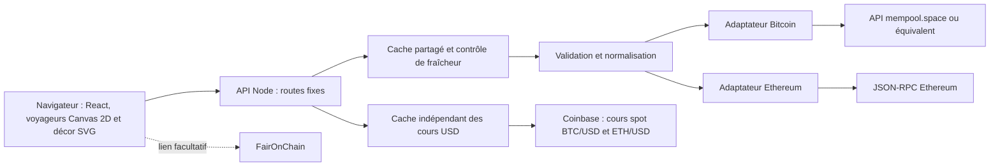

# Architecture et choix durables

## Recommandation

Construire une application web portable : **React + TypeScript + Vite, Canvas 2D natif pour les voyageurs individuels et SVG/CSS pour le décor, petit serveur HTTP Node 24 et adaptateurs de données en lecture seule**. Un seul langage, un contrat explicite et aucun service de stockage pour la version initiale. Le serveur sert les fichiers compilés et l'API sur le même domaine.

TxStreet fournit la référence de métaphore. Son dépôt décrit Vue, Bulma, Phaser, des communications socket.io et un backend distinct historiquement accompagné de nœuds, MongoDB et Redis. Ce projet propose une implémentation originale avec une infrastructure plus petite ; il ne dépend ni du backend ni des ressources TxStreet. [Source : dépôt TxStreet](https://github.com/txstreet/txstreet).

## Options de rendu

| Option                           | Atouts                                                                      | Coût d'entretien                                                              | Décision                                                                               |
| -------------------------------- | --------------------------------------------------------------------------- | ----------------------------------------------------------------------------- | -------------------------------------------------------------------------------------- |
| SVG/CSS avec React               | Dessins nets, éléments inspectables, accessibilité native                   | Coût DOM et réconciliation pour de nombreux voyageurs                         | Conservé pour wagons, décor, textes et groupes collectifs                              |
| Canvas 2D natif                  | Un dessin raster par rue, images préparées réutilisables, aucune dépendance | Découpes, sélection au pointeur et parcours clavier à maintenir explicitement | Retenu pour les voyageurs individuels le 15 octobre 2026, à la demande du propriétaire |
| PixiJS ou autre moteur graphique | Effets et gestion graphique plus élaborés                                   | Dépendance et cycle de rendu supplémentaires                                  | Différé ; aucun besoin concret supplémentaire                                          |
| Moteur de jeu / 3D               | Grande liberté de caméra et de mise en scène                                | Assets, GPU, compatibilité mobile et dépendances supplémentaires              | Différé ; aucune nécessité pour comprendre les chaînes                                 |

Une belle scène ne nécessite pas une transaction visible pour chaque transaction du réseau. Le serveur limite les données et la scène regroupe les voyageurs. Le design privilégie la composition, les couleurs, les détails vectoriels et des mouvements sobres. Le texte et les statistiques restent utilisables lorsque les animations sont en pause ou réduites.

### Décision de rendu du 15 octobre 2026

Le propriétaire demande la migration en Canvas 2D après avoir constaté des ralentissements avec l'échantillon étendu. La décision réduit le nombre d'éléments DOM individuels sans réduire l'échantillon alors fixé à 240 voyageurs ni les 48 unités des projections. L'extension à 480 voyageurs est décrite dans la décision distincte ci-dessous. Ce choix est explicite ; il ne constitue pas une conclusion de profilage et aucun gain mesuré n'est annoncé.

React conserve les panneaux, contrôles, détails et données de sélection. Chaque rue reçoit un Canvas transparent pour ses voyageurs individuels. Les wagons, portes, phares, textes, maisons et groupes collectifs statiques restent en SVG. Un cache borné de petites surfaces prépare les têtes, torses et icônes ; membres, flèches et sélection suivent les poses. La couleur des t-shirts est appliquée directement à chaque observation sans l'ancienne transition CSS de 300 ms. Le painter consomme les mises à jour existantes et n'ajoute aucune boucle d'animation, moteur graphique, dépendance ou service.

Le moteur pur reste indépendant du rendu. Le painter reproduit le `viewBox`, la projection du quai, le miroir Bitcoin, les positions des wagons et les découpes de l'intérieur et des portes. Le hit test utilise les transformations inverses et les mêmes découpes dans l'ordre de profondeur du dessin ; un occupant masqué ne devient pas une cible à travers la carrosserie. Les cohortes historiques en départ restent non interactives. La sélection clavier passe par un navigateur HTML natif par rue, avec choix de transaction, ouverture des détails, Échap et gestion du focus, au lieu d'un élément SVG ou d'un bouton par avatar. Un Canvas indisponible affiche une explication tout en conservant les contrôles HTML.

Le ratio de pixels est plafonné à 2. Chaque Canvas principal est borné à quatre millions de pixels et 8 192 pixels par dimension, avec adaptation au viewport et nettoyage des observations de taille et événements. Les petites surfaces mises en cache sont également bornées : douze variantes de tête, 256 couleurs de torse et cinq icônes, à une densité de quatre pixels par unité de scène. Le cache d'apparence conserve au plus 2 048 hashes par rue ; les surfaces sont libérées au démontage. La migration conserve les limites de résidents et d'archives, les preuves d'inclusion, la préparation minimale d'une seconde, les panneaux à quatre secondes et le cache blockchain à trois secondes. Elle reste non validée pendant la suspension des contrôles ; les anciens tests DOM fondés sur les personnages SVG devront être adaptés lors de leur reprise autorisée.

Les réutilisations déjà introduites restent applicables : poses immobiles, projections du quai, libellés de frais, formateurs numériques partagés et bornés, et caches à références faibles liés aux transactions. Les médianes natives dépendent de l'instantané, tandis que l'ancienneté des cours et du pool continue d'être évaluée séparément. La scène et le campus sont mémorisés, avec des commandes de sélection stables ; la publication des effectifs vers l'interface est espacée d'au moins 250 ms et ne change pas la cadence des déplacements à environ 24 images par seconde. Aucun profilage ni mesure du coût ou du gain n'est effectué.

Le moteur garde les références des personnages et collections inchangés, avec caches `WeakMap` pour la géométrie des chemins, l'apparence des transactions et leurs poses. Les longueurs et directions des segments sont calculées une seule fois pour un même chemin immuable ; la table d'archive est copiée seulement lorsqu'elle change. Le hook compare les informations effectivement dessinées avant de publier un état React, tout en avançant son horloge interne pour les échéances et admissions. Il annule sa boucle `requestAnimationFrame` quand le document devient masqué et la relance avec un repère de temps neuf au retour. Les limites, preuves, réservations, portes, marqueur du dernier départ, pause et mouvements réduits restent indépendants de ces réutilisations ; aucun cache ne devient une source de données blockchain.

`src/hooks/useSourceFreshness.ts` conserve les garde-fous d'ancienneté malgré la mémorisation : un délai ponctuel réveille l'affichage au-delà de cinq minutes pour un cours USD utilisable, puis aux seuils d'ancienneté de 30 secondes et d'expiration de 120 secondes pour le compte Ethereum. Les états sont relus au retour dans un onglet visible après l'échéance. Chaque délai et écouteur sont nettoyés lorsque l'échéance change ou que le composant disparaît, sans intervalle ni nouvelle collecte. Les panneaux et la scène invalident les libellés USD à l'expiration ; l'application recalcule les comptes utilisables et l'échelle commune de la file collective, même lorsque l'API attend et que les personnages sont immobiles.

Les personnages absents du nouvel échantillon restent en attente visuelle sur le quai avec leur dernière observation, sans être déclarés encore en attente dans le réseau. Le moteur conserve normalement au plus 960 personnages résidents et 480 admissions différées par chaîne. Jusqu'à 480 anciennes observations immobiles restent individualisées ; les suivantes rejoignent une représentation collective. Une archive côté interface conserve jusqu'à 512 identifiants pendant 30 minutes depuis leur dernière présence dans l'échantillon. Les observations expirées ou évincées restent dans un compteur sans suivi individuel, distinct des identifiants encore suivis. Le total ne représente ni des transactions uniques ni un mempool actuel.

Une preuve retrouvée réserve l'identifiant suivi dans l'archive jusqu'à la préparation du départ correspondant. La réservation est protégée de l'expiration et de l'éviction, éventuellement au-delà de 30 minutes pendant une pause ou une file de départs, dans la même borne de 512 identifiants ; le délai de rétention concerne les observations encore sans preuve. À la préparation, le personnage est réadmis depuis la position du groupe et son compteur diminue. Une file de 16 départs traite les blocs intermédiaires ; le chargement initial ne rejoue pas l'ancien journal. Des preuves reçues après le départ de leur bloc portent le libellé RATTRAPAGE. En préparation, les limites temporaires sont de 2 912 résidents et 1 952 inclusions superposables ; ces nouvelles bornes et leur coût restent non validés pendant la suspension des tests et de la compilation. Le mode réduit marque les preuves statiquement et conserve les observations. Les réservations sont libérées après traitement, annulation ou règlement statique. Cette mémoire reste volatile et n'ajoute aucun service de stockage.

## Allègement des départs — décision du 15 octobre 2026

Le propriétaire demande d'alléger le départ des wagons après le passage à 480 voyageurs en attente par chaîne. Le painter réutilise une image de la cohorte complète embarquée dans le premier wagon : une fois ses occupants et leurs découpes dessinés, le trajet déplace cette image plutôt que de redessiner chaque avatar à chaque image. La carrosserie, les portes, les feux et le compteur arrière restent en SVG. Les voyageurs sur le quai et dans le wagon en promotion conservent leur rendu individuel ; le groupe qui quitte la scène demeure non interactif.

Le cache contient au plus une surface supplémentaire par renderer, donc par rue : **un million de pixels**, **2 048 pixels par dimension** et une densité maximale de **quatre pixels par unité logique**. La densité est adaptée à l'échelle du dessin et au ratio de pixels, puis réduite pour respecter les bornes. Ce budget est distinct des quatre millions de pixels du Canvas principal et des petits caches de glyphes existants. L'identité de la cohorte dessinée, son apparence ou sa projection, les découpes communes, le miroir et la densité déclenchent sa reconstruction ; la translation verticale ne l'invalide pas. Le premier dessin sans départ et le démontage libèrent la surface. En cas d'échec de création, tous les occupants restent dessinés individuellement ; l'échec est mémorisé pour éviter une nouvelle allocation à chaque image avec les mêmes entrées.

La cohorte de départ est exposée séparément des voyageurs encore actifs. Elle réutilise une collection stable tant que ses poses projetées et couleurs ne changent pas ; ses libellés USD ne sont pas construits puisqu'elle n'est pas sélectionnable. Le compteur arrière réutilise également son comptage tant que sa cohorte est identique.

Dans le moteur, des `WeakMap` réutilisent l'index des inclusions et les ensembles d'identifiants des résidents et des cohortes immuables. Les tableaux et objets sont copiés seulement lorsqu'une admission ou une modification réelle le demande ; une admission impossible faute de place conserve les références existantes. Les positions interpolées sont calculées seulement pour les transitions qui les utilisent. La cohorte du départ extrait les poses de ses seuls occupants, sans construire un état de présentation complet. Les trois passes de préparation et leur ordre sont conservés ; le contrôle final exigeant tous les inclus à bord et les autres voyageurs hors du premier wagon n'est évalué qu'après la seconde minimale de préparation, puis continue de conditionner chaque départ. Ces réutilisations ne créent aucune preuve et ne changent ni les limites ni les conditions de circulation.

Ce cache ne modifie ni les identifiants ni les preuves d'inclusion. Les limites de 480 voyageurs courants, 48 unités par projection, 1 952 inclusions en départ et 2 912 résidents pendant la préparation sont conservées. La préparation d'au moins une seconde, le départ et la promotion en 1,2 seconde puis l'arrivée du remplaçant en 0,7 seconde à vitesse normale gardent leurs conditions. Aucune dépendance, boucle d'animation, requête ou modification de contrat n'est ajoutée. Le changement vise le travail répété ; aucun profilage, benchmark ni gain mesuré ne permet encore de conclure sur son effet. Il reste non validé pendant la suspension des contrôles.

## Échantillon doublé — décision du 15 octobre 2026

Après la migration des voyageurs en Canvas 2D, le propriétaire demande davantage de transactions représentées. La scène et les adaptateurs passent de 240 à **480 transactions en attente par chaîne** ; le contrat partagé accepte désormais **504 transactions**, avec 24 confirmations réservées séparément. La sélection continue de privilégier les frais élevés de la vue disponible du fournisseur et peut être plus petite ; aucune donnée fictive n'est ajoutée au direct. La démonstration produit 480 transactions en attente et 12 confirmations simulées par chaîne, soit 492 transactions. La médiane porte sur toutes les transactions en attente valides reçues, sans se présenter comme représentative du réseau.

La file possède seize colonnes et 30 rangées à pas vertical de 14, de `y=239` à `y=645`, entre `x=318` et `x=408` dans la géométrie canonique. Les colonnes partagent le même espace horizontal qu'auparavant et peuvent se recouvrir ; les places courantes restent stables pendant les nouvelles collectes. Les indices historiques commencent à 960. Le miroir Bitcoin, la projection desktop, les trajets et les 48 unités de chaque wagon sont conservés.

Le moteur borne les résidents ordinaires à 960, les admissions différées à 480 et les anciennes observations individualisées à 480. L'archive garde sa limite de 512 : un départ peut illustrer au plus **1 952 inclusions** (`960 + 512 + 480`) et sa préparation conserver au plus **2 912 résidents** (`960 + 1 952`). Ces limites coordonnent les données et la représentation ; elles ne décrivent ni une taille de bloc réelle ni un mempool complet.

Le suivi serveur conserve sa limite durable de 2 048 identifiants pendant 30 minutes ; son maximum transitoire devient **2 528** (`2 048 + 480`) avant vérification et éviction. Les 16 blocs du journal, les 2 048 preuves totales, les huit blocs de rattrapage, le cache partagé de trois secondes, les délais et les limites réseau sont conservés. Les caches Canvas et leurs bornes de surface restent inchangés. L'augmentation réutilise les réponses existantes, sans requête supplémentaire, dépendance ou service. Elle augmente les plafonds de travail et de mémoire ; aucun gain de fluidité ni capacité mesurée n'est annoncé. Les tests et contrôles restent suspendus à la demande du propriétaire : nouvelles bornes, coût de rendu et conséquences sur le contrat restent non validés.

## Capacité de 96 unités et compteur des wagons — décision du 15 octobre 2026

Cette décision initiale est conservée pour l'historique. Son budget et son pourcentage illustratifs sont remplacés par la décision en ressources natives ci-dessous ; seule la grille de 96 emplacements reste en vigueur.

À la demande du propriétaire d’augmenter le nombre de personnages possibles dans un wagon, le budget de chacune des deux projections passe de 48 à **96 unités illustratives**. La constante `WAGON_SEAT_COUNT` de la géométrie commune fixe à la fois les 96 emplacements du dessin et `CANDIDATE_CAPACITY` dans le moteur. La grille comprend huit colonnes et douze rangées : les colonnes partagent le même intervalle de `WAGON_X + 17.5` à `WAGON_X + 66.5` ; les rangées restent de `y=80` à `y=179` par pas de 9. Taille du wagon, portes, découpes et trajets sont conservés ; les personnages peuvent se superposer davantage. La version de géométrie passe de `v14` à `v15`.

Un voyageur conserve son coût de une à trois unités ; 96 unités permettent au plus 96 voyageurs d’une unité, sans promettre 96 transactions pour toutes les distributions de tailles. Les inclusions vérifiées préparées pour un départ peuvent dépasser cette grille et se superposer, dans les bornes de représentation existantes. L’échantillon reste limité à 480 voyageurs courants, avec 960 résidents ordinaires, 1 952 inclusions en départ et 2 912 résidents pendant la préparation. L’archive et le cache Canvas de départ borné à un million de pixels par rue sont conservés ; aucune capacité mesurée ou amélioration de performance n’est annoncée. Les décisions de rendu et d’extension précédentes conservent ci-dessus les capacités alors en vigueur.

La plaque arrière `N TX · P %` compte les identifiants uniques des personnages effectivement représentés à bord, y compris les cohortes capturées pour le départ ou la promotion. Le pourcentage est l'entier arrondi de `100 × somme des resourceUnits des identifiants uniques à bord / CANDIDATE_CAPACITY`, soit un budget de 96 unités. Il exclut les places réservées hors du véhicule, vaut 0 % à vide et peut dépasser 100 % lorsque les inclusions vérifiées se superposent au-delà de ce budget. Les deux valeurs suivent la même cohorte et la transformation du véhicule, avec des textes lisibles dans le miroir Bitcoin. Son infobulle et son libellé accessible distinguent le nombre de voyageurs, les unités illustratives et leur dépassement du total réel d'un bloc ou de son taux de remplissage réseau. L'échantillon courant de 480 voyageurs, les archives, le suivi serveur, les contrats, les appels, les caches et les durées sont conservés. Aucun service ni dépendance n'est ajouté. Cette capacité et cette plaque restent non validées pendant la suspension des contrôles ; les tests et fixtures fondés sur l'ancien budget devront être adaptés lors de leur reprise autorisée.

## Capacité native et occupation des blocs — décision du 15 octobre 2026

Le propriétaire demande que le pourcentage reflète la taille des transactions face à la place possible dans un bloc. Le budget de 96 unités ne pilote donc plus l'admission ni le compteur. Les 96 emplacements de huit colonnes et douze rangées restent une grille de présentation, avec superposition des voyageurs lorsque nécessaire. Le nombre de personnages dans un wagon dépend désormais des tailles natives admissibles et de l'échantillon borné, sans limite artificielle de 96 transactions.

`src/lib/blockCapacity.ts` centralise `capacityForSnapshot`, `transactionBlockSize`, `blockUsagePercent` et `wagonBlockOccupancy`. Le moteur expose `candidateCapacity` nullable, ses réservations `used` en ressources natives et le bloc complet `departingBlock` lié au hash du départ ou du rattrapage. La géométrie passe à la version `v16`. Le plan conserve le tri par taux de frais et le seuil de référence de l'instantané, puis additionne `Tx.size` pour réserver la capacité des deux projections successives ; une taille nulle ou invalide n'est pas admise. Pour Bitcoin, la taille est exprimée en vBytes et le budget vaut **1 000 000 vBytes**, équivalent à la limite de 4 000 000 unités de poids. Pour Ethereum, `Tx.size` est la **limite de gas déclarée**, comparée au `gasLimit` du dernier bloc observé. Cette somme constitue une estimation prudente : la consommation réelle peut être moindre, et le budget du bloc à venir peut évoluer. Aucune capacité Ethereum ne se déduit de la grille visuelle ou d'une constante de repli ; sans valeur source, elle reste indisponible. Les dépendances Bitcoin, nonces Ethereum, canaux privés, ressources de blobs et choix des producteurs restent hors de cette projection pédagogique. Sources : [BIP 141, poids et taille virtuelle](https://github.com/bitcoin/bips/blob/master/bip-0141.mediawiki), [blocs Ethereum, `gas_used` et `gas_limit`](https://ethereum.org/developers/docs/blocks/).

La plaque arrière distingue deux périmètres. À l'arrêt, `N TX · ≈P %` compte les identifiants uniques représentés à bord et rapporte leur somme de tailles natives à la capacité de projection. Les voyageurs encore en chemin réservent leur taille dans le plan, mais restent exclus du pourcentage jusqu'à leur embarquement. Dès la préparation du premier wagon, puis pendant son départ, le pourcentage utilise **l'ensemble du bloc vérifié** : `100 × Block.used / Block.capacity`. Le bloc est conservé avec l'événement de départ et son hash ; les blocs intermédiaires proviennent aussi du journal `Snapshot.inclusions`. La réception d'un bloc plus récent ne remplace pas cette référence. `N TX` continue de compter seulement les voyageurs visibles de l'échantillon, sans devenir le total du bloc. Infobulle et libellé accessible explicitent ces périmètres, ainsi que la différence entre gas déclaré projeté et gas consommé observé. Une absence donne `—`, sans zéro ou capacité inventés ; pour un bloc attendu sans métadonnées, il n'y a pas de repli sur la somme des limites de gas des personnages. L'affichage utilise une décimale, deux sous 1 %, et `<0,01 %` pour une valeur positive plus petite. Les pieds des projections montrent les ressources et pourcentages réservés en vBytes ou en gas, avec somme et capacité dans l'infobulle, sans `/96`.

Cette correction réutilise le contrat existant `Tx.size`, `Block.used`, `Block.capacity` et les blocs du journal. Elle n'ajoute ni reçu Ethereum, ni requête, ni dépendance, ni service. Les 480 voyageurs courants, 960 résidents ordinaires, 1 952 inclusions en départ, 2 912 résidents pendant la préparation, l'archive, le cache Canvas du départ, les durées et le cache API de trois secondes restent bornés comme auparavant. Les tests et contrôles demeurent suspendus à la demande du propriétaire : cette nouvelle sémantique reste non validée et ne bénéficie pas des résultats historiques portant sur les budgets illustratifs.

## Classement du mempool et mises à jour — décision du 15 octobre 2026

Le propriétaire autorise l'essai local d'un classement sur le mempool complet du fournisseur, puis demande de charger le pool une première fois et de ne récupérer ensuite que les arrivées. La décision garde une collecte **facultative en arrière-plan**, sans transformer la scène en inventaire exhaustif ni ajouter de service, dépendance ou stockage durable. Les 480 meilleurs taux natifs seulement, les comptes et la date du relevé sont transmis aux visiteurs ; les réponses RPC complètes ne le sont pas.

**Bitcoin** utilise un RPC configuré côté serveur, `BITCOIN_RPC_URL`, par défaut Bitcoin PublicNode et désactivable par valeur vide. La base initiale `getrawmempool(true)` est accompagnée du contrôle `getblockchaininfo`, réseau principal et synchronisation initiale terminée. Le serveur conserve une table compacte bornée à **100 000 entrées**. Chaque mise à jour demande la liste `getrawmempool(false, true)`, inventaire et numéro de séquence validé sous **huit Mio**, retire les identifiants disparus et demande `getmempoolentry` uniquement pour les nouveaux : au plus **500 ajouts par cycle**, en lots de **25**, deux simultanés au plus avec **128 Kio par réponse**, dans un budget total de **huit secondes pour le cycle Bitcoin entier**. Une base complète est relue après **dix minutes**. Un échec de réconciliation retire le classement complet public et déclenche le repli explicite. Réseau, HTTP, RPC, timeout ou dépassement de volume conservent seulement l'index privé antérieur jusqu'à l'échéance de dix minutes pour réessayer sans retéléchargement complet ; les métadonnées partielles de la tentative sont abandonnées. Donnée invalide, mauvais réseau, erreur de base, horloge incohérente ou expiration effacent cet index et imposent un chargement complet à la tentative suivante. Les frais de base rapportés à `weight / 4` sont comparés exactement, sans paquets CPFP, ajustements de frais ni `vsize` ajusté par la politique du nœud. La taille de bloc représentée utilise séparément `weight / 4`.

Cette stratégie Bitcoin réduit les métadonnées retéléchargées, mais continue de relire tous les identifiants pour détecter les retraits. Le relevé résulte d'appels successifs et ne constitue pas une photographie atomique ; une entrée disparue pendant sa lecture ne peut devenir une métadonnée inventée. Un retrait du pool ne prouve jamais une confirmation. mempool.space garde les blocs, frais conseillés, preuves et replis : la provenance combinée est annoncée, et le compte du top complet vient du même relevé RPC avec sa date propre. Aucun compteur d'un autre fournisseur ne remplace ce compte.

**Ethereum** continue `txpool_content` sur le RPC existant après validation du réseau et du dernier bloc, sous une limite de **50 000 entrées `pending + queued`**. Il conserve au plus 30 secondes les candidates `pending` compactées pour les reclasser à la nouvelle base fee ; `queued` reste exclu des wagons. Les prix effectifs sont comparés exactement en wei, mais ni les dépendances de nonce ni les choix du producteur ne promettent les prochaines inclusions. Les comptes de `Snapshot.mempool` restent séparés et proviennent de `txpool_status` à leur propre date.

Le RPC PublicNode a accepté la création, la lecture vide puis la suppression d'un filtre d'arrivées pendant un essai ponctuel. Ce mécanisme ne fournit pas de journal complet des retraits, évictions et catégories `queued` et ne permet donc pas de maintenir seul le top complet. La priorité donnée à un classement honnête conduit à **conserver les lectures complètes Ethereum**. Une future collecte incrémentale demandera des réconciliations, une reprise après perte de flux et une gestion des fournisseurs qui répartissent les requêtes entre plusieurs nœuds ; un flux d'arrivées seul ne suffit pas.

Chaque fournisseur garde une seule collecte en cours, mutualisée entre les visiteurs, **30 secondes minimum après sa fin** et une validité du classement complet de **30 secondes depuis le relevé**. La réponse blockchain n'attend pas cette capacité et garde son cache de trois secondes. Un transport réservé, huit secondes par requête et **32 Mio** au plus, protège ces lectures sans relever le plafond ordinaire de deux Mio ; tous les appels et traitements d’un cycle Bitcoin partagent en plus le budget total indiqué plus haut. Bitcoin attend 30 secondes après un échec ; Ethereum attend 60 secondes, ou cinq minutes après un refus RPC. Les dépassements ne sont jamais tronqués puis annoncés comme complets. Aucun endpoint ne laisse le visiteur choisir la destination upstream.

`Snapshot.sampling`, facultatif nullable, porte méthode, source expurgée, date et comptes du relevé utilisé ; Bitcoin ajoute `update: 'full' | 'incremental'`. La méthode est liée à la chaîne et le champ réel est interdit en démonstration ou indisponibilité. Sa fraîcheur est distincte de celle des blocs, et l'interface doit la contrôler même si l'API conserve un instantané ancien. Le suivi des inclusions, son journal et les limites Canvas ne s'étendent pas à l'ensemble du pool.

Un diagnostic expurgé journalise seulement les changements de catégorie d'échec, phase, type et éventuel nombre d'ajouts dépassant 500, sans réponse brute ni secret. Les coûts supplémentaires concernent réseau, table Bitcoin en mémoire, désérialisation et classement. Le cache évite une collecte par visiteur ou toutes les trois secondes ; il ne mesure pas la capacité du Mac ou d'un hébergement HEG. Aucun WebSocket permanent, file de travail, nœud complet ou nouveau composant d'exploitation n'est ajouté. Cette décision et son contrat restent **non validés** : l'essai manuel autorisé figure dans [validation.md](validation.md), sans reprise des tests ou promesse de disponibilité. Sources : [Bitcoin Core `getrawmempool`](https://bitcoincore.org/en/doc/30.0.0/rpc/blockchain/getrawmempool/), [`getmempoolentry`](https://bitcoincore.org/en/doc/30.0.0/rpc/blockchain/getmempoolentry/), [Geth txpool](https://geth.ethereum.org/docs/interacting-with-geth/rpc/ns-txpool#txpool-content), [Geth abonnements](https://geth.ethereum.org/docs/interacting-with-geth/rpc/pubsub).

## Ville commune et espace desktop

La scène occupe toute la largeur disponible, avec trois colonnes principales : réseau Bitcoin flexible, campus commun et réseau Ethereum flexible. Le campus rassemble une seule rangée de maisons et de bâtiments HEG, de largeur desktop comprise entre 128 et 240 pixels. Les rues sont symétriques : wagons près des maisons centrales, puis corridor de déplacement, file d'attente et colonne d'arrivée vers chaque bord extérieur. Les grands panneaux restent au-dessus de leur réseau ; les lignes en-tête, scène, file collective inférieure et couverture sont alignées par `subgrid`, avec une grille interne de repli. Cette propriété partage les pistes de la grille parente et bénéficie d'une disponibilité inter-navigateurs depuis septembre 2023 selon [MDN](https://developer.mozilla.org/en-US/docs/Web/CSS/Guides/Grid_layout/Subgrid). Le campus et les commandes se compactent sur les écrans plus étroits.

Le moteur conserve une seule géométrie canonique de quai droit, indépendante de la blockchain. Bitcoin est projeté en miroir, avec portes et quai à gauche ; Ethereum garde portes et quai à droite. Les glyphes des voyageurs et les textes restent lisibles. Les nouveaux personnages arrivent horizontalement depuis `x = SCENE_WIDTH + 28` à la hauteur de leur place dans la file canonique, puis rejoignent cette place. Le miroir transpose cette entrée au bord gauche Bitcoin. Les retours, observations anciennes et reprises depuis l'archive passent toujours par le quai extérieur ; aucun chemin ne traverse la chaussée.

Chaque SVG adapte sa largeur logique à `max(236, 740 × largeurViewport / hauteurViewport)`. La hauteur de référence reste 740 ; la projection élargit le quai au-delà du corridor canonique `x=298`. Les wagons et les personnages gardent une taille proportionnelle uniforme, plutôt qu'un étirement horizontal global. La même transformation projette les portes, files, chemins et positions individuelles, avec orientation et angles des flèches adaptés au miroir. Le redimensionnement modifie la présentation, pas la provenance, les priorités ou les phases du moteur. La préparation minimale d'une seconde, les départs vérifiés, les feux, les pages de panneau à quatre secondes et les compteurs existants sont conservés. Aucun service, adaptateur, champ API, secret ou dépendance n'est ajouté. Cette disposition reste non validée pendant la suspension des contrôles.

## File collective du fournisseur

Le bandeau inférieur **File globale · fournisseur** est une représentation collective de la mempool locale, séparée du moteur de voyageurs et de l'archive des observations. Le composant lit `providerMempool(snapshot)` ; ce même lecteur alimente le panneau supérieur et conserve les règles de provenance et d'expiration propres au comptage Ethereum. Le total Bitcoin provient du fournisseur configuré, celui d'Ethereum de `pending + queued` seulement lorsque cette mesure reste utilisable. Le total exact et la provenance locale sont lisibles ; l'infobulle et le résumé accessible précisent le nom de la source et la distinction locale/réseau. Une mesure absente ne se déduit jamais de l'échantillon.

La présentation borne le rendu à 48 silhouettes par chaîne. L'interface calcule une échelle commune sur le maximum des deux comptes affichables, en arrondissant vers une valeur suffisante de la série `1, 2, 5 × 10ⁿ`. Chaque groupe porte cette quantité, sauf le dernier s'il est partiel. La légende et le résumé accessible donnent explicitement l'échelle et le total ; les silhouettes restent décoratives, statiques et non sélectionnables. Elles ne portent ni identifiants ni frais individuels et ne constituent pas des preuves d'inclusion. Un vrai zéro, une absence, un ancien relevé et une simulation gardent chacun un état explicite.

Le bandeau occupe une ligne de 92 pixels en bas de chaque réseau, avant la couverture ; une bande verte du campus commun s'aligne sur cette ligne. Les quatre lignes de la grille partagent leur hauteur entre les deux rues et le campus. La scène conserve ses 480 voyageurs courants, ses anciennes observations et tous ses trajets. Aucune donnée individuelle, route HTTP, collecte, minuterie, dépendance ou modification de contrat n'est ajoutée. La mise à jour utilise les instantanés déjà reçus ; l'échelle décrit leurs effectifs observés et ne promet ni comparaison simultanée des réseaux ni connaissance d'un mempool mondial. Ce changement reste non validé pendant la suspension des contrôles.

## Flux et responsabilités

- `src/` : interface, scène, textes et personnalisation ; aucune clé ni interprétation brute du RPC.
- `server/` : configuration, HTTP, appels upstream, cache, erreurs et adaptateurs.
- `shared/` : schéma Zod et types du contrat commun.
- Les données de démonstration sont identifiées comme telles et séparées des adaptateurs directs.

Le backend n'accepte aucune méthode blockchain fournie par les visiteurs. Il effectue les appels nécessaires à ses propres adaptateurs. La configuration du fournisseur appartient à l'opérateur. Tous les clients consomment des instantanés normalisés.

## Contrat et nouvelles chaînes

Le schéma partagé est la référence exacte. Un instantané associe une chaîne, une provenance, une date de collecte, un état de fraîcheur, des blocs, des transactions échantillonnées et les métriques disponibles. Les unités et la disponibilité des métriques doivent être explicites ; une absence est distincte de zéro.

Le champ facultatif `Tx.blockHash` associe une confirmation à un bloc vérifié. Bitcoin le renseigne après comparaison de l'identifiant avec les transactions du bloc ; Ethereum utilise le hash du bloc confirmé effectivement lu. Une transaction en attente ne peut pas porter ce champ. Les anciennes confirmations sans hash restent compatibles mais ne sont pas utilisées comme preuve d'appartenance au départ animé. Les deux wagons à l'arrêt projettent les blocs à venir en ressources natives ; à réception d'une preuve de bloc réel, le premier est ajusté aux inclusions connues puis part. Cette logique suit la métaphore de [TxStreet](https://github.com/txstreet/txstreet/blob/main/src/components/street.js#L677-L846), avec un échantillon borné et les simplifications de sélection documentées.

`Snapshot.inclusions` ajoute un journal facultatif de `BlockInclusions = { block, transactionIds }`. Il contient au plus 16 blocs et 2 048 identifiants au total, exclusivement des observations suivies dont l'inclusion a été vérifiée dans ce hash. Il reste séparé des 504 transactions et des trois blocs de l'instantané courant ; ses blocs historiques n'ont pas à appartenir aux trois derniers. Hashes et hauteurs y sont uniques ; à hauteur commune avec `blocks`, les hashes doivent être identiques. Les formats d'identifiants et de hashes sont propres à la chaîne en direct. Un instantané indisponible ne peut porter ce journal. Son caractère facultatif préserve les anciens consommateurs et les démonstrations sans ce suivi.

Pour ajouter une chaîne :

1. Décrire ses capacités : vue des transactions en attente, unités de frais, blocs, finalité et limites du fournisseur.
2. Étendre le registre de chaînes et le schéma commun si nécessaire, sans changer implicitement les unités existantes.
3. Créer un adaptateur qui valide les réponses externes puis les normalise ; limiter les données à la frontière serveur.
4. Fournir des fixtures valides, invalides, incomplètes et en panne. Tester la provenance et la distinction attente / confirmation.
5. Ajouter les textes pédagogiques, la couleur et les liens d'explorateur. Réutiliser la scène ; ne pas lui faire interpréter le RPC.
6. Vérifier l'affichage d'une métrique absente et le retour arrière de version. Documenter le fournisseur retenu.

## Ce que signifie « direct »

**Bitcoin.** Les blocs et indicateurs proviennent de l'API configurée ; le top complet facultatif utilise le RPC Bitcoin configuré séparément, avec provenance combinée annoncée. Le mempool est une vue observée, et la scène un échantillon. Le minage fournit un rythme moyen, pas une heure de départ garantie ; ne pas afficher un compte à rebours exact du prochain bloc. [Source : protocole et difficulté Bitcoin](https://developer.bitcoin.org/devguide/block_chain.html).

**Ethereum.** `eth_getBlockByNumber` accepte notamment `latest` et `pending`. L'adaptateur essaie les données en attente disponibles puis présente les transactions du dernier bloc avec leur état confirmé si le fournisseur ne fournit pas de vue exploitable. Ce repli reste une donnée réelle, avec une sémantique différente et annoncée. [Source : API JSON-RPC](https://ethereum.org/developers/docs/apis/json-rpc/).

Le besoin de compter les transactions du **fournisseur observé** ajoute une capacité facultative `txpool_status` à l'adaptateur Ethereum existant. Le total `pendingCount` vaut alors `pending + queued` du nœud RPC observé ; les transactions en file future ne sont pas toutes admissibles au prochain bloc. Un nouveau champ facultatif nullable `Snapshot.mempool` conserve ces deux compteurs, la méthode et leur date de réception en millisecondes avec état `ok` ou `stale`. Il reste réservé à Ethereum en direct. La somme et chacun des compteurs sont des entiers sûrs, validés après lecture de quantités hexadécimales strictes. Le total Bitcoin vient du même relevé RPC que le top complet lorsqu'il est disponible ; en repli, il conserve la provenance de `/mempool`. L'échantillon visible et le bloc candidat Ethereum ne permettent jamais d'inventer un total absent.

Le fournisseur Ethereum conserve ce comptage dans sa propre fermeture en mémoire, sans service, dépendance ou variable d'environnement supplémentaire. Après validation de la chaîne et du dernier bloc, il lance une requête en arrière-plan vers le RPC fixé côté serveur : une requête simultanée au plus, **30 secondes minimum après chaque tentative**, délai de huit secondes, réponse plafonnée à **64 Kio**. Un RPC qui refuse cette méthode laisse le total indisponible. Un échec conserve explicitement la dernière valeur comme ancienne, au plus **120 secondes depuis sa réception** ; après expiration, le total et son détail deviennent `null`. Aucun appel facultatif n'est attendu par la réponse blockchain et aucun échec de comptage ne modifie la fraîcheur des blocs. Le client doit comparer la date propre du comptage à l'heure courante, y compris lorsqu'un instantané blockchain ancien est conservé. Le cache est commun aux visiteurs d'une instance et le transport et l'horloge injectés restent utilisés ; les fixtures devront simuler aussi cette capacité. Sources : [namespace `txpool` Geth](https://geth.ethereum.org/docs/interacting-with-geth/rpc/ns-txpool#txpool-status), [implémentation des compteurs Geth](https://github.com/ethereum/go-ethereum/blob/master/internal/ethapi/api.go).

En repli du classement complet décrit plus haut, Bitcoin utilise une connexion courte au WebSocket du fournisseur mempool.space compatible et demande les transactions du premier bloc projeté. La connexion suit les délais et limites de taille existants, puis ferme après réception de la liste. Une indisponibilité de cette capacité conduit à un repli explicitement annoncé sur l'échantillon récent. Ethereum trie le bloc `pending` validé par prix effectif du gas avant troncature ; ce classement reste local au fournisseur. Les inclusions vérifiées sont réservées séparément pour conserver leur provenance même avec des frais faibles.

Un slot Ethereum dure actuellement 12 secondes ; un slot peut manquer et ne garantit ni inclusion ni finalité. La vue en attente d'un fournisseur est locale et exclut potentiellement des flux privés. La version initiale n'annonce pas une mesure de mempool global. [Source : consensus Ethereum](https://ethereum.org/developers/docs/consensus-mechanisms/pos/).

Le cache serveur évite un appel upstream par visiteur : délai minimal de 3 secondes après chaque collecte, réussie ou en échec, une récupération en cours partagée, timeout de 8 secondes par requête HTTP externe, réponse ordinaire limitée à 2 MiB (32 Mio réservés au lecteur de pool complet), jusqu'à 504 transactions (480 en attente et 24 confirmations réservées) et 3 blocs courants par chaîne, plus le journal d'inclusions borné. Une réponse récente peut être signalée comme ancienne jusqu'à 120 secondes ; après, l'API annonce l'indisponibilité. Le client attend 3 secondes en direct et 5 secondes en démonstration après chaque réponse avant la prochaine lecture de l'API locale ; il ne chevauche pas ses requêtes et les suspend dans un onglet masqué. Une seule collecte reste en cours par chaîne ; sa durée et celle du rattrapage s'ajoutent au délai de cache et ne permettent pas de garantir de nouvelles données toutes les 3 secondes. Deux chaînes représentent au plus environ 40 requêtes locales par minute par onglet visible, sous la limite par défaut de 120 par adresse cliente ; plusieurs onglets ou une adresse partagée peuvent atteindre cette limite. Ces limites doivent être modifiées avec leurs tests et leur documentation.

Chaque adaptateur conserve jusqu'à 2 048 identifiants échantillonnés pendant 30 minutes depuis leur dernière observation, afin de les rapprocher des blocs réellement reçus. L'éviction attend la vérification : une collecte peut temporairement conserver 2 048 observations anciennes et 480 nouvelles, soit 2 528 identifiants transitoires, puis revient à 2 048 avant réponse. Le rattrapage examine au plus huit blocs par collecte et garde les lacunes à réessayer après un échec. Le journal est rejoué dans les réponses suivantes : la première lecture d'un visiteur ne consomme pas les preuves destinées aux autres. Côté scène, une preuve retrouvée réserve l'identifiant suivi jusqu'à la préparation de son bloc, puis le réadmet à la position du groupe. Une panne ne transforme pas une absence d'échantillon en confirmation. Une réorganisation invalide les preuves incompatibles avec les hashes reçus ; un recul du dernier bloc annule les départs supérieurs en file ou en préparation, en laissant finir un véhicule déjà en mouvement. La connaissance reste limitée aux blocs effectivement vérifiés et ne promet pas de finalité ni de reprise historique exhaustive. Sources : [route Esplora des identifiants de bloc](https://github.com/Blockstream/esplora/blob/master/API.md#get-blockhashtxids), [routes Bitcoin mempool.space](https://github.com/mempool/mempool/blob/master/backend/src/api/bitcoin/bitcoin.routes.ts), [JSON-RPC Ethereum](https://ethereum.org/developers/docs/apis/json-rpc/).

## Fournisseurs ou nœuds propres

| Approche                  | Avantages                                                 | Contraintes                                                                  | Usage proposé                                               |
| ------------------------- | --------------------------------------------------------- | ---------------------------------------------------------------------------- | ----------------------------------------------------------- |
| API publiques partagées   | Mise en route rapide, pas de nœud à gérer                 | Quotas, disponibilité variable, fonctionnalités partielles, aucun SLA local  | Première version et validation pédagogique                  |
| Fournisseur dédié         | Quota explicite, support et options de flux selon contrat | Budget, confidentialité, dépendance commerciale                              | Application publique avec trafic et disponibilité attendus  |
| Nœuds administrés par HEG | Contrôle de la provenance et de la politique de collecte  | Stockage, synchronisation, sécurité, supervision et expertise d'exploitation | Recherche ou autonomie lorsqu'une équipe peut les exploiter |

Un nœud propre observe lui aussi un mempool local. Aucun prestataire ne rend automatiquement exhaustive la connaissance des transactions privées. Pour le choix du fournisseur, vérifier le support `pending`, les disponibilités facultatives de `getrawmempool(true)`, `txpool_content` et `txpool_status`, les quotas, l'emplacement des données, les règles d'utilisation et la rotation des clés. Ne pas figer des prix ou des promesses fournisseur dans le code.

## Valeur native du dernier bloc complet

Le besoin de présenter une valeur totale du dernier bloc étend le contrat avec `Snapshot.latestBlockValue`, facultatif et nullable, sans service, dépendance, stockage ni collecte réseau supplémentaires. L'agrégat porte le hash, la hauteur, le compte complet, sa date de collecte en millisecondes, une méthode et un entier exact sérialisé en chaîne décimale canonique de 83 chiffres maximum. Zod lie `sat` à `bitcoin-output-sum` et `wei` à `ethereum-transaction-value-sum`, vérifie la chaîne et impose la correspondance avec `blocks[0]`. Une démonstration et un instantané indisponible ne peuvent annoncer cet agrégat réel. Un instantané ancien conserve sa date et la valeur de ce bloc observé ; aucune donnée fictive ne remplace une absence.

Bitcoin lit `extras.totalOutputAmt` du bloc enrichi déjà reçu par `/v1/blocks`, après une validation facultative indépendante. Le champ doit être un entier sûr non négatif ; une valeur absente ou invalide produit `null` sans invalider les blocs. Son origine est `getblockstats.total_out`, somme des sorties **hors coinbase**, avec la monnaie rendue incluse. Cette valeur brute ne mesure pas un volume économique net. Le compte conservé est celui du bloc complet, coinbase comprise pour la cohérence du contrat, même si sa valeur est exclue. Sources : [agrégat des blocs enrichis Mempool](https://github.com/mempool/mempool/blob/master/backend/src/api/blocks.ts), [définition Bitcoin Core de `total_out`](https://bitcoincore.org/en/doc/30.0.0/rpc/blockchain/getblockstats/).

Ethereum somme en `BigInt` les champs `value` de toutes les transactions du dernier bloc complet validé, avant toute troncature des passagers. Ces valeurs natives **déclarées** peuvent inclure des appels échoués : aucun reçu ni trace ne mesure leur exécution. Les frais, tokens ERC20, transferts internes de contrats et retraits des validateurs sont exclus. Les entrées restent limitées à 256 bits par quantité, 50 000 transactions et la limite HTTP existante de 2 MiB ; la représentation exacte bornée évite une perte de précision flottante. [Source : JSON-RPC Ethereum](https://ethereum.org/developers/docs/apis/json-rpc/).

L'interface présente une cinquième page **Valeur** sur le grand panneau supérieur et un détail dans **Bloc**, avec un montant BTC/ETH natif. Un cours actuel encore utilisable permet un équivalent USD secondaire marqué `≈` ; il ne devient pas un cours historique du bloc. L'arrondi visible n'altère pas l'entier exact du contrat. Les panneaux alternent toutes les **quatre secondes**, indépendamment du polling et du cache blockchain conservés à trois secondes. Le tri des frais et la sémantique des passagers restent inchangés. Le nouveau contrat et l'affichage restent **non validés** pendant la suspension explicite des tests, TypeScript, compilation, lint, audit et validation visuelle.

## Conversion facultative des frais en USD

Le besoin est un changement d'unité d'affichage commun aux deux chaînes. `server/marketPrices.ts` ajoute un lecteur de cours dans le processus Node existant, sans dépendance, service déployé ou stockage supplémentaire. Il appelle uniquement les routes publiques fixes `https://api.coinbase.com/v2/prices/BTC-USD/spot` et `https://api.coinbase.com/v2/prices/ETH-USD/spot`. Aucun visiteur ne choisit une URL et aucune clé n'est requise. Le renouvellement du cours se lance en arrière-plan, sans bloquer la réponse blockchain ; le lecteur retourne immédiatement un ancien cours encore utilisable ou `null`, puis une lecture suivante récupère le nouveau cours.

Deux caches de cours, un par chaîne et partagés entre les visiteurs d'une même instance, limitent les tentatives à une toutes les 60 secondes après leur fin et dédupliquent les requêtes simultanées. Chaque appel garde un délai de huit secondes et une limite HTTP de 16 Kio. Le lecteur valide l'enveloppe, la paire BTC ou ETH, la devise USD et un montant décimal positif, fini et borné à un milliard. Après un échec, le dernier cours reste signalé comme ancien pendant au plus cinq minutes depuis sa réception ; ensuite il devient `null`. Sa disponibilité est indépendante de celle de la blockchain.

Le champ facultatif et nullable `Snapshot.usdQuote` porte `{ usdPerCoin, observedAt, source: 'Coinbase', status: 'ok' | 'stale' }`. Son horodatage en millisecondes est l'heure de réception, pas celle d'une transaction de marché. La source et l'heure restent visibles. Le mode démonstration n'appelle pas le lecteur et ne peut porter un cours live non nul. Les lecteurs de cours, transports et horloges sont injectables ; les fournisseurs blockchain injectés restent isolés des appels de cours sauf injection explicite du lecteur USD.

`src/lib/feeDisplay.ts` convertit uniquement la présentation : un taux Bitcoin en USD/vB vaut `feeRate * usdPerCoin / 100_000_000` ; un taux Ethereum en USD/gas vaut `feeRate * usdPerCoin / 1_000_000_000`. Le montant total estimé d'un voyageur multiplie ce taux par sa taille virtuelle Bitcoin ou sa limite de gas Ethereum et porte `≈`. Cette limite de gas n'est pas le gas consommé ni le montant réellement payé. Le cours relevé ne devient pas un cours historique de confirmation. Les champs natifs, le classement, les couleurs et les animations gardent leur sémantique. Une conversion invalide ou expirée affiche une absence ; les petits montants positifs ne sont pas arrondis en faux zéros.

La métrique principale des en-têtes et de la page Réseau utilise désormais la médiane des coûts individuels estimés des transactions `pending` du snapshot reçu, avec effectif et identifiants uniques de la même chaîne. Pour un effectif pair, elle prend la moyenne des deux valeurs centrales. Les confirmations et anciennes observations de scène sont exclues ; l'échantillon top frais n'est pas représentatif du réseau. La médiane est exprimée en BTC/ETH ou convertie en USD, sans ajout d'appel ou de champ d'API. Les taux conseillés Bitcoin et de base Ethereum sont conservés en détail natif secondaire. Le prix du gas observé des transactions Ethereum comprend leur pourboire éventuel ; la médiane reste fondée sur la limite de gas et ne fournit pas un montant payé.

L'hébergement doit autoriser `api.coinbase.com:443` en sortie si la conversion est souhaitée. Il n'y a aucun nouveau paramètre d'environnement ou appel navigateur direct. Le cache cours de 60 secondes reste distinct du cache blockchain de trois secondes. Sources : [API Coinbase des cours spot](https://docs.cdp.coinbase.com/coinbase-app/track-apis/prices), [unités et calcul des frais Ethereum](https://ethereum.org/developers/docs/gas/).

## Hébergement et évolution

| Option                                          | Coût opérationnel relatif                          | Portabilité          | Condition                                                                    |
| ----------------------------------------------- | -------------------------------------------------- | -------------------- | ---------------------------------------------------------------------------- |
| Serveur Linux + conteneur + reverse proxy HTTPS | Faible infrastructure, administration à assurer    | Très bonne           | Recommandation avec un opérateur identifié                                   |
| Plateforme de conteneurs gérée                  | Moins d'administration système, budget fournisseur | Bonne avec image OCI | Vérifier accès sortant, secrets, processus actif, journaux et retour arrière |
| Infrastructure HEG                              | Selon les services déjà disponibles                | Très bonne           | Confirmer domaine, responsable, réseau sortant et sauvegardes                |

L'état du cache, du suivi d'identifiants et du journal d'inclusions est volatile ; un redémarrage demande un nouvel instantané et ne restaure pas les observations oubliées. L'archive de présentation disparaît également au rechargement du navigateur. Cela évite une base de données inutile pour le périmètre actuel. Ajouter SQLite ou un stockage d'historique seulement si une reprise durable, des analyses historiques, exports ou travaux de recherche le nécessitent. Ajouter un cache distribué uniquement si plusieurs instances doivent partager le budget d'appels ; actuellement chaque processus possède son propre cache et son propre suivi.

La publication doit avoir un domaine HTTPS, des limites au reverse proxy, une surveillance de santé et de fraîcheur des sources, un accès opérateur et une image précédente conservée. Le conteneur portable facilite une migration d'hébergeur. Aucune publication automatique n'est activée.

## HEG et FairOnChain

`src/config/brand.ts` centralise les paramètres de marque. La proposition de design HEG n'est pas une certification institutionnelle. Remplacer les textes ou intégrer un logo officiel après validation des droits et de la charte.

Le lien FairOnChain est optionnel et désactivé par défaut. Il ouvre une ressource externe ; aucun appel vers ce service n'est nécessaire à l'application. Une future intégration devra rester derrière une capacité facultative avec validation de données et état d'indisponibilité indépendant.

## Décisions initiales — 14 octobre 2026

- Retenir initialement SVG et un échantillon limité pour réduire l'entretien et garder une interface accessible ; le rendu des voyageurs est remplacé par Canvas 2D dans la décision du 15 octobre 2026 ci-dessus.
- Garder un backend HTTP natif et un contrat Zod, sans framework serveur, base ou broker initial.
- Démarrer sur des sources publiques remplaçables, en rendant leurs limites visibles.
- Conserver les clés et les appels fournisseur côté serveur.
- Séparer la démonstration des données directes et conserver la distinction Ethereum attente / confirmation.
- Préparer CI, Dependabot et maintenance Codex ; garder la revue et la livraison sous contrôle humain.
- Étendre le contrat par un journal facultatif d'inclusions vérifiées, avec suivi volatile de 2 048 identifiants, expiration de 30 minutes et rattrapage borné ; conserver une archive de présentation indépendante de 512 identifiants et rendre explicites les observations sans suivi.
- Colorer les t-shirts selon la moyenne des seuls voyageurs en attente affichés dans leur chaîne : jaune faible, orange à la moyenne, rouge à au moins deux fois la moyenne ; ce repère n'est pas une moyenne du réseau.
- Ajouter une conversion USD facultative par un cours Coinbase indépendant et borné, sans modifier les taux natifs ou prétendre mesurer les frais Ethereum réellement payés.
- Compter le mempool local du fournisseur Ethereum par une capacité facultative `txpool_status`, avec date et cache indépendants ; une absence reste inconnue et ne se déduit pas du bloc candidat.
- Ajouter un agrégat exact facultatif du dernier bloc complet à partir des réponses déjà reçues : sorties Bitcoin hors coinbase, valeurs Ethereum déclarées. Lier sa provenance au hash et à la hauteur ; garder distincts total natif, arrondi visuel et équivalent USD au cours actuel.
- Partager un seul campus central entre deux rues symétriques occupant la largeur du desktop. Conserver un moteur géométrique canonique, projeter Bitcoin en miroir et élargir les quais selon le viewport sans étirer les personnages ; faire entrer les nouveaux voyageurs par les bords extérieurs.
- Représenter collectivement le compte local du fournisseur dans une file inférieure bornée à 48 silhouettes par réseau, avec total exact et échelle commune explicite. Garder ce bandeau indépendant des voyageurs échantillonnés, des archives et des confirmations, sans inventer un total mondial ni ajouter une collecte.
- Réduire le travail répété de React et des calculs du rendu par réutilisation de valeurs immuables et caches bornés ou à références faibles, sans réduire l'échantillon ni ajouter un moteur. Séparer l'actualisation des effectifs de la cadence des mouvements et garder indépendants provenance, fraîcheur des données et caches réseau. Conditionner toute affirmation de gain à des mesures préalables.

## Évolution — 15 octobre 2026

- Essayer localement un top frais issu de lectures complètes facultatives `getrawmempool(true)` et `txpool_content`, mutualisées en arrière-plan avec bornes distinctes ; ne transmettre que le top 480, sa provenance et ses comptes. Bitcoin conserve une table compacte, réconcilie les identifiants et lit les métadonnées des seuls nouveaux, avec recalage complet périodique ; Ethereum garde une lecture complète faute de journal fiable des retraits. Annoncer la double source Bitcoin et les replis, maintenir une fraîcheur propre au relevé et conserver les tests suspendus.

- Remplacer les budgets illustratifs par la taille native des transactions et la capacité du bloc pour l'admission et le pourcentage : vBytes / 1 000 000 vBytes pour Bitcoin, limites de gas déclarées / `gasLimit` du dernier bloc pour Ethereum. Garder 96 emplacements comme grille visuelle seulement. Dès la préparation d'un départ, afficher l'utilisation du bloc complet associé à son hash, distincte du nombre de voyageurs échantillonnés ; une capacité absente reste indisponible. Aucun appel, reçu ou dépendance supplémentaire, et changement non validé pendant la suspension des contrôles.

- Décision initiale remplacée pour la capacité : doubler le budget des projections de 48 à 96 unités illustratives et leurs emplacements à huit colonnes par douze rangées, dans le même wagon. La grille est conservée ; les coûts de une à trois unités ne gouvernent plus l'admission ou le pourcentage depuis la correction en ressources natives.

- Alléger le départ par une image préparée de sa cohorte complète, translatée avec le premier wagon, sans supprimer de voyageur ni modifier les durées, preuves ou portes. Conserver les autres voyageurs en rendu individuel et borner la mémoire du cache ; ce choix reste non validé et son effet n'est pas mesuré.
- Doubler ensuite l'échantillon courant à 480 voyageurs par chaîne, avec réponse bornée à 504 transactions, grille de seize colonnes et bornes de représentation coordonnées. Conserver les limites d'archive, de journal et de dessin Canvas ainsi que le cache réseau, sans nouvel appel ni complément fictif en direct. Cette extension reste non validée pendant la suspension des contrôles.

- Migrer les voyageurs individuels vers Canvas 2D natif à la demande du propriétaire, avec images préparées bornées, transformations et découpes communes au hit test. Garder le décor SVG, les contrôles React et un parcours de sélection HTML accessible. Ne pas annoncer de gain sans mesure et conserver la suspension des contrôles.
