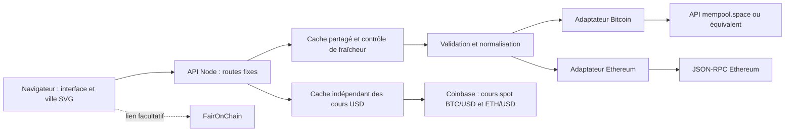

# Architecture et choix durables

## Recommandation

Construire une application web portable : **React + TypeScript + Vite, SVG/CSS pour la scène, petit serveur HTTP Node 24 et adaptateurs de données en lecture seule**. Un seul langage, un contrat explicite et aucun service de stockage pour la version initiale. Le serveur sert les fichiers compilés et l'API sur le même domaine.

TxStreet fournit la référence de métaphore. Son dépôt décrit Vue, Bulma, Phaser, des communications socket.io et un backend distinct historiquement accompagné de nœuds, MongoDB et Redis. Ce projet propose une implémentation originale avec une infrastructure plus petite ; il ne dépend ni du backend ni des ressources TxStreet. [Source : dépôt TxStreet](https://github.com/txstreet/txstreet).

## Options de rendu

| Option             | Atouts                                                                                               | Coût d'entretien                                                        | Décision                                                |
| ------------------ | ---------------------------------------------------------------------------------------------------- | ----------------------------------------------------------------------- | ------------------------------------------------------- |
| SVG/CSS avec React | Dessins nets, éléments inspectables, accessibilité, tests DOM, aucun moteur graphique supplémentaire | Limiter les objets animés et le travail React                           | Retenue pour l'échantillon pédagogique initial          |
| Canvas/PixiJS      | Adapté à des milliers d'objets et effets GPU                                                         | Cycle de rendu, hit testing, accessibilité et tests visuels spécifiques | À introduire seulement après profilage d'un besoin réel |
| Moteur de jeu / 3D | Grande liberté de caméra et de mise en scène                                                         | Assets, GPU, compatibilité mobile et dépendances supplémentaires        | Différé ; aucune nécessité pour comprendre les chaînes  |

Une belle scène ne nécessite pas une transaction visible pour chaque transaction du réseau. Le serveur limite les données et la scène regroupe les voyageurs. Le design privilégie la composition, les couleurs, les détails vectoriels et des mouvements sobres. Le texte et les statistiques restent utilisables lorsque les animations sont en pause ou réduites.

Les personnages absents du nouvel échantillon restent en attente visuelle sur le quai avec leur dernière observation, sans être déclarés encore en attente dans le réseau. Le moteur conserve normalement au plus 480 personnages résidents et 240 admissions différées par chaîne. Jusqu'à 240 anciennes observations immobiles restent individualisées ; les suivantes rejoignent une représentation collective. Une archive côté interface conserve jusqu'à 512 identifiants pendant 30 minutes depuis leur dernière présence dans l'échantillon. Les observations expirées ou évincées restent dans un compteur sans suivi individuel, distinct des identifiants encore suivis. Le total ne représente ni des transactions uniques ni un mempool actuel.

Une preuve retrouvée réserve l'identifiant suivi dans l'archive jusqu'à la préparation du départ correspondant. La réservation est protégée de l'expiration et de l'éviction, éventuellement au-delà de 30 minutes pendant une pause ou une file de départs, dans la même borne de 512 identifiants ; le délai de rétention concerne les observations encore sans preuve. À la préparation, le personnage est réadmis depuis la position du groupe et son compteur diminue. Une file de 16 départs traite les blocs intermédiaires ; le chargement initial ne rejoue pas l'ancien journal. Des preuves reçues après le départ de leur bloc portent le libellé RATTRAPAGE. En préparation, les limites temporaires sont de 1 712 résidents et 1 232 inclusions superposables ; ces nouvelles bornes et leur coût restent non validés pendant la suspension des tests et de la compilation. Le mode réduit marque les preuves statiquement et conserve les observations. Les réservations sont libérées après traitement, annulation ou règlement statique. Cette mémoire reste volatile et n'ajoute aucun service de stockage.

## Échantillon étendu et bornes coordonnées

Pour occuper davantage les quais desktop, la scène accepte **240 voyageurs en attente par chaîne**, contre 80 auparavant, et les adaptateurs relèvent leur sélection de frais élevés de 96 à **240 candidates**. Le contrat partagé accepte **264 transactions**, avec 24 confirmations réservées en complément des candidates en attente. Cette sélection reste locale au fournisseur et peut être plus petite ; aucune donnée fictive n'est ajoutée au direct. La démonstration produit 240 transactions en attente et 12 confirmations simulées par chaîne. La médiane est calculée sur toutes les transactions en attente valides reçues, sans conserver l'ancien plafond de lecture.

La file possède huit colonnes et 30 rangées à pas de 14, de `y=239` à `y=645`. Les indices historiques commencent à 480 ; les places courantes restent stables, les positions excédentaires se superposent et le miroir Bitcoin ainsi que la projection desktop sont conservés. Le moteur borne les résidents ordinaires à 480, les admissions différées à 240 et les anciennes observations individualisées à 240. L'archive garde sa limite de 512 : un départ peut illustrer au plus **1 232 inclusions** (`480 + 512 + 240`) et sa préparation conserver au plus **1 712 résidents** (`480 + 1 232`). Ces limites coordonnent les données et la représentation ; elles ne décrivent ni une taille de bloc réelle ni un mempool complet.

Le suivi serveur conserve sa limite durable de 2 048 identifiants pendant 30 minutes ; son maximum transitoire devient **2 288** (`2 048 + 240`) avant vérification et éviction. Les 16 blocs du journal, les 2 048 preuves totales, les huit blocs de rattrapage, le cache partagé de trois secondes, les délais et les limites réseau sont conservés. L'augmentation réutilise les réponses existantes, sans requête supplémentaire, dépendance ou service. Les tests et contrôles restent suspendus à la demande du propriétaire ; ces nouvelles bornes, leur coût de rendu et leurs conséquences sur le contrat ne sont pas déclarés validés.

## Ville commune et espace desktop

La scène occupe toute la largeur disponible, avec trois colonnes principales : réseau Bitcoin flexible, campus commun et réseau Ethereum flexible. Le campus rassemble une seule rangée de maisons et de bâtiments HEG, de largeur desktop comprise entre 128 et 240 pixels. Les rues sont symétriques : wagons près des maisons centrales, puis corridor de déplacement, file d'attente et colonne d'arrivée vers chaque bord extérieur. Les grands panneaux restent au-dessus de leur réseau ; les lignes en-tête, scène, file collective inférieure et couverture sont alignées par `subgrid`, avec une grille interne de repli. Cette propriété partage les pistes de la grille parente et bénéficie d'une disponibilité inter-navigateurs depuis septembre 2023 selon [MDN](https://developer.mozilla.org/en-US/docs/Web/CSS/Guides/Grid_layout/Subgrid). Le campus et les commandes se compactent sur les écrans plus étroits.

Le moteur conserve une seule géométrie canonique de quai droit, indépendante de la blockchain. Bitcoin est projeté en miroir, avec portes et quai à gauche ; Ethereum garde portes et quai à droite. Les glyphes des voyageurs et les textes restent lisibles. Les nouveaux personnages arrivent horizontalement depuis `x = SCENE_WIDTH + 28` à la hauteur de leur place dans la file canonique, puis rejoignent cette place. Le miroir transpose cette entrée au bord gauche Bitcoin. Les retours, observations anciennes et reprises depuis l'archive passent toujours par le quai extérieur ; aucun chemin ne traverse la chaussée.

Chaque SVG adapte sa largeur logique à `max(236, 740 × largeurViewport / hauteurViewport)`. La hauteur de référence reste 740 ; la projection élargit le quai au-delà du corridor canonique `x=298`. Les wagons et les personnages gardent une taille proportionnelle uniforme, plutôt qu'un étirement horizontal global. La même transformation projette les portes, files, chemins et positions individuelles, avec orientation et angles des flèches adaptés au miroir. Le redimensionnement modifie la présentation, pas la provenance, les priorités ou les phases du moteur. La préparation minimale d'une seconde, les départs vérifiés, les feux, les pages de panneau à quatre secondes et les compteurs existants sont conservés. Aucun service, adaptateur, champ API, secret ou dépendance n'est ajouté. Cette disposition reste non validée pendant la suspension des contrôles.

## File collective du fournisseur

Le bandeau inférieur **File globale · fournisseur** est une représentation collective de la mempool locale, séparée du moteur de voyageurs et de l'archive des observations. Le composant lit `providerMempool(snapshot)` ; ce même lecteur alimente le panneau supérieur et conserve les règles de provenance et d'expiration propres au comptage Ethereum. Le total Bitcoin provient du fournisseur configuré, celui d'Ethereum de `pending + queued` seulement lorsque cette mesure reste utilisable. Le total exact et la provenance locale sont lisibles ; l'infobulle et le résumé accessible précisent le nom de la source et la distinction locale/réseau. Une mesure absente ne se déduit jamais de l'échantillon.

La présentation borne le rendu à 48 silhouettes par chaîne. L'interface calcule une échelle commune sur le maximum des deux comptes affichables, en arrondissant vers une valeur suffisante de la série `1, 2, 5 × 10ⁿ`. Chaque groupe porte cette quantité, sauf le dernier s'il est partiel. La légende et le résumé accessible donnent explicitement l'échelle et le total ; les silhouettes restent décoratives, statiques et non sélectionnables. Elles ne portent ni identifiants ni frais individuels et ne constituent pas des preuves d'inclusion. Un vrai zéro, une absence, un ancien relevé et une simulation gardent chacun un état explicite.

Le bandeau occupe une ligne de 92 pixels en bas de chaque réseau, avant la couverture ; une bande verte du campus commun s'aligne sur cette ligne. Les quatre lignes de la grille partagent leur hauteur entre les deux rues et le campus. La scène conserve ses 240 voyageurs courants, ses anciennes observations et tous ses trajets. Aucune donnée individuelle, route HTTP, collecte, minuterie, dépendance ou modification de contrat n'est ajoutée. La mise à jour utilise les instantanés déjà reçus ; l'échelle décrit leurs effectifs observés et ne promet ni comparaison simultanée des réseaux ni connaissance d'un mempool mondial. Ce changement reste non validé pendant la suspension des contrôles.

## Flux et responsabilités

- `src/` : interface, scène, textes et personnalisation ; aucune clé ni interprétation brute du RPC.
- `server/` : configuration, HTTP, appels upstream, cache, erreurs et adaptateurs.
- `shared/` : schéma Zod et types du contrat commun.
- Les données de démonstration sont identifiées comme telles et séparées des adaptateurs directs.

Le backend n'accepte aucune méthode blockchain fournie par les visiteurs. Il effectue les appels nécessaires à ses propres adaptateurs. La configuration du fournisseur appartient à l'opérateur. Tous les clients consomment des instantanés normalisés.

## Contrat et nouvelles chaînes

Le schéma partagé est la référence exacte. Un instantané associe une chaîne, une provenance, une date de collecte, un état de fraîcheur, des blocs, des transactions échantillonnées et les métriques disponibles. Les unités et la disponibilité des métriques doivent être explicites ; une absence est distincte de zéro.

Le champ facultatif `Tx.blockHash` associe une confirmation à un bloc vérifié. Bitcoin le renseigne après comparaison de l'identifiant avec les transactions du bloc ; Ethereum utilise le hash du bloc confirmé effectivement lu. Une transaction en attente ne peut pas porter ce champ. Les anciennes confirmations sans hash restent compatibles mais ne sont pas utilisées comme preuve d'appartenance au départ animé. Les deux wagons à l'arrêt projettent les blocs à venir ; à réception d'une preuve de bloc réel, le premier est ajusté aux inclusions connues puis part. Cette logique suit la métaphore de [TxStreet](https://github.com/txstreet/txstreet/blob/main/src/components/street.js#L677-L846), avec un échantillon et des budgets illustratifs bornés.

`Snapshot.inclusions` ajoute un journal facultatif de `BlockInclusions = { block, transactionIds }`. Il contient au plus 16 blocs et 2 048 identifiants au total, exclusivement des observations suivies dont l'inclusion a été vérifiée dans ce hash. Il reste séparé des 264 transactions et des trois blocs de l'instantané courant ; ses blocs historiques n'ont pas à appartenir aux trois derniers. Hashes et hauteurs y sont uniques ; à hauteur commune avec `blocks`, les hashes doivent être identiques. Les formats d'identifiants et de hashes sont propres à la chaîne en direct. Un instantané indisponible ne peut porter ce journal. Son caractère facultatif préserve les anciens consommateurs et les démonstrations sans ce suivi.

Pour ajouter une chaîne :

1. Décrire ses capacités : vue des transactions en attente, unités de frais, blocs, finalité et limites du fournisseur.
2. Étendre le registre de chaînes et le schéma commun si nécessaire, sans changer implicitement les unités existantes.
3. Créer un adaptateur qui valide les réponses externes puis les normalise ; limiter les données à la frontière serveur.
4. Fournir des fixtures valides, invalides, incomplètes et en panne. Tester la provenance et la distinction attente / confirmation.
5. Ajouter les textes pédagogiques, la couleur et les liens d'explorateur. Réutiliser la scène ; ne pas lui faire interpréter le RPC.
6. Vérifier l'affichage d'une métrique absente et le retour arrière de version. Documenter le fournisseur retenu.

## Ce que signifie « direct »

**Bitcoin.** Les blocs et le mempool proviennent du fournisseur configuré. Le mempool est une vue observée, et la scène un échantillon. Le minage fournit un rythme moyen, pas une heure de départ garantie ; ne pas afficher un compte à rebours exact du prochain bloc. [Source : protocole et difficulté Bitcoin](https://developer.bitcoin.org/devguide/block_chain.html).

**Ethereum.** `eth_getBlockByNumber` accepte notamment `latest` et `pending`. L'adaptateur essaie les données en attente disponibles puis présente les transactions du dernier bloc avec leur état confirmé si le fournisseur ne fournit pas de vue exploitable. Ce repli reste une donnée réelle, avec une sémantique différente et annoncée. [Source : API JSON-RPC](https://ethereum.org/developers/docs/apis/json-rpc/).

Le besoin de compter les transactions du **fournisseur observé** ajoute une capacité facultative `txpool_status` à l'adaptateur Ethereum existant. Le total `pendingCount` vaut alors `pending + queued` du nœud RPC observé ; les transactions en file future ne sont pas toutes admissibles au prochain bloc. Un nouveau champ facultatif nullable `Snapshot.mempool` conserve ces deux compteurs, la méthode et leur date de réception en millisecondes avec état `ok` ou `stale`. Il reste réservé à Ethereum en direct. La somme et chacun des compteurs sont des entiers sûrs, validés après lecture de quantités hexadécimales strictes. Le total Bitcoin conserve la provenance de `/mempool`. L'échantillon visible et le bloc candidat Ethereum ne permettent jamais d'inventer un total absent.

Le fournisseur Ethereum conserve ce comptage dans sa propre fermeture en mémoire, sans service, dépendance ou variable d'environnement supplémentaire. Après validation de la chaîne et du dernier bloc, il lance une requête en arrière-plan vers le RPC fixé côté serveur : une requête simultanée au plus, **30 secondes minimum après chaque tentative**, délai de huit secondes, réponse plafonnée à **64 Kio**. Un RPC qui refuse cette méthode laisse le total indisponible. Un échec conserve explicitement la dernière valeur comme ancienne, au plus **120 secondes depuis sa réception** ; après expiration, le total et son détail deviennent `null`. Aucun appel facultatif n'est attendu par la réponse blockchain et aucun échec de comptage ne modifie la fraîcheur des blocs. Le client doit comparer la date propre du comptage à l'heure courante, y compris lorsqu'un instantané blockchain ancien est conservé. Le cache est commun aux visiteurs d'une instance et le transport et l'horloge injectés restent utilisés ; les fixtures devront simuler aussi cette capacité. Sources : [namespace `txpool` Geth](https://geth.ethereum.org/docs/interacting-with-geth/rpc/ns-txpool#txpool-status), [implémentation des compteurs Geth](https://github.com/ethereum/go-ethereum/blob/master/internal/ethapi/api.go).

Pour échantillonner les frais élevés, Bitcoin utilise une connexion courte au WebSocket du fournisseur mempool.space compatible et demande les transactions du premier bloc projeté. La connexion suit les délais et limites de taille existants, puis ferme après réception de la liste. Une indisponibilité de cette capacité conduit à un repli explicitement annoncé sur l'échantillon récent. Ethereum trie le bloc `pending` validé par prix effectif du gas avant troncature ; ce classement reste local au fournisseur. Les inclusions vérifiées sont réservées séparément pour conserver leur provenance même avec des frais faibles.

Un slot Ethereum dure actuellement 12 secondes ; un slot peut manquer et ne garantit ni inclusion ni finalité. La vue en attente d'un fournisseur est locale et exclut potentiellement des flux privés. La version initiale n'annonce pas une mesure de mempool global. [Source : consensus Ethereum](https://ethereum.org/developers/docs/consensus-mechanisms/pos/).

Le cache serveur évite un appel upstream par visiteur : délai minimal de 3 secondes après chaque collecte, réussie ou en échec, une récupération en cours partagée, timeout de 8 secondes par requête HTTP externe, réponse limitée à 2 MiB, jusqu'à 264 transactions (240 en attente et 24 confirmations réservées) et 3 blocs courants par chaîne, plus le journal d'inclusions borné. Une réponse récente peut être signalée comme ancienne jusqu'à 120 secondes ; après, l'API annonce l'indisponibilité. Le client attend 3 secondes en direct et 5 secondes en démonstration après chaque réponse avant la prochaine lecture de l'API locale ; il ne chevauche pas ses requêtes et les suspend dans un onglet masqué. Une seule collecte reste en cours par chaîne ; sa durée et celle du rattrapage s'ajoutent au délai de cache et ne permettent pas de garantir de nouvelles données toutes les 3 secondes. Deux chaînes représentent au plus environ 40 requêtes locales par minute par onglet visible, sous la limite par défaut de 120 par adresse cliente ; plusieurs onglets ou une adresse partagée peuvent atteindre cette limite. Ces limites doivent être modifiées avec leurs tests et leur documentation.

Chaque adaptateur conserve jusqu'à 2 048 identifiants échantillonnés pendant 30 minutes depuis leur dernière observation, afin de les rapprocher des blocs réellement reçus. L'éviction attend la vérification : une collecte peut temporairement conserver 2 048 observations anciennes et 240 nouvelles, puis revient à 2 048 avant réponse. Le rattrapage examine au plus huit blocs par collecte et garde les lacunes à réessayer après un échec. Le journal est rejoué dans les réponses suivantes : la première lecture d'un visiteur ne consomme pas les preuves destinées aux autres. Côté scène, une preuve retrouvée réserve l'identifiant suivi jusqu'à la préparation de son bloc, puis le réadmet à la position du groupe. Une panne ne transforme pas une absence d'échantillon en confirmation. Une réorganisation invalide les preuves incompatibles avec les hashes reçus ; un recul du dernier bloc annule les départs supérieurs en file ou en préparation, en laissant finir un véhicule déjà en mouvement. La connaissance reste limitée aux blocs effectivement vérifiés et ne promet pas de finalité ni de reprise historique exhaustive. Sources : [route Esplora des identifiants de bloc](https://github.com/Blockstream/esplora/blob/master/API.md#get-blockhashtxids), [routes Bitcoin mempool.space](https://github.com/mempool/mempool/blob/master/backend/src/api/bitcoin/bitcoin.routes.ts), [JSON-RPC Ethereum](https://ethereum.org/developers/docs/apis/json-rpc/).

## Fournisseurs ou nœuds propres

| Approche                  | Avantages                                                 | Contraintes                                                                  | Usage proposé                                               |
| ------------------------- | --------------------------------------------------------- | ---------------------------------------------------------------------------- | ----------------------------------------------------------- |
| API publiques partagées   | Mise en route rapide, pas de nœud à gérer                 | Quotas, disponibilité variable, fonctionnalités partielles, aucun SLA local  | Première version et validation pédagogique                  |
| Fournisseur dédié         | Quota explicite, support et options de flux selon contrat | Budget, confidentialité, dépendance commerciale                              | Application publique avec trafic et disponibilité attendus  |
| Nœuds administrés par HEG | Contrôle de la provenance et de la politique de collecte  | Stockage, synchronisation, sécurité, supervision et expertise d'exploitation | Recherche ou autonomie lorsqu'une équipe peut les exploiter |

Un nœud propre observe lui aussi un mempool local. Aucun prestataire ne rend automatiquement exhaustive la connaissance des transactions privées. Pour le choix du fournisseur, vérifier le support `pending`, la disponibilité facultative de `txpool_status`, les quotas, l'emplacement des données, les règles d'utilisation et la rotation des clés. Ne pas figer des prix ou des promesses fournisseur dans le code.

## Valeur native du dernier bloc complet

Le besoin de présenter une valeur totale du dernier bloc étend le contrat avec `Snapshot.latestBlockValue`, facultatif et nullable, sans service, dépendance, stockage ni collecte réseau supplémentaires. L'agrégat porte le hash, la hauteur, le compte complet, sa date de collecte en millisecondes, une méthode et un entier exact sérialisé en chaîne décimale canonique de 83 chiffres maximum. Zod lie `sat` à `bitcoin-output-sum` et `wei` à `ethereum-transaction-value-sum`, vérifie la chaîne et impose la correspondance avec `blocks[0]`. Une démonstration et un instantané indisponible ne peuvent annoncer cet agrégat réel. Un instantané ancien conserve sa date et la valeur de ce bloc observé ; aucune donnée fictive ne remplace une absence.

Bitcoin lit `extras.totalOutputAmt` du bloc enrichi déjà reçu par `/v1/blocks`, après une validation facultative indépendante. Le champ doit être un entier sûr non négatif ; une valeur absente ou invalide produit `null` sans invalider les blocs. Son origine est `getblockstats.total_out`, somme des sorties **hors coinbase**, avec la monnaie rendue incluse. Cette valeur brute ne mesure pas un volume économique net. Le compte conservé est celui du bloc complet, coinbase comprise pour la cohérence du contrat, même si sa valeur est exclue. Sources : [agrégat des blocs enrichis Mempool](https://github.com/mempool/mempool/blob/master/backend/src/api/blocks.ts), [définition Bitcoin Core de `total_out`](https://bitcoincore.org/en/doc/30.0.0/rpc/blockchain/getblockstats/).

Ethereum somme en `BigInt` les champs `value` de toutes les transactions du dernier bloc complet validé, avant toute troncature des passagers. Ces valeurs natives **déclarées** peuvent inclure des appels échoués : aucun reçu ni trace ne mesure leur exécution. Les frais, tokens ERC20, transferts internes de contrats et retraits des validateurs sont exclus. Les entrées restent limitées à 256 bits par quantité, 50 000 transactions et la limite HTTP existante de 2 MiB ; la représentation exacte bornée évite une perte de précision flottante. [Source : JSON-RPC Ethereum](https://ethereum.org/developers/docs/apis/json-rpc/).

L'interface présente une cinquième page **Valeur** sur le grand panneau supérieur et un détail dans **Bloc**, avec un montant BTC/ETH natif. Un cours actuel encore utilisable permet un équivalent USD secondaire marqué `≈` ; il ne devient pas un cours historique du bloc. L'arrondi visible n'altère pas l'entier exact du contrat. Les panneaux alternent toutes les **quatre secondes**, indépendamment du polling et du cache blockchain conservés à trois secondes. Le tri des frais et la sémantique des passagers restent inchangés. Le nouveau contrat et l'affichage restent **non validés** pendant la suspension explicite des tests, TypeScript, compilation, lint, audit et validation visuelle.

## Conversion facultative des frais en USD

Le besoin est un changement d'unité d'affichage commun aux deux chaînes. `server/marketPrices.ts` ajoute un lecteur de cours dans le processus Node existant, sans dépendance, service déployé ou stockage supplémentaire. Il appelle uniquement les routes publiques fixes `https://api.coinbase.com/v2/prices/BTC-USD/spot` et `https://api.coinbase.com/v2/prices/ETH-USD/spot`. Aucun visiteur ne choisit une URL et aucune clé n'est requise. Le renouvellement du cours se lance en arrière-plan, sans bloquer la réponse blockchain ; le lecteur retourne immédiatement un ancien cours encore utilisable ou `null`, puis une lecture suivante récupère le nouveau cours.

Deux caches de cours, un par chaîne et partagés entre les visiteurs d'une même instance, limitent les tentatives à une toutes les 60 secondes après leur fin et dédupliquent les requêtes simultanées. Chaque appel garde un délai de huit secondes et une limite HTTP de 16 Kio. Le lecteur valide l'enveloppe, la paire BTC ou ETH, la devise USD et un montant décimal positif, fini et borné à un milliard. Après un échec, le dernier cours reste signalé comme ancien pendant au plus cinq minutes depuis sa réception ; ensuite il devient `null`. Sa disponibilité est indépendante de celle de la blockchain.

Le champ facultatif et nullable `Snapshot.usdQuote` porte `{ usdPerCoin, observedAt, source: 'Coinbase', status: 'ok' | 'stale' }`. Son horodatage en millisecondes est l'heure de réception, pas celle d'une transaction de marché. La source et l'heure restent visibles. Le mode démonstration n'appelle pas le lecteur et ne peut porter un cours live non nul. Les lecteurs de cours, transports et horloges sont injectables ; les fournisseurs blockchain injectés restent isolés des appels de cours sauf injection explicite du lecteur USD.

`src/lib/feeDisplay.ts` convertit uniquement la présentation : un taux Bitcoin en USD/vB vaut `feeRate * usdPerCoin / 100_000_000` ; un taux Ethereum en USD/gas vaut `feeRate * usdPerCoin / 1_000_000_000`. Le montant total estimé d'un voyageur multiplie ce taux par sa taille virtuelle Bitcoin ou sa limite de gas Ethereum et porte `≈`. Cette limite de gas n'est pas le gas consommé ni le montant réellement payé. Le cours relevé ne devient pas un cours historique de confirmation. Les champs natifs, le classement, les couleurs et les animations gardent leur sémantique. Une conversion invalide ou expirée affiche une absence ; les petits montants positifs ne sont pas arrondis en faux zéros.

La métrique principale des en-têtes et de la page Réseau utilise désormais la médiane des coûts individuels estimés des transactions `pending` du snapshot reçu, avec effectif et identifiants uniques de la même chaîne. Pour un effectif pair, elle prend la moyenne des deux valeurs centrales. Les confirmations et anciennes observations de scène sont exclues ; l'échantillon top frais n'est pas représentatif du réseau. La médiane est exprimée en BTC/ETH ou convertie en USD, sans ajout d'appel ou de champ d'API. Les taux conseillés Bitcoin et de base Ethereum sont conservés en détail natif secondaire. Le prix du gas observé des transactions Ethereum comprend leur pourboire éventuel ; la médiane reste fondée sur la limite de gas et ne fournit pas un montant payé.

L'hébergement doit autoriser `api.coinbase.com:443` en sortie si la conversion est souhaitée. Il n'y a aucun nouveau paramètre d'environnement ou appel navigateur direct. Le cache cours de 60 secondes reste distinct du cache blockchain de trois secondes. Sources : [API Coinbase des cours spot](https://docs.cdp.coinbase.com/coinbase-app/track-apis/prices), [unités et calcul des frais Ethereum](https://ethereum.org/developers/docs/gas/).

## Hébergement et évolution

| Option                                          | Coût opérationnel relatif                          | Portabilité          | Condition                                                                    |
| ----------------------------------------------- | -------------------------------------------------- | -------------------- | ---------------------------------------------------------------------------- |
| Serveur Linux + conteneur + reverse proxy HTTPS | Faible infrastructure, administration à assurer    | Très bonne           | Recommandation avec un opérateur identifié                                   |
| Plateforme de conteneurs gérée                  | Moins d'administration système, budget fournisseur | Bonne avec image OCI | Vérifier accès sortant, secrets, processus actif, journaux et retour arrière |
| Infrastructure HEG                              | Selon les services déjà disponibles                | Très bonne           | Confirmer domaine, responsable, réseau sortant et sauvegardes                |

L'état du cache, du suivi d'identifiants et du journal d'inclusions est volatile ; un redémarrage demande un nouvel instantané et ne restaure pas les observations oubliées. L'archive de présentation disparaît également au rechargement du navigateur. Cela évite une base de données inutile pour le périmètre actuel. Ajouter SQLite ou un stockage d'historique seulement si une reprise durable, des analyses historiques, exports ou travaux de recherche le nécessitent. Ajouter un cache distribué uniquement si plusieurs instances doivent partager le budget d'appels ; actuellement chaque processus possède son propre cache et son propre suivi.

La publication doit avoir un domaine HTTPS, des limites au reverse proxy, une surveillance de santé et de fraîcheur des sources, un accès opérateur et une image précédente conservée. Le conteneur portable facilite une migration d'hébergeur. Aucune publication automatique n'est activée.

## HEG et FairOnChain

`src/config/brand.ts` centralise les paramètres de marque. La proposition de design HEG n'est pas une certification institutionnelle. Remplacer les textes ou intégrer un logo officiel après validation des droits et de la charte.

Le lien FairOnChain est optionnel et désactivé par défaut. Il ouvre une ressource externe ; aucun appel vers ce service n'est nécessaire à l'application. Une future intégration devra rester derrière une capacité facultative avec validation de données et état d'indisponibilité indépendant.

## Décisions initiales — 14 octobre 2026

- Retenir SVG et un échantillon limité pour réduire l'entretien et garder une interface accessible.
- Garder un backend HTTP natif et un contrat Zod, sans framework serveur, base ou broker initial.
- Démarrer sur des sources publiques remplaçables, en rendant leurs limites visibles.
- Conserver les clés et les appels fournisseur côté serveur.
- Séparer la démonstration des données directes et conserver la distinction Ethereum attente / confirmation.
- Préparer CI, Dependabot et maintenance Codex ; garder la revue et la livraison sous contrôle humain.
- Étendre le contrat par un journal facultatif d'inclusions vérifiées, avec suivi volatile de 2 048 identifiants, expiration de 30 minutes et rattrapage borné ; conserver une archive de présentation indépendante de 512 identifiants et rendre explicites les observations sans suivi.
- Colorer les t-shirts selon la moyenne des seuls voyageurs en attente affichés dans leur chaîne : jaune faible, orange à la moyenne, rouge à au moins deux fois la moyenne ; ce repère n'est pas une moyenne du réseau.
- Ajouter une conversion USD facultative par un cours Coinbase indépendant et borné, sans modifier les taux natifs ou prétendre mesurer les frais Ethereum réellement payés.
- Compter le mempool local du fournisseur Ethereum par une capacité facultative `txpool_status`, avec date et cache indépendants ; une absence reste inconnue et ne se déduit pas du bloc candidat.
- Ajouter un agrégat exact facultatif du dernier bloc complet à partir des réponses déjà reçues : sorties Bitcoin hors coinbase, valeurs Ethereum déclarées. Lier sa provenance au hash et à la hauteur ; garder distincts total natif, arrondi visuel et équivalent USD au cours actuel.
- Partager un seul campus central entre deux rues symétriques occupant la largeur du desktop. Conserver un moteur géométrique canonique, projeter Bitcoin en miroir et élargir les quais selon le viewport sans étirer les personnages ; faire entrer les nouveaux voyageurs par les bords extérieurs.
- Représenter collectivement le compte local du fournisseur dans une file inférieure bornée à 48 silhouettes par réseau, avec total exact et échelle commune explicite. Garder ce bandeau indépendant des voyageurs échantillonnés, des archives et des confirmations, sans inventer un total mondial ni ajouter une collecte.
